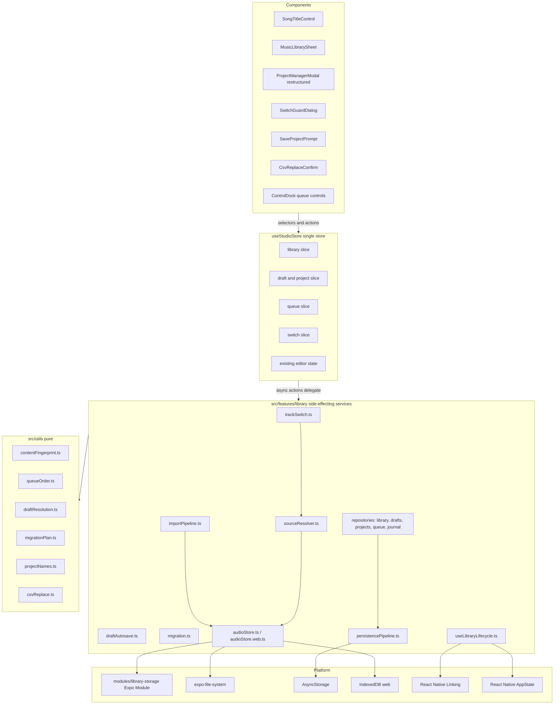
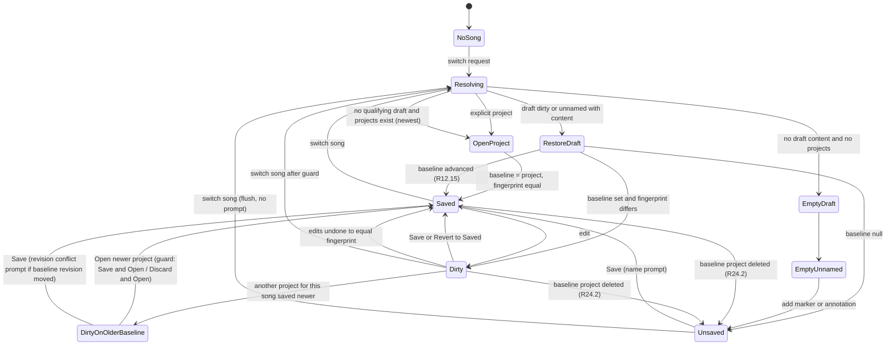

# Design Document: Local Music Library and Playback Queue

## Overview

This feature turns BeatNote's transient "pick a file, play the cache copy" model into a durable,
app-owned **Music Library** with a **Playback Queue**, and separates three kinds of annotation state
that are conflated today: reusable **Music_Items**, one automatically persisted **Song_Draft** per
Music_Item, and explicitly named **Saved_Projects** (many per Music_Item). Every song change runs
through one guarded **Track_Switch_Transaction**. The four reserved dock controls become queue
controls, the toolbar's Choose/Replace Audio action becomes a **Song_Title_Control**, the Project
Manager is rebuilt around the current project, CSV import becomes a confirmed, reversible replace,
and existing projects are migrated through a journaled, idempotent migration.

This design satisfies [`requirements.md`](./requirements.md), which the user approved together with
every Open Question default (OQ-1…OQ-8) and these product decisions: no Recently Deleted; deleting a
song keeps its projects and draft in a relinkable missing-audio state; no queue auto-advance;
Previous restarts the track after 3 seconds; relaunch reopens the last song paused at 0 ms; and a
same-song project switch with a dirty draft offers Save & Open, Discard Changes & Open, and Cancel.

It is a **spec-only** document. It proposes modules, types, storage, and behaviour; it changes no
code, tests, steering, or `AGENTS.md`.

### Scope boundary

In scope: local audio import (Files picker, Open_In, Relink), the Music_Directory, the library
sheet, drafts and autosave, Saved_Project storage v1.2.0, the queue and its four dock controls, the
Project Manager restructure, CSV replace-import with undo, migration, web parity, and one minimal
Expo Module for platform gaps. Out of scope: streaming providers, a Share Extension, user-created
Collections, auto-advance, Recently Deleted, stem separation, and edits to the generated `ios/`
directory. All global state stays in `useStudioStore` (ADR-001); timestamps stay integer
milliseconds (ADR-009); colours come from `src/styles/common.ts`; icons come from `BeatNoteIcon`.

### Current-state analysis

Verified against commit `0f588bb`, the installed packages, and the current working tree. The tree
carries uncommitted in-progress playback-speed work (`src/utils/playbackSpeed.ts` untracked;
`useAudioPlayer.ts`, `useStudioStore.ts`, `projectManager.ts`, and `src/types/project.ts`
modified); rows that depend on it say so.

| Concern | Where it lives | Verified behaviour that constrains the design |
|---------|----------------|-----------------------------------------------|
| Audio picking | `useCustomAudioPlayer.loadSong` in `src/hooks/useAudioPlayer.ts` | `DocumentPicker.getDocumentAsync` with eight MIME types, `copyToCacheDirectory: true`, `multiple: false`; extension check only; `setAudioSource({ uri: file.uri })` on the cache copy; blocking `Alert.alert('Success', …)`. No size, decode, or free-space check; no durable copy. |
| Audio state | `useCustomAudioPlayer` local `useState` | `audioSource` and `audioFilename` are hook-local, so the playing URI and the annotation state in the store are set by separate calls in separate render passes. `loadProjectAudio(uri, filename)` loads without checking the file exists. |
| Player | `useAudioPlayer(audioSource)` from `expo-audio` 1.0.15 | The player is recreated from `audioSource`; duration flows to `setSongDuration(player.duration * 1000)` in an effect. `createAudioPlayer(source)` exists for transient probe players (`node_modules/expo-audio/build/ExpoAudio.d.ts`). |
| Playback speed | `setPlaybackSpeed`, `normalizePlaybackSpeed` (`src/utils/playbackSpeed.ts`) | Uncommitted in the working tree: implemented with `expo-audio` pitch correction (ADR-011) and persisted as `settings.playbackSpeed`. The requirements' field list predates this; `playbackSpeed` is Persisted_Content under the "fields added by later features" clause. |
| Project type | `src/types/project.ts` | `BeatNoteProject` with top-level and `settings` index signatures, `audio: { uri; filename }`, no ID. `ProjectListItem` keyed by `filename`. |
| Project storage | `src/utils/projectManager.ts` | One AsyncStorage value `beatnote_projects`; `getStoredProjects` returns `{}` on read or parse failure, so the next `setStoredProjects` overwrites every project. `renameProject` re-keys. `PROJECT_VERSION = '1.1.0'`; `withProjectDefaults` and `normalizePersistedLoop` normalise on load. |
| Save | `useStudioStore.saveProject(name, audioUri, audioFilename)` | Always creates (no filename passed), resets `createdAt`, spreads unknown fields only when `loadedProjectSource.version` is newer than `1.1.0`. |
| Load | `useStudioStore.loadProject(filename)` | Single `set()` replacing layers, bpm, duration, view settings, loop state, `playbackSpeed`; resets `currentTime`, selections, loop restore snapshot; returns `audio.uri`/`audio.filename` for a separate audio load. |
| CSV import | `ImportModal` → `useStudioStore.importFromCSV` → `ImportEngine.importFromCSV` | Reads with `expo-file-system/legacy` `readAsStringAsync`; parser throws on empty, header-less, or zero-row input and returns `{ layers, importedMarkers, skippedRows }`; store **appends** immediately. |
| CSV export | `ExportModal`, `exportEngine.ts` / `.ios.ts` / `.web.ts`, `exportEngineCore.buildCsvContent` | iOS writes to `documentDirectory/beatnote_exports` and calls React Native `Share.share`; web downloads a Blob. Exports the in-memory store. |
| Toolbar | `ProjectControls.tsx` | `load-song` (with "Replace Audio?" alert), `save-project`, `load-project`, `import-data`, `export-data`, then `sidebar-open-toggle` on mobile. Hosts `SaveProjectModal`, `ProjectManagerModal`, `ExportModal`, `ImportModal`. |
| Project Manager | `ProjectManagerModal.tsx` | `Modal` with `presentationStyle="pageSheet"`; flat newest-first list; Open/Rename/Delete via `Alert`; testIDs `load-saved-project-<name>`, `delete-saved-project-<name>`. |
| Dock | `ControlDock.tsx` | `reserved()` renders `first-track-control`, `previous-track-control`, `next-track-control`, `shuffle-control` with `state={songLoaded ? 'reserved' : 'unavailable'}` and "… is in development" toasts. |
| Toast | `useDockToast` in `MainContent.tsx` | Local hook; `show(message, action?)`; actions extend the timer to at least 5000 ms. Only components rendered under `MainContent` can reach it today. |
| Layout rule | `StudioScreen.tsx` and peers | Phone when web width < 768, or native `min(width, height) < 768`. |
| Lifecycle | `App.tsx`, `src/` | No `AppState` subscription; nothing autosaves; launch starts with no song. |
| Incoming URLs | `ios/BeatNote/AppDelegate.swift` (generated) | `application(_:open:options:)` returns `super… || RCTLinkingManager…`, so React Native core `Linking` receives opened file URLs. `expo-linking` is **not** installed and is not needed. |
| File system | `expo-file-system` 19.0.19 | New API: `File`, `Directory`, `Paths.document`, `Paths.cache`, `Paths.availableDiskSpace` (sync), `File.info({ md5: true })`, `parentDirectory`, `modificationTime`. No Application Support path and no backup-exclusion API. `File.md5` reads the whole file into memory (`Data(contentsOf:)` in `ios/FileSystemFile.swift`). `File.copy` is synchronous; legacy `copyAsync` is asynchronous. Web is a stub. |
| Crypto/UUID | `package.json` | No `expo-crypto`; Hermes provides no `crypto.randomUUID`. Web has `crypto.randomUUID` and `crypto.subtle`. |
| Native config | `app.json`, `plugins/` | `UIFileSharingEnabled: true`, `LSSupportsOpeningDocumentsInPlace: true`, only the `.beatnote` document type; plugins `withIosPodDeploymentTarget.js`, `withIosUiTests.js`. |
| Tests | `tests/ui-components.spec.ts`, `tests/waveform-features.spec.ts`, `tests/ios/BeatNoteUITests.swift`, `scripts/ios-ui-test.js` | Six Playwright journeys and six XCTest cases. Several assert the toolbar testIDs `load-song`, `import-data`, `export-data` that this feature moves. The iOS script stages fixtures into the app's `Documents` via `simctl get_app_container`. |

### Goals and non-goals

- One durable copy per distinct audio file, addressed by UUID and relative path.
- Never lose annotation work: every Persisted_Content change reaches a draft within 2000 ms, and
  no read failure can trigger a destructive write.
- A song change is all-or-nothing from the user's point of view.
- Keep the editor provider-neutral so a streaming source can be added behind capabilities.
- Do not change loop-wrap or end-of-track logic in `useAudioPlayer.ts`, beyond reading the audio
  source from the store.

### Resolutions made while designing

These points were not settled by the requirements and are resolved here; each is called out where
it applies.

1. **ADR numbering.** `architecture-decisions.md` already defines ADR-011 (expo-audio playback
   speed). The requirements' proposed ADR-011…015 are renumbered **ADR-012…ADR-016**.
2. **Speed capability.** Requirement 25.2 says the `local` provider declares pitch-preserving speed
   unsupported "until the native time-stretch engine ships". ADR-011 shipped pitch-preserved speed
   through `expo-audio`, so that condition is met: `local` declares it **supported**, and the
   capability gate still exists for future providers.
3. **Native module.** `expo-file-system` 19 cannot resolve Application Support, set
   `NSURLIsExcludedFromBackupKey`, generate UUIDs on Hermes, or hash 500 MB files without loading
   them into memory. One minimal Expo Module, `modules/library-storage/`, fills exactly those gaps
   (ADR-003).
4. **MD5 source.** The approved algorithm (MD5 on native) is kept, but it is computed by the module's
   chunked CryptoKit digest rather than `File.md5`, which loads the full file into memory. Both
   produce the same hex digest.
5. **Legacy key.** `beatnote_projects` is frozen as a read-only pre-migration snapshot rather than
   rewritten. Older builds keep listing their pre-upgrade projects (Requirement 28.11 intent) and
   the original data remains a recovery source.
6. **Toast reach.** Import, Open_In, and save confirmations originate outside `MainContent`. A
   session-only `libraryNotice` field in the store is forwarded to `useDockToast` by `MainContent`.

## Architecture

### Layering



### Why side-effecting code lives in `src/features/library/`

The coding standards require `src/utils/` to hold pure functions with no side effects. Filesystem,
AsyncStorage, IndexedDB, picker, `AppState`, and `Linking` code is side-effecting, so it lives in
`src/features/library/`, following the precedent of `src/features/stemSeparation/` (which already
holds `stemCache.ts`). Every decision with branching logic (fingerprinting, draft resolution, queue
order, shuffle, migration planning, name uniqueness, CSV replace) is a pure function in `src/utils/`
so it can be tested without I/O. Services are plain modules of exported async functions, not
classes, and never hold global state; they read and write the store only through
`useStudioStore.getState()` inside event handlers and effects (coding standards).

### Files

| File | Kind | Role |
|------|------|------|
| `src/types/library.ts` | types | `MusicItem`, `SourceIdentity`, `PlaybackCapabilities`, `Collection`, `LibrarySort`, `ImportJob` |
| `src/types/project.ts` | types (extended) | `BeatNoteProject` unchanged for legacy reads; adds `SavedProject`, `SavedProjectSummary`, `PersistedContent`, `SongDraft`, `DraftBaseline` |
| `src/types/queue.ts` | types | `PlaybackQueue` |
| `src/types/migration.ts` | types | `MigrationJournal`, `MigrationEntry` |
| `src/types/csvImport.ts` | types | `CsvImportPreview`, `CsvUndoSnapshot` |
| `src/utils/contentFingerprint.ts` | pure | Canonical serialisation and `computeContentFingerprint` |
| `src/utils/persistedContent.ts` | pure | Extract Persisted_Content from store state; apply it back; split unknown fields |
| `src/utils/draftResolution.ts` | pure | `resolveSongLoad` (Requirement 13) and `decideSwitchGuard` (Requirement 14) |
| `src/utils/queueOrder.ts` | pure | Queue build, shuffle, navigation targets, restore filtering, deletion maintenance |
| `src/utils/projectNames.ts` | pure | Name validation, uniqueness, `(n)` suggestion, export filename sanitising |
| `src/utils/csvReplace.ts` | pure | Preview counts and replace/undo layer transforms |
| `src/utils/migrationPlan.ts` | pure | Classify legacy URIs, dedupe grouping, next migration step |
| `src/utils/recordValidation.ts` | pure | Shape guards for stored records (Requirement 1.9) |
| `src/features/library/persistencePipeline.ts` | service | Single serialised write queue, read-health gate, retry |
| `src/features/library/repositories.ts` | service | Typed read/write for each key family |
| `src/features/library/audioStore.ts` | service (native) | Music_Directory, staging, copy, hash, decode probe, delete, orphan sweep |
| `src/features/library/audioStore.web.ts` | service (web) | IndexedDB equivalent |
| `src/features/library/importPipeline.ts` | service | Requirement 3 stages, duplicate and relink handling, FIFO job queue |
| `src/features/library/sourceResolver.ts` | service | Provider registry; `local` provider |
| `src/features/library/draftAutosave.ts` | service | Store subscription, debounce, max latency, flush |
| `src/features/library/trackSwitch.ts` | service | Track_Switch_Transaction coordinator |
| `src/features/library/projectService.ts` | service | Save, Save as New, rename, delete, revert, open |
| `src/features/library/migration.ts` | service | Journaled migration runner |
| `src/features/library/useLibraryLifecycle.ts` | hook | Boot sequence, `AppState`, `Linking` wiring; mounted once in `StudioScreen` |
| `modules/library-storage/` | Expo Module | `ios/LibraryStorageModule.swift`, `android/…/LibraryStorageModule.kt`, `src/index.ts`, `expo-module.config.json` |
| `plugins/withAudioDocumentTypes.js` | config plugin | Audio `CFBundleDocumentTypes` and imported UTIs |

## Components and Interfaces

### Native module `modules/library-storage/`

The smallest native surface that closes the verified gaps. It is a local Expo Module autolinked from
`modules/` (ADR-003); no bare React Native module and no `ios/` edits.

```typescript
// modules/library-storage/src/index.ts
export interface LibraryStorageModule {
  /** Absolute file:// URI of Library/Application Support/BeatNote/Music/, created if absent. */
  getMusicDirectoryUri(): string;
  /** Set or clear NSURLIsExcludedFromBackupKey on a file or directory. No-op on Android. */
  setExcludedFromBackup(uri: string, excluded: boolean): Promise<void>;
  /** Read back the backup-exclusion flag (used by the launch verification step). */
  isExcludedFromBackup(uri: string): Promise<boolean>;
  /** Streaming MD5 in 1 MiB chunks via CryptoKit Insecure.MD5; lowercase hex. */
  md5File(uri: string): Promise<string>;
  /** NSUUID().uuidString lowercased / java.util.UUID.randomUUID(). */
  randomUUID(): string;
}
```

On Android the Music_Directory is `Context.noBackupFilesDir/BeatNote/Music`, which Android excludes
from Auto Backup by definition, so `setExcludedFromBackup` is a no-op. Android remains secondary and
needs no Open_In in V1 (future F-6).

Security-scoped access is **not** added to the module. `expo-file-system` already wraps every
native file operation in `startAccessingSecurityScopedResource` / `stop…`
(`ios/FileSystemPath.swift`), which satisfies Requirement 7.9 for the duration of each copy and
release on success or failure.

### Config plugin `plugins/withAudioDocumentTypes.js`

Uses `withInfoPlist` to append, without touching the existing `BeatNote Project` entry
(Requirement 7.11):

- One `CFBundleDocumentTypes` entry named `Audio`, `CFBundleTypeRole = Viewer`,
  `LSHandlerRank = Alternate`, with `LSItemContentTypes`: `public.mp3`, `com.microsoft.waveform-audio`,
  `public.mpeg-4-audio`, `com.apple.m4a-audio`, `public.aac-audio`, `org.xiph.ogg-audio`,
  `org.xiph.flac`.
- `UTImportedTypeDeclarations` for `org.xiph.ogg-audio` (`.ogg`, `audio/ogg`) and `org.xiph.flac`
  (`.flac`, `audio/flac`), conforming to `public.audio`, because iOS does not declare both on every
  supported version.
- The provisional OQ-4 decision is `LSSupportsOpeningDocumentsInPlace = false`; the plugin owns the
  key so `app.json` stops setting it directly. Physical-device acceptance must confirm this before
  the decision is treated as final.

**OQ-4 spike (first implementation task):** on the simulator and one physical device, open a
`.mp3` and a `.beatnote` from Files and from a third-party app with the key `true` and `false`, and
record whether the delivered URL is an `Inbox` copy or an in-place security-scoped URL. Accept
`false` when `.beatnote` still arrives (BeatNote has no `.beatnote` import yet, so "unaffected"
means the Info.plist declaration and Files presentation are unchanged). Either outcome works with
the Import_Pipeline: an Inbox copy is deleted after commit (Requirement 3.11); an in-place URL is
copied under scoped access and the original is never deleted.

**Simulator spike result (2026-10-18, iPhone 17 Pro / iOS 26.2):** a disposable build with a
separate bundle identifier retained the existing `BeatNote Project` declaration and appended only
MP3/M4A audio types under both key values. `simctl openurl` delivered M4A into
`Linking.addEventListener('url', …)` while running and `Linking.getInitialURL()` on cold launch for
both `true` and `false`; every delivered URL was an app-container `Documents/Inbox/` copy. MP3 also
reached both Linking paths with the key `true`. This proves simulator delivery is suitable for the
planned native Open-in case. The disposable spike suggested no fallback was needed, but the
integrated application test later showed that the generated Expo app delegate consumed the file URL
before React Native `Linking` surfaced it, so the library-storage subscriber described below is used.
The simulator result does **not** distinguish true in-place access from Inbox delivery, because
`simctl openurl` itself stages the host file. A `.beatnote` host URL opened the Files document UI
rather than the app under both launch states, so its delivery path was not validated; prebuild did
preserve its declaration byte-for-byte apart from normal plist serialisation.

Adopt `false` provisionally because audio delivery through Linking works, it avoids requiring
security-scoped access in the expected device path, and the application must copy imports anyway.
The physical-iPhone pass from Files and one third-party app remains blocked on signing/Apple
Developer access. It must verify MP3/M4A Inbox URLs, `.beatnote` Files presentation, and the absence
of a delivery regression before the setting is final. The generated AppDelegate still uses
`super.application(…) || RCTLinkingManager.application(…)`; effective Linking delivery is proven,
but the individual `super` return value was not separately instrumented.

### Incoming URL handling

`library-storage` registers `LibraryStorageAppDelegateSubscriber` through Expo module autolinking.
The subscriber retains file URLs that arrive before JavaScript observes the module and emits
`onOpenURL` for running-app delivery. `useLibraryLifecycle` subscribes once, consumes retained URLs,
and queues them until the boot sequence (migration, library load) completes. A supported audio
`file://` URL becomes an `ImportJob` with `origin: 'openIn'`; any other extension is rejected with
the Requirement 3.2 message (Requirement 7.8). `.beatnote` URLs are ignored because project-file
import does not yet exist.

The integrated iPhone 17 Pro / iOS 26.2 simulator case proved the subscriber path end to end: the
system placed an M4A in `Documents/Inbox`, the app imported and loaded it, the dock toast confirmed
the import, and the item remained in the Music Library. Physical-device delivery remains provisional.

**Why no Share Extension (Requirement 7.10):** Open_In through document types already places
BeatNote in the share sheet's app row and "Open in…" for every supported audio type. A Share
Extension adds a second target with its own memory limit (about 120 MB, too small to copy a 500 MB
file), an App Group container, signing work that is blocked on the Apple Developer account, and a
handoff protocol, for no additional V1 source coverage.

### `audioStore` service

```typescript
// src/features/library/audioStore.ts (native) and audioStore.web.ts (web) share this contract.
export interface StagedAudio {
  stagingRef: string;        // native: relative path under .staging/; web: in-memory key
  byteSize: number;
}

export interface AudioStoreAdapter {
  ensureDirectories(): Promise<void>;                       // Music_Directory and .staging/
  availableBytes(): Promise<number | null>;                 // null when not reportable (R3.6)
  sourceByteSize(sourceUri: string): Promise<number | null>; // fallback when a source reports no size
  randomUUID(): string;                                     // platform-safe UUID for IDs and paths
  stage(
    sourceUri: string,
    expectedBytes: number,
    extension: SupportedAudioExtension,
  ): Promise<StagedAudio>; // extension is the validated result, not inferred from picker/content URI
  hash(staged: StagedAudio): Promise<string>;               // 'md5:<hex>' native, 'sha256:<hex>' web
  probeDuration(staged: StagedAudio, timeoutMs: number): Promise<number>; // ms, positive finite
  commit(staged: StagedAudio, physicalName: string): Promise<string>;     // returns relative path
  discard(staged: StagedAudio): Promise<void>;
  resolvePlayableUri(relativePath: string): Promise<string>; // file:// or blob: URL
  checkAvailable(relativePath: string): Promise<'available' | 'missing'>;
  remove(relativePath: string): Promise<void>;
  sweepOrphans(referenced: ReadonlySet<string>, minAgeMs: number): Promise<number>;
  deleteSourceCopy(sourceUri: string): Promise<void>;       // picker cache or Inbox copy only
}
```

Native behaviour:

- `ensureDirectories` creates `Music/` and `Music/.staging/` with `Directory.create({ idempotent:
  true, intermediates: true })`, then calls `setExcludedFromBackup(musicDirUri, true)` (OQ-2). At
  every launch it reads `isExcludedFromBackup` and re-applies the flag if a restore cleared it.
- `availableBytes` returns `Paths.availableDiskSpace`.
- `stage` uses the already validated extension because picker and content URIs do not reliably
  retain a suffix, then legacy `copyAsync` (asynchronous, unlike `File.copy`) to `.staging/<uuid>.<ext>`,
  then compares `new File(staged).size` with `expectedBytes` (Requirement 3.10). A mismatch deletes
  the staged file and throws `ImportError('copyIncomplete')`.
- `hash` calls `LibraryStorage.md5File`.
- `probeDuration` creates a transient `createAudioPlayer({ uri })`, polls `isLoaded` and `duration`
  every 100 ms, resolves with `duration * 1000` when it is positive and finite, rejects after
  `IMPORT_DECODE_TIMEOUT_MS`, and always calls `release()`.
- `commit` moves the staged file to `Music/<uuid>.<ext>` with `File.move` (same-volume rename).
- `checkAvailable` returns `missing` when the file does not exist, has size 0, or `File.info()`
  throws (Requirement 5.1).
- `deleteSourceCopy` deletes only URIs under `Paths.cache` or `Documents/Inbox/`; it never deletes
  an in-place original (Requirement 3.14).
- `sweepOrphans` lists `Music/` and `.staging/`, deletes entries not in `referenced` whose
  `modificationTime` is older than `ORPHAN_FILE_MIN_AGE_MS`, logs each failure and continues, and
  returns the count (Requirement 6.3–6.4).

Web behaviour (`audioStore.web.ts`):

- `availableBytes` uses `navigator.storage.estimate()` (`quota - usage`), or `null` when the API is
  absent.
- `stage` fetches the picker's object URL into a `Blob` held in memory; `hash` digests
  `await blob.arrayBuffer()` with `crypto.subtle.digest('SHA-256', …)`.
- `probeDuration` loads an `HTMLAudioElement` from a temporary object URL and waits for
  `loadedmetadata`.
- `commit` writes `{ id, blob, byteSize, hash, extension, createdAt }` to the `audio` object store
  in one `readwrite` transaction; IndexedDB transactions are atomic, so a quota abort leaves no
  partial bytes (Requirement 27.4).
- `resolvePlayableUri` returns a fresh `URL.createObjectURL(blob)`; the previous URL is revoked when
  the track changes.

### `importPipeline` service

```typescript
export type ImportOrigin = 'picker' | 'openIn' | 'relink' | 'migration';

export interface ImportRequest {
  origin: ImportOrigin;
  sourceUri: string;
  originalFilename: string;
  reportedBytes: number | null;
  relinkTargetId?: string;          // Music_Item_ID for relink
}

export type ImportOutcome =
  | { kind: 'created'; musicItemId: string }
  | { kind: 'duplicate'; musicItemId: string }        // existing available item (R4.1)
  | { kind: 'reattached'; musicItemId: string }       // missing item, same hash (R4.4, R5.6)
  | { kind: 'relinkNeedsConfirm'; musicItemId: string; staged: StagedAudio; chosen: RelinkCandidate }
  | { kind: 'cancelled' }
  | { kind: 'failed'; error: ImportError };

export function enqueueImport(request: ImportRequest): Promise<ImportOutcome>;
export function cancelImport(jobId: string): void;
export function dismissImportJob(jobId: string): void;
export function resolveRelinkConfirmation(
  stagingRef: string,
  useFile: boolean,
): Promise<ImportOutcome>;
```

Jobs run one at a time in arrival order (Requirement 3.17); the queue is in-memory and its visible
state is mirrored to the store's `importJobs`. Failed jobs remain observable until dismissed.
Relink confirmation continuations re-enter the same FIFO, so physical and metadata commits never
overlap another import. Stage details are in Import ingestion pipeline (below).

### `persistencePipeline` service

```typescript
export type PersistenceKeyFamily = 'library' | 'draft' | 'project' | 'projectIndex' | 'queue'
  | 'prefs' | 'journal';

export interface WriteOp {
  label: string;                         // user-facing name of the affected data
  family: PersistenceKeyFamily;
  coalesceKey?: string;                  // e.g. `draft:<musicItemId>`; newer op replaces queued one
  run: () => Promise<void>;              // performs one or more AsyncStorage writes
}

export function enqueueWrite(op: WriteOp): Promise<void>;
export function cancelQueued(coalesceKey: string): boolean;
export function markReadFailed(key: string): void;
export function markReadSucceeded(key: string): void;
```

Behaviour is specified in Persistence_Pipeline (below).

### `trackSwitch` service

```typescript
export interface SwitchRequest {
  musicItemId: string;
  origin: 'queueNext' | 'queuePrevious' | 'queueFirst' | 'library' | 'openIn' | 'duplicate'
    | 'launch' | 'projectOpen' | 'deleteCurrent';
  explicitProjectId?: string;       // R13.4
  queueIndex?: number;              // target index when origin is queue navigation
  rebuildQueue?: boolean;           // R18.1, R18.4
}

export type SwitchResult =
  | { kind: 'committed'; musicItemId: string }
  | { kind: 'cancelled' }           // guard Cancel, naming cancelled, flush failed (Stay)
  | { kind: 'superseded' }          // replaced while pending (R15.7)
  | { kind: 'failed'; reason: SwitchFailure };

export function requestTrackSwitch(request: SwitchRequest): Promise<SwitchResult>;
```

### `draftAutosave` service

```typescript
export function startDraftAutosave(): () => void;     // returns unsubscribe; started after boot
export function flushDraft(timeoutMs: number): Promise<'written' | 'skipped' | 'failed' | 'timeout'>;
```

### `projectService` service

```typescript
export function saveCurrent(): Promise<SaveResult>;               // R16.1, R16.2, R16.8, R16.12
export function saveAsNew(name: string): Promise<SaveResult>;     // R16.3
export function renameProject(projectId: string, name: string): Promise<RenameResult>;
export function deleteProject(projectId: string): Promise<void>;  // R24.1, R24.2
export function openProject(projectId: string): Promise<OpenResult>; // R17
export function revertToSaved(): Promise<void>;                   // R17.8
export function exportProjectCsv(projectId: string | 'current'): Promise<ExportResult>; // R23
```

`SaveResult` distinguishes `saved`, `needsName`, `nameConflict` (with suggestion), `revisionConflict`,
`cancelled`, and `failed`, so prompts are driven by data rather than nested `Alert` callbacks.

### Source resolution

```typescript
// src/features/library/sourceResolver.ts
export interface SourceProvider {
  id: SourceProviderId;
  capabilities: PlaybackCapabilities;
  resolve(item: MusicItem): Promise<{ uri: string }>;   // throws SourceUnavailableError
}

export function getProvider(id: SourceProviderId): SourceProvider;
export function capabilitiesFor(item: MusicItem | null): PlaybackCapabilities;
```

The `local` provider resolves `SourceIdentity.reference` (a relative path) through
`audioStore.resolvePlayableUri` after `checkAvailable`. Failure sets the item to missing and offers
Relink (Requirement 25.5).

### UI components

All new components are functional, under about 150 lines each, with styles mirrored under
`src/styles/` (ADR-006) and icons from `BeatNoteIcon`. New icon names added to the family:
`chevron-down`, `music-library`, `warning`, `more`, `current`, `missing-audio`, `close`, `search`,
`sort`. Each follows the 24×24, 1.75-point rounded-stroke grammar.

| Component | Path | Style file | Responsibility |
|-----------|------|------------|----------------|
| `SongTitleControl` | `src/components/ui/controls/SongTitleControl.tsx` | `src/styles/components/controls/songTitleControl.ts` | Toolbar title button (Requirement 8) |
| `BottomSheet` | `src/components/ui/common/BottomSheet.tsx` | `src/styles/components/common/bottomSheet.ts` | Detented sheet primitive (Requirement 9) |
| `MusicLibrarySheet` | `src/components/ui/library/MusicLibrarySheet.tsx` | `src/styles/components/library/musicLibrarySheet.ts` | Sheet content: header, import row, search, sort, list |
| `MusicLibraryRow` | `src/components/ui/library/MusicLibraryRow.tsx` | `src/styles/components/library/musicLibraryRow.ts` | One row with state, progress, overflow |
| `ImportProgressRow` | `src/components/ui/library/ImportProgressRow.tsx` | `src/styles/components/library/importProgressRow.ts` | In-progress or failed import row |
| `OverflowMenu` | `src/components/ui/common/OverflowMenu.tsx` | `src/styles/components/common/overflowMenu.ts` | Glass action menu with VoiceOver custom actions |
| `SwitchGuardDialog` | `src/components/ui/modals/SwitchGuardDialog.tsx` | `src/styles/components/modals/switchGuardDialog.ts` | Requirement 14.4 dialog |
| `SaveProjectPrompt` | `src/components/ui/modals/SaveProjectPrompt.tsx` (replaces `SaveProjectModal.tsx`) | `src/styles/components/modals/saveProjectPrompt.ts` | Name entry, validation, duplicate suggestion |
| `ConfirmDialog` | `src/components/ui/modals/ConfirmDialog.tsx` | `src/styles/components/modals/confirmDialog.ts` | Shared glass confirmation (revision conflict, delete, relink mismatch, open-project guard) |
| `CsvReplaceConfirm` | `src/components/ui/modals/CsvReplaceConfirm.tsx` | `src/styles/components/modals/csvReplaceConfirm.ts` | Requirement 22.4 confirmation |
| `ProjectManagerModal` | existing path, restructured | existing style file | Three sections (Requirement 21) |
| `CurrentProjectSection` | `src/components/ui/projects/CurrentProjectSection.tsx` | `src/styles/components/projects/currentProjectSection.ts` | Name, state, four actions, CSV undo |
| `ProjectRow` | `src/components/ui/projects/ProjectRow.tsx` | `src/styles/components/projects/projectRow.ts` | Row with overflow (Open, Rename, Export CSV, Delete) |
| `PersistenceBanner` | `src/components/ui/common/PersistenceBanner.tsx` | `src/styles/components/common/persistenceBanner.ts` | Persistent "Draft not saved" and storage errors with Retry |
| `QueueTrackButton` | `src/components/ui/controls/QueueTrackButton.tsx` | `src/styles/components/controls/queueTrackButton.ts` | First/Previous/Next/Shuffle replacing `reserved()` |

`ImportModal.tsx` is deleted; its picker logic moves to `CurrentProjectSection` + `csvReplace`.
`ExportModal.tsx` remains as the format chooser invoked from the Current Project section and row
overflow menus.

#### `SongTitleControl`

```typescript
interface SongTitleControlProps {
  isMobile: boolean;           // Phone_Layout: icon-only siblings; title fills remaining width
  onOpen: () => void;
}
```

Subscribes to `currentMusicItemId`, the current item's `displayTitle` and `availability`. Renders
`Choose Music` or the title on one line (`numberOfLines={1}`, `ellipsizeMode="tail"`) followed by a
`chevron-down` glyph; when missing, a `warning` glyph and the word "Missing" precede the chevron.
`flex: 1, minWidth: 0, minHeight: 44`. Accessibility: role `button`, label `Music library, current
song <title>` (or `Music library, no song chosen`), `, audio missing` suffix when missing, hint
`Opens your music library`. After a queue switch commits, `AccessibilityInfo.announceForAccessibility`
announces the new title once (Requirement 19.17).

#### `BottomSheet` primitive

```typescript
interface BottomSheetProps {
  visible: boolean;
  title: string;                    // focus target on open (R9.10)
  initialDetent: 'medium' | 'large';
  onClose: () => void;
  returnFocusRef: React.RefObject<View | null>;
  testID: string;
  children: React.ReactNode;
}
```

Built on the installed `react-native-gesture-handler` 2.28 (`Gesture.Pan`) and
`react-native-reanimated` 4.1 (`useSharedValue`, `withTiming`), with no new dependency (OQ-3).
Rendered inside a transparent `Modal` (`presentationStyle="overFullScreen"`, `animationType="none"`)
so it sits over the live workspace, matching the Settings host pattern. Behaviour:

- `Sheet_Height = windowHeight - insets.top - insets.bottom`. Medium detent is
  `0.50 × Sheet_Height`; large is `Sheet_Height`.
- Pan is attached to the grabber and header only; the list keeps its own scroll.
- On release, target = nearest detent; if the translation is more than `0.25 × medium` below the
  medium detent, close. Settle uses `withTiming(target, { duration: 300 })`, within
  `SHEET_SETTLE_MS`.
- With Reduce Motion on (`AccessibilityInfo.isReduceMotionEnabled` plus the change listener),
  detent changes and open/close are immediate.
- Landscape (`width > height`) opens at large and applies leading/trailing/bottom insets as padding.
- Keyboard: `Keyboard.addListener('keyboardWillShow')` moves to large and pads the list by the
  keyboard height so the focused search field stays above the keyboard top edge.
- A visible Close button (44×44) and an `accessibilityActions` entry `{ name: 'activate', label:
  'Switch sheet size' }` on the grabber provide drag-free resize and dismissal (Requirement 9.5).
- Web: `onKeyDown` traps Tab/Shift-Tab within the sheet container, Escape closes, and focus returns
  to `returnFocusRef` (Requirement 9.12).
- Rotation keeps the sheet mounted; scroll offset and search text are component state that
  survive the re-layout; detent heights are recomputed from the new safe area (Requirement 9.7).

#### `MusicLibrarySheet` and `MusicLibraryRow`

Layout top to bottom: title "Music" and Close; Import Audio row (always first, Requirement 10.10);
in-progress or failed import rows; search field (only when the collection has more than 8 items);
sort selector; list (`FlatList`) or the empty, loading, no-match, or read-error state.

Row content: title (one line, two lines at accessibility text sizes), duration as `m:ss` or `--:--`,
`<n> projects`, a `current` glyph with `accessibilityState={{ selected: true }}` on the current row,
a `missing-audio` glyph plus "Audio missing" text when missing, and a 44×44 `more` button opening
`OverflowMenu` with Rename, Show Projects, Delete from BeatNote, and (when missing) Relink. The same
actions are VoiceOver custom actions on the row. The row's accessibility label concatenates title,
duration, project count, and "Audio missing" when applicable.

Tapping a row calls `requestTrackSwitch({ origin: 'library', rebuildQueue: true })`. While that
transaction is in its Load_Phase, the tapped row shows a spinner and the other rows are disabled.
On `committed` the sheet closes; on `failed` an inline message with Retry appears under the row; on
`cancelled` the sheet stays open unchanged (Requirement 10.3–10.6).

Search filters with `normalizeForSearch(s) = s.normalize('NFD').replace(/\p{Diacritic}/gu,
'').toLocaleLowerCase()` over Display_Title and Original_Filename. Sorting uses
`Intl.Collator(undefined, { sensitivity: 'base' })` for Title; `addedAt` descending for Recently
Added; `lastPlayedAt` descending with nulls last for Recently Played; duration ascending with
unknown last for Duration. Ties break by Music_Item_ID ascending so order is deterministic. The sort
persists in `beatnote.library.prefs.v1`.

#### `SwitchGuardDialog`

Title "Save changes before switching?", message "Your changes to “<song>” differ from the saved
project “<project>”. BeatNote can keep them as a draft.", actions Save & Switch (accent),
Keep Draft & Switch (quiet glass), Cancel. No Discard (Requirement 14.5). Driven entirely by the
store's `switchGuard` field; resolving it calls `resolveSwitchGuard(choice)`.

#### Restructured `ProjectManagerModal`

Keeps the full-screen phone presentation, safe-area handling, and portrait/landscape layout
(Requirement 21.11). A single `SectionList` renders:

1. Current Project (`CurrentProjectSection`): project name or "Unsaved draft"; Display_Title;
   state text plus icon ("Saved", "Edited — not saved", "Draft based on “<name>”"); the
   newer-project note with Open (Requirement 13.5); Save, Save as New Project, Import CSV, Export
   CSV; Revert to Saved; Undo CSV Import when a snapshot exists. With no song: "No song chosen",
   Choose Music, and the four actions disabled.
2. "Projects for <Display_Title>": other projects of the current Music_Item.
3. "All Projects": remaining projects grouped by Display_Title ascending, plus an "Audio removed"
   group for removed Music_Items (Requirement 24.5) with Relink and Delete.

Within each section rows sort by `modifiedAt` descending. Empty sections show one line (for example
"No other projects for this song"). Rows show name, marker count, modified time, Display_Title in
All Projects, "Audio missing" when applicable, "Read-only (newer version)" for skipped-newer
projects, and the overflow button. Row testIDs become `project-row-<projectId>`, with overflow
actions `project-open-<projectId>`, `project-rename-<projectId>`, `project-export-<projectId>`,
`project-delete-<projectId>`.

#### Queue dock controls

`ControlDock.reserved()` is replaced by four `QueueTrackButton` instances that keep testIDs and grid
cells (Requirement 19.1). Each subscribes to `queue`, `currentMusicItemId`, `currentTime` (Previous
only, sampled through a selector that returns `currentTime > PREVIOUS_RESTART_THRESHOLD_MS` so the
button does not re-render every 50 ms), `switchPhase`, and `switchGuard`. States map onto the
existing `DockButton` states: `inactive` (enabled), `unavailable` (disabled with description),
`active` (Shuffle on, `checked`). Disabled descriptions: "Choose music to start a queue" (no song or
empty queue) and "End of queue" (Next at the last entry). While the guard dialog is open, all four
are disabled (Requirement 14.10).

## Data Models

### Ownership

| Type | Defined in | Owned (written) by | Persisted |
|------|------------|--------------------|-----------|
| `MusicItem`, `Collection` | `src/types/library.ts` | `importPipeline`, `projectService` (rename), library actions | `beatnote.library.v1` |
| `SourceIdentity`, `PlaybackCapabilities` | `src/types/library.ts` | `sourceResolver` (capabilities are code constants) | identity inside `MusicItem` |
| `SongDraft` | `src/types/project.ts` | `draftAutosave`, `projectService` | `beatnote.draft.v1.<musicItemId>` |
| `SavedProject` | `src/types/project.ts` | `projectService`, `migration` | `beatnote.project.v2.<projectId>` |
| `SavedProjectSummary` | `src/types/project.ts` | `projectService`, `migration` | `beatnote.projects.v2.index` |
| `PlaybackQueue` | `src/types/queue.ts` | queue actions via `queueOrder` | `beatnote.queue.v1` |
| `MigrationJournal` | `src/types/migration.ts` | `migration` | `beatnote.migration.v1` |
| `CsvImportPreview`, `CsvUndoSnapshot` | `src/types/csvImport.ts` | CSV actions | session only |

### Library types

```typescript
// src/types/library.ts
export type SourceProviderId = 'local';            // future: 'appleMusic' | 'spotify' (F-2)

export interface SourceIdentity {
  provider: SourceProviderId;
  /** local: path relative to Music_Directory, e.g. "3f2a….m4a". Never absolute (R2.5). */
  reference: string;
}

export interface PlaybackCapabilities {
  exactSeeking: boolean;
  waveformAccess: boolean;
  pitchPreservingSpeed: boolean;
  offlinePlayback: boolean;
  queueControl: boolean;
  backgroundPlayback: boolean;
  repeat: boolean;
  shuffle: boolean;
}

export const IMPORTED_MUSIC_COLLECTION_ID = 'imported-music';

export interface Collection {
  id: string;                        // V1: only IMPORTED_MUSIC_COLLECTION_ID
  name: string;
  builtIn: boolean;
}

export type MusicItemAvailability = 'available' | 'missing';

export interface MusicItem {
  id: string;                        // UUID v4, immutable (R2.1)
  source: SourceIdentity;
  displayTitle: string;              // ≤ DISPLAY_TITLE_MAX_LENGTH
  originalFilename: string;
  extension: 'mp3' | 'wav' | 'm4a' | 'aac' | 'ogg' | 'flac';
  byteSize: number;
  contentHash: string | null;        // 'md5:<hex>' | 'sha256:<hex>'; null only for migrated-missing
  durationMs: number | null;         // integer ms
  addedAt: string;                   // ISO 8601
  lastPlayedAt: string | null;
  availability: MusicItemAvailability;
  removed: boolean;                  // R24.4 hidden "removed" entry
  collectionIds: string[];           // always includes IMPORTED_MUSIC_COLLECTION_ID while !removed (R1.10)
  legacy?: { filename: string; durationMs: number | null }; // migration matching (R28.6)
}

export type LibrarySortKey = 'title' | 'recentlyAdded' | 'recentlyPlayed' | 'duration';

export interface LibraryRecord {
  schemaVersion: 1;
  items: Record<string, MusicItem>;
  collections: Record<string, Collection>;
}

export interface LibraryPrefs {
  schemaVersion: 1;
  sort: LibrarySortKey;
  missingAudioNoticeShownForMigration: number | null; // R28.12
}

export type ImportJobStatus = 'queued' | 'validating' | 'copying' | 'hashing' | 'probing'
  | 'committing' | 'failed';

/** Session-only projection rendered by ImportProgressRow. */
export interface ImportJobView {
  id: string;
  origin: 'picker' | 'openIn' | 'relink' | 'migration';
  originalFilename: string;
  status: ImportJobStatus;
  progress: number | null;           // 0...1 when measurable; null = indeterminate
  cancellable: boolean;              // false once Import_Commit begins
  error: string | null;
}
```

A removed item keeps `collectionIds: []` and `removed: true`; Requirement 1.10 applies to
non-removed items. This reconciles "remove the Music_Item from every Collection" (Requirement 24.4)
with the Imported_Music invariant.

### Project and draft types

```typescript
// src/types/project.ts (additions)
export const SAVED_PROJECT_VERSION = '1.2.0';

export interface PersistedLayer {
  id: LayerId;
  name: string;
  color: string;
  markers: number[];
  annotations: { timestamp: number; text: string }[];
  isVisible: boolean;
  [key: string]: unknown;            // layer-persistent unknown fields
}

/** Exactly the content a draft or project persists. */
export interface PersistedContent {
  layers: PersistedLayer[];          // always six, by LayerId
  bpm: number;
  stemCount: 2 | 4 | 6;
  settings: BeatNoteProject['settings'];   // includes playbackSpeed, loopRange, loopEnabled, unknown keys
  extras: Record<string, unknown>;   // unknown top-level fields (R1.8)
}

export interface SavedProject extends BeatNoteProject {
  version: string;                   // '1.2.0' or a preserved newer version
  projectId: string;                 // UUID, immutable
  musicItemId: string;
  revision: number;                  // starts at 1; +1 per write
  /** Retained read-only for older builds (R28.11); never used for playback (R1.7). */
  audio: { uri: string; filename: string };
}

export interface SavedProjectSummary {
  projectId: string;
  musicItemId: string;
  name: string;
  revision: number;
  modifiedAt: string;
  markerCount: number;
  version: string;
  readOnly: boolean;                 // newer-than-running version (R28.10)
}

export interface ProjectIndexRecord {
  schemaVersion: 1;
  projects: Record<string, SavedProjectSummary>;
}

export interface DraftBaseline {
  projectId: string;
  revision: number;
}

export interface SongDraft {
  schemaVersion: 1;
  musicItemId: string;
  baseline: DraftBaseline | null;    // null = Unnamed_Draft
  baselineFingerprint: string | null;
  content: PersistedContent;
  updatedAt: string;
}
```

For new projects `audio.uri` is the empty string and `audio.filename` is the Original_Filename, so
an older build lists the project and fails its own load with "This project does not contain a saved
audio file reference" (the existing `loadProjectAudio` guard) instead of loading a wrong URI.

Mapping between `SavedProject` and `PersistedContent` (`src/utils/persistedContent.ts`):

- `layers`, `metadata.bpm`, `metadata.stemCount`, and `settings` map directly.
- `metadata.name`, `metadata.createdAt`, `metadata.modifiedAt`, `metadata.duration`, `version`,
  `projectId`, `musicItemId`, `revision`, and `audio` are envelope fields, not content.
- Every other top-level key goes to `extras`; on write, `extras` is spread first and known fields
  override, so unknown fields survive unchanged.

### Queue type

```typescript
// src/types/queue.ts
export interface PlaybackQueue {
  schemaVersion: 1;
  snapshot: string[];                // unshuffled Queue_Snapshot of Music_Item_IDs
  order: string[];                   // playback order: equals snapshot when !shuffle
  currentIndex: number | null;       // index into order
  shuffle: boolean;
  collectionId: string;
  sortKey: LibrarySortKey;
}
```

`order` and `snapshot` are always permutations of the same ID set. The queue holds no Project_ID,
project name, or draft reference (Requirement 1.6).

### Migration and CSV types

```typescript
// src/types/migration.ts
export type MigrationEntryStatus = 'pending' | 'importing' | 'migrated' | 'missing'
  | 'skippedNewer' | 'failedRetrying';

export interface MigrationEntry {
  legacyKey: string;                 // key in beatnote_projects
  status: MigrationEntryStatus;
  projectId: string;                 // assigned once, before any write, reused on resume
  musicItemId: string | null;
  stagedRelativePath: string | null; // for interrupted-copy cleanup (R28.7)
  attempts: number;                  // ≤ MIGRATION_IMPORT_ATTEMPT_LIMIT
  lastError: string | null;
}

export interface MigrationJournal {
  schemaVersion: 1;
  migrationVersion: 1;
  state: 'running' | 'complete';
  startedAt: string;
  entries: Record<string, MigrationEntry>;
  unresolvedCount: number;
}

// src/types/csvImport.ts
export interface CsvImportPreview {
  sourceName: string;
  imported: Partial<Record<LayerId, { markers: number[]; annotations: MarkerAnnotation[] }>>;
  importedMarkerCount: number;
  importedAnnotationCount: number;
  skippedRows: number;
  existingMarkerCount: number;
  existingAnnotationCount: number;
  beyondDurationCount: number;       // R22.12
}

export interface CsvUndoSnapshot {
  layers: Record<LayerId, { markers: number[]; annotations: MarkerAnnotation[] }>;
  priorDraftState: DraftUiState;     // 'saved' | 'dirty' | 'unsaved' | 'emptyUnnamed'
  createdAt: number;
}
```

`ImportEngine.importFromCSV` currently throws when zero markers are importable. The preview path
calls a new pure `parseCsvForPreview` that returns `importedMarkerCount: 0` instead, so the
confirmation can show "No markers were found" with Replace disabled (Requirement 22.5). The thrown
errors for empty and header-less files remain the Requirement 22.3 parser errors.

### Persistence keys

All keys are AsyncStorage keys (web AsyncStorage is backed by `localStorage`). Each family has a
versioned name so a later schema can migrate side by side.

| Key | Value | Notes |
|-----|-------|-------|
| `beatnote.library.v1` | `LibraryRecord` | All Music_Items and Collections; small (no audio) |
| `beatnote.library.prefs.v1` | `LibraryPrefs` | Sort, migration notice flag |
| `beatnote.draft.v1.<musicItemId>` | `SongDraft` | One per Music_Item (R11.3, R26.1) |
| `beatnote.project.v2.<projectId>` | `SavedProject` | Source of truth per project (OQ-6, R26.4) |
| `beatnote.projects.v2.index` | `ProjectIndexRecord` | Derived cache for lists; rebuildable |
| `beatnote.queue.v1` | `PlaybackQueue` | Current index is the last committed song (R15.14) |
| `beatnote.migration.v1` | `MigrationJournal` | Resumable, idempotent (R28.1, R28.7) |
| `beatnote_projects` | legacy record | Frozen after migration; never written by V1.2 |
| `<key>_corrupt_<timestamp>` | raw string | Quarantine copy of an unparseable value (R26.2) |

### Filesystem layout

```text
iOS app container (path may change after update or restore; never stored)
├── Documents/                      Files-visible (UIFileSharingEnabled); NOT used for music
│   ├── beatnote_exports/           existing CSV/MIDI exports
│   └── Inbox/                      iOS Open_In copies (only when in-place opening is off)
├── Library/
│   ├── Application Support/
│   │   └── BeatNote/
│   │       └── Music/              Music_Directory, NSURLIsExcludedFromBackupKey = true
│   │           ├── .staging/       in-progress copies: <uuid>.<ext>
│   │           ├── 3f2a…e1.m4a     Managed_Audio_File: <uuid>.<ext>
│   │           └── 9b0c…44.wav
│   └── Caches/                     picker copies (copyToCacheDirectory); purgeable
└── tmp/
```

Stored paths are relative to `Music/` (for example `3f2a…e1.m4a`); `audioStore` resolves the
absolute URI from `getMusicDirectoryUri()` at runtime (Requirement 2.5). The physical UUID is a
separate UUID from the Music_Item_ID, so a Relink can attach a new physical file without changing
identity.

### Web IndexedDB schema

```text
database: beatnote-audio   version: 1
  object store: audio      keyPath: "id"       (id = physical UUID = SourceIdentity.reference)
    value: { id, blob: Blob, byteSize, hash, extension, createdAt }
```

No staging store is needed: a staged web import is an in-memory `Blob`, and the `audio` put is a
single atomic transaction. `navigator.storage.persist()` is requested once after the first
successful import to reduce eviction risk; a denial is logged, not shown.

### Store slice (single Zustand store, ADR-001)

New fields and actions are added to `StudioStore` in `useStudioStore.ts`. Persisted fields are
in-memory mirrors written only through repositories; session fields are never persisted.

```typescript
interface LibrarySlice {
  // Mirrors of persisted data
  libraryItems: Record<string, MusicItem>;
  librarySort: LibrarySortKey;
  projectSummaries: Record<string, SavedProjectSummary>;
  queue: PlaybackQueue | null;

  // Current song and draft (persisted via draft key; these are the live mirrors)
  currentMusicItemId: string | null;
  currentAudioUri: string | null;            // replaces useCustomAudioPlayer's local audioSource
  draftBaseline: DraftBaseline | null;
  draftBaselineFingerprint: string | null;
  draftBaselineName: string | null;
  lastWrittenFingerprint: string | null;
  draftUiState: DraftUiState;                // derived after each fingerprint pass

  // Session state
  libraryStatus: 'booting' | 'migrating' | 'ready' | 'readError';
  persistenceIssues: PersistenceIssue[];     // drives PersistenceBanner
  importJobs: ImportJobView[];
  switchPhase: 'idle' | 'guard' | 'flushing' | 'resolving' | 'loading' | 'committing' | 'rollingBack';
  switchGuard: SwitchGuardPrompt | null;
  pendingSwitchTargetId: string | null;
  loadingMusicItemId: string | null;
  saveInProgress: boolean;
  csvPreview: CsvImportPreview | null;
  csvUndo: CsvUndoSnapshot | null;
  libraryNotice: { id: number; message: string; action?: DockToastAction } | null;
  isLibrarySheetOpen: boolean;

  // Actions (thin; async work delegates to src/features/library)
  applyTrackState: (payload: TrackCommitPayload) => void;   // one set() for audio + content
  setLibraryItems: (items: Record<string, MusicItem>) => void;
  setLibrarySort: (sort: LibrarySortKey) => void;
  setQueue: (queue: PlaybackQueue | null) => void;
  setDraftBaseline: (baseline: DraftBaseline | null, fingerprint: string | null, name: string | null) => void;
  setLastWrittenFingerprint: (fingerprint: string) => void;
  notify: (message: string, action?: DockToastAction) => void;
  openLibrarySheet: () => void;
  closeLibrarySheet: () => void;
  // …plus thin wrappers: requestTrackSwitch, nextTrack, previousTrack, firstTrack, toggleShuffle,
  // saveCurrent, saveAsNew, previewCsvImport, applyCsvReplace, undoCsvReplace, resolveSwitchGuard.
}
```

`saveProject`, `loadProject`, and `importFromCSV` in the store are replaced by `projectService`
calls and `applyCsvReplace`. `useCustomAudioPlayer` reads `currentAudioUri` from the store (narrow
selector) instead of owning `audioSource`; `loadSong` and `loadProjectAudio` are removed.

Selector scoping follows the dock design: `SongTitleControl` reads only the current item's title and
availability; queue buttons read `queue`, `currentMusicItemId`, `switchPhase`, `switchGuard`, and a
boolean derived from `currentTime`; no new component subscribes to waveform inputs.

## Persistence_Pipeline

### Serialised queue

`persistencePipeline` holds one FIFO array of `WriteOp`s and one worker. Exactly one op runs at a
time, in enqueue order (Requirement 12.8). An op enqueued with a `coalesceKey` that matches a
**queued, not running** op replaces it in place, so a burst of draft writes for one song collapses
to one write while keeping its queue position. A running op is never cancelled. `enqueueWrite`
returns a promise that settles when that op (or the op that superseded it) finishes.

### Atomicity strategy

AsyncStorage `setItem` replaces one key's value as a unit; no multi-key transaction exists on any
platform. The design therefore never needs two keys to change together for correctness:

- **Per-project keys are the source of truth.** `beatnote.projects.v2.index` is a derived cache.
  A save writes `beatnote.project.v2.<id>` first, then the index. At boot, `repositories` loads the
  index, lists keys with `getAllKeys()` filtered by the `beatnote.project.v2.` prefix, and rebuilds
  index entries for any project key missing from the index or whose revision differs, and drops
  index entries without a project key. A crash between the two writes therefore self-heals.
- **Save + draft baseline** (Requirement 12.9) run in one pipeline op: write the project, then the
  draft with the new baseline. If the process dies between them, the draft keeps the old baseline;
  on next load Requirement 12.15 advances the baseline because the fingerprints are equal.
- **Library record** is one key; every Music_Item mutation is read-modify-write of the in-memory
  mirror, serialised by the pipeline, so there is no lost update.
- **Write-new-then-delete for removals.** Deleting a project deletes its key, then rewrites the
  index; a crash leaves an index entry that the boot reconcile drops.

### Read-failure write blocking

Each key has a read-health flag in the pipeline. `repositories.read*` calls `markReadFailed(key)`
when `getItem` throws or `JSON.parse` fails, and `markReadSucceeded(key)` on success. An op whose
target key is marked failed is rejected with `PersistenceBlockedError` without touching storage
(Requirement 26.2–26.3). For parse failures the repository copies the raw string to
`<key>_corrupt_<Date.now()>` before marking, and raises a `PersistenceIssue` naming the data
("your music library", "projects", "the draft for “<title>”") with Retry, which re-reads the key.

The legacy defect is removed: `getStoredProjects` returning `{}` on failure can no longer lead to a
write, because project writes now target per-project keys and the project family is blocked until a
successful `getAllKeys` + index read (Requirement 26.3).

Records that parse but fail shape validation (`recordValidation.ts`) are left in storage untouched,
excluded from memory, and logged with their ID (Requirement 1.9); the rest of the family loads.

### Failure classification and retry

| Error | Detection | Behaviour |
|-------|-----------|-----------|
| Storage full | web `DOMException` name `QuotaExceededError`; native message containing `space` or `full`, or `Paths.availableDiskSpace < 1 MB` after the failure | No retry. Previous value is untouched because `setItem` failed. Issue "BeatNote is out of storage space" naming the item (R26.5). |
| Blocked by read failure | `PersistenceBlockedError` | No retry until the read succeeds. |
| Other | anything else | Automatic retries after 1 s, 2 s, 4 s (3 attempts, `PERSISTENCE_AUTO_RETRY_LIMIT`), then an issue with manual Retry (R26.6). |

Retries re-run the same op at the head of the queue so ordering is preserved; later ops wait.
In-memory state is never rolled back by a write failure.

## Draft model and Content_Fingerprint

### Canonical serialisation

`canonicalize(content: PersistedContent): string` in `src/utils/contentFingerprint.ts`:

1. Layers are sorted by `id`.
2. Each layer's `markers` are copied and sorted numerically ascending; duplicates are kept.
3. Each layer's `annotations` are sorted by `timestamp` ascending, then by `text` using code-unit
   comparison (locale-independent, so the result is stable across devices).
4. Object keys are emitted in ascending code-unit order at every depth, including `settings`,
   `extras`, and unknown nested values.
5. `undefined` values are omitted; `null` is kept; numbers use `JSON.stringify` formatting;
   non-finite numbers serialise as `null`.
6. Excluded entirely: project name, Project_ID, revision, `createdAt`, `modifiedAt`, `version`,
   `musicItemId`, `audio`, and `metadata.duration` (an audio property, not authored content).

### Fingerprint

`computeContentFingerprint(content) = 'fp1:' + length + ':' + h1 + h2`, where `h1` and `h2` are
two independent 53-bit `cyrb53` hashes (seeds 0 and `0x9e3779b9`) of the canonical string, encoded
in base 36. It is synchronous, pure, and dependency-free; the 106-bit space makes an accidental
"not dirty" collision negligible, and the hash is not a security control. The `fp1:` prefix allows a
future algorithm change: fingerprints with a different prefix are treated as unequal and recomputed
from stored content.

### Dirty state

| `draftUiState` | Condition | Current Project text |
|----------------|-----------|----------------------|
| `emptyUnnamed` | baseline null and no markers or annotations | "Unsaved draft" |
| `unsaved` | baseline null and at least one marker or annotation | "Unsaved draft" |
| `saved` | baseline set and fingerprint equals `draftBaselineFingerprint` | "Saved" |
| `dirty` | baseline set and fingerprints differ | "Edited — not saved", or "Draft based on “<name>”" when a newer project exists (R13.5) |

An Unnamed_Draft is never `dirty` (glossary). The fingerprint is computed inside the autosave
debounce callback and when the guard, Save, or Project Manager needs it, never on every render.

### Autosave scheduling

`draftAutosave` subscribes with `useStudioStore.subscribe` to a selector that returns the tuple of
Persisted_Content source references (`allLayersData`, `bpm`, `stemCount`, `viewMode`,
`showGridLines`, `layerSpecificNavigation`, `primaryView`, `countSize`, `rowDensity`,
`followPlayhead`, `playbackSpeed`, `loopStartMs`, `loopEndMs`, `isLoopRangeEnabled`), compared
shallowly. Session fields (`currentTime`, `isPlaying`, selections, `isLoopMarkerActive`, toasts,
deletion history, loop restore snapshot) are not in the tuple (Requirement 11.2).

```text
on change (and currentMusicItemId != null and libraryStatus == 'ready'):
  if firstUnwrittenAt == null: firstUnwrittenAt = now
  clear debounceTimer
  delay = min(DRAFT_AUTOSAVE_DEBOUNCE_MS, firstUnwrittenAt + DRAFT_FLUSH_TIMEOUT_MS - now)
  debounceTimer = setTimeout(scheduleWrite, max(0, delay))

scheduleWrite:
  enqueueWrite({ coalesceKey: 'draft:' + id, run: writeDraft })

writeDraft (runs inside the pipeline):
  content = extractPersistedContent(getState())          // snapshot at execution time (R12.4)
  fp = computeContentFingerprint(content)
  if fp == lastWrittenFingerprint: return                 // R12.3
  setItem(draftKey(id), { baseline, baselineFingerprint, content, updatedAt })
  setLastWrittenFingerprint(fp); firstUnwrittenAt = null; recompute draftUiState
```

A change during an executing write re-arms the timer and enqueues a new op (Requirement 12.5).
The `min(…)` term guarantees a write is enqueued no later than 2000 ms after the first unwritten
change even under continuous edits (Requirement 12.2).

`flushDraft(timeoutMs)` clears the timer, enqueues `writeDraft` immediately (coalescing with a
queued one), and races it against `timeoutMs`. It is called on track switch (Requirement 12.6) and
from the `AppState` listener on `background` and `inactive` (Requirement 12.7). iOS gives an app a
few seconds after backgrounding, which covers one draft write; at most the last
`DRAFT_AUTOSAVE_DEBOUNCE_MS` of edits can be lost on a hard kill (Requirement 12.11).

AsyncStorage replaces a value whole, so a reader never sees a partially written draft: it sees the
previous or the new value (Requirement 12.11).

On draft write failure: keep memory, add the issue "Draft not saved. Your latest changes are only on
screen." with Retry, and retry at the next change or `AppState` `active` (Requirement 12.12). A
successful write removes the issue (Requirement 12.13).

## Song, draft, and project resolution

### Resolution function

`resolveSongLoad(input): Resolution` in `src/utils/draftResolution.ts` is pure:

```typescript
interface ResolutionInput {
  draft: SongDraft | null;
  draftFingerprint: string | null;           // of draft.content
  projects: SavedProjectSummary[];           // for this Music_Item
  explicitProjectId: string | null;
}

type Resolution =
  | { kind: 'openProject'; projectId: string }                 // R13.2, R13.4
  | { kind: 'restoreDraft'; asUnnamed: boolean; advanceBaselineTo?: DraftBaseline } // R13.1, R13.7, R12.15
  | { kind: 'emptyDraft' };                                    // R13.3
```

Rules, in order:

1. `explicitProjectId` set → `openProject` (Requirement 13.4).
2. Draft baseline references a project not in `projects` → treat draft as Unnamed_Draft
   (Requirement 13.7) and continue.
3. If the baseline project exists and its stored revision is newer than the draft baseline revision
   while the fingerprints are equal → `advanceBaselineTo` the stored revision (Requirement 12.15).
4. Draft is `dirty`, or is `unsaved` (Unnamed with content) → `restoreDraft` (Requirement 13.1).
5. One or more projects → `openProject` for the greatest `modifiedAt`, then greater `revision`, then
   smaller Project_ID (Requirement 13.2).
6. Otherwise → `restoreDraft` of the existing Unnamed_Draft, or `emptyDraft` (Requirement 13.3).

After any resolution the commit sets `currentTime` 0, `isPlaying` per Requirement 15.11–15.12, and
resets Session_State (Requirement 13.8). When a `restoreDraft` result is dirty and its baseline is
not the newest project for the song, the Current Project section shows "Draft based on “<baseline>”"
plus "A newer project “<name>” exists" with Open, which runs `openProject` through the Requirement
17 guard (Requirement 13.5–13.6).

### State machine



`DirtyOnOlderBaseline` is `dirty` plus the presentation note; it is not a separate stored state.

### Switch_Guard decision

`decideSwitchGuard(draftUiState): 'continue' | 'prompt'` returns `prompt` only for `dirty`
(Requirement 14.2–14.3). The same function is used for queue navigation, library selection, Open_In,
duplicate re-import, deletion of the current song, and launch restoration (Requirement 14.1). At
launch the outgoing song is "no song", so the guard always continues.

| Choice | Action |
|--------|--------|
| Save & Switch | `saveCurrent()`; on `needsName` or `revisionConflict` keep the destination in `switchGuard.pendingDestination` and show the prompt; continue only on `saved`; on cancel or failure drop the destination and stay (R14.6, R14.9, R16.11). |
| Keep Draft & Switch | `flushDraft`; continue with the draft still dirty (R14.7). |
| Cancel | Clear the guard; song, queue index, and playback state unchanged (R14.8). |

While `switchPhase === 'guard'`, new switch requests are ignored and queue controls are disabled
(Requirement 14.10). If `AppState` becomes `background` while the dialog is open, the draft is
flushed and the dialog and destination stay (Requirement 14.11).

### Same-song project switching (Requirement 17)

Opening a project for the current Music_Item never runs a Track_Switch_Transaction and never touches
the queue or audio (Requirement 17.6). With a `dirty` draft it shows "Save changes before opening?"
with Save & Open, Discard Changes & Open, and Cancel. Discard asks a second destructive confirmation
that names `changedMarkerCount` (symmetric difference of marker timestamps per layer between the
draft and its baseline), or the changed setting names when that count is 0. Revert to Saved is
enabled only for `dirty` and uses the same second confirmation (Requirement 17.8–17.9). Opening a
project of another Music_Item calls `requestTrackSwitch({ explicitProjectId })` (Requirement 17.7).

## Track_Switch_Transaction

### Sequence

```mermaid
sequenceDiagram
  autonumber
  actor U as User
  participant UI as Dock / Sheet / Linking
  participant TS as trackSwitch
  participant ST as useStudioStore
  participant DA as draftAutosave
  participant PP as persistencePipeline
  participant SR as sourceResolver
  participant AS as audioStore
  participant AP as useCustomAudioPlayer

  U->>UI: Next / row tap / Open_In
  UI->>TS: requestTrackSwitch(dest)
  alt switchPhase is guard
    TS-->>UI: ignored (R14.10)
  else switchPhase in Load_Phase
    TS->>ST: pendingSwitchTargetId = dest (replace older, R15.6-15.7)
    TS-->>UI: superseded or queued
  else idle
    TS->>ST: decideSwitchGuard(draftUiState)
    opt dirty
      TS->>ST: switchPhase = guard, show SwitchGuardDialog
      U->>TS: Save and Switch / Keep Draft and Switch / Cancel
      alt Cancel or save cancelled or failed
        TS->>ST: clear guard, unchanged (R14.8, R14.9)
        TS-->>UI: cancelled
      end
    end
    TS->>ST: wasPlaying = isPlaying; pause source (R15.10)
    TS->>DA: flushDraft(DRAFT_FLUSH_TIMEOUT_MS)
    alt failed or timeout
      TS->>ST: error "BeatNote couldn't save your draft..." Retry / Stay (R12.14)
      TS-->>UI: cancelled
    end
    TS->>ST: switchPhase = resolving, loadingMusicItemId = dest
    TS->>AS: checkAvailable(dest.reference)
    TS->>SR: resolve(dest) -> playable uri
    TS->>PP: read draft and project summaries for dest
    TS->>TS: resolveSongLoad(...) -> content, baseline
    TS->>AS: probeDuration(uri) (pre-commit decode check)
    alt any step fails
      TS->>ST: mark missing when file check failed (R5.3)
      TS->>ST: error naming dest: Relink / Skip (queue) / Close (R15.3)
      TS-->>UI: failed (source untouched)
    else success
      TS->>ST: switchPhase = committing
      TS->>ST: applyTrackState(uri, content, baseline, queueIndex, isPlaying) in one set() (R15.2)
      ST->>AP: currentAudioUri changes -> player source replaced
      AP-->>TS: loaded or error (await isLoaded, 10 s)
      alt player failed after commit
        TS->>ST: rollingBack: applyTrackState(source snapshot), reload source paused at previous time (R15.4)
        TS-->>UI: failed
      else loaded
        TS->>PP: write queue (current index), library lastPlayedAt (R15.1)
        TS->>ST: switchPhase = idle; start playback if wasPlaying and no guard (R15.11)
        TS-->>UI: committed
      end
    end
    opt pendingSwitchTargetId set
      TS->>TS: requestTrackSwitch(pending) with full guard (R15.9)
    end
  end
```

### Atomic apply

`applyTrackState` is one `set()` that writes `currentMusicItemId`, `currentAudioUri`, every
Persisted_Content field (layers, bpm, stemCount, settings, loop state per the existing `loadProject`
normalisation), `songDuration` from the probe, the baseline fields, the queue's `currentIndex`, and
the Session_State reset, and sets `isLoopMarkerActive: false` while leaving `isRepeatActive`
untouched (Requirement 15.13). Because `useCustomAudioPlayer` derives its `AudioSource` from
`currentAudioUri`, React renders the new markers and the new player source in the same commit; no
frame pairs one song's markers with the other's audio (Requirement 15.2). While the player loads,
`switchPhase === 'committing'` disables play/pause and the waveform shows the existing loading state.

The source snapshot needed for rollback (`currentMusicItemId`, URI, Persisted_Content, baseline
fields, queue index, `currentTime`) is captured in memory before the commit. The queue and
`lastPlayedAt` are written only after the player reports loaded, so a failure leaves them unchanged
(Requirement 15.3). Requirement 15.4's reload of the source uses `seekTo(previousTime / 1000)` after
`isLoaded`, paused.

### Rapid switching and coalescing

- `pendingSwitchTargetId` is one slot; a newer request during the Load_Phase overwrites it, so
  intermediate destinations are never loaded and never get `lastPlayedAt` (Requirement 15.6–15.7).
- Next/Previous during a transaction compute their target from the pending destination's index, or
  the in-progress destination's index when none is pending (Requirement 15.8). Ten rapid Next taps
  therefore move ten entries and load only the in-flight item and the final one.
- The pending destination runs a full transaction, including its own guard (Requirement 15.9).
  Since the in-flight transaction just committed a fresh resolution, that guard nearly always
  continues; it prompts only if the user edited during the load.

### Playback state across a switch

`wasPlaying` is sampled at transaction start. The destination starts at 0 ms and plays only when
`wasPlaying` is true and no guard dialog was shown (Requirement 15.11–15.12). Repeat is preserved,
marker looping is turned off, and the loop range comes from the resolved content (Requirement
15.13).

### Backgrounding and termination mid-transaction

The persisted queue `currentIndex` changes only at the final commit step, so if the app is killed
during any earlier step the next launch loads the last committed song (Requirement 15.14). A
background event during the transaction flushes the outgoing draft (already done by step 2) and lets
the transaction continue; iOS suspension simply delays it. If the app returns with the player failed
to load, rollback applies.

### Launch restoration

Boot sequence in `useLibraryLifecycle`:

1. Read library, prefs, project index (with reconcile), queue, and journal. On any read failure:
   `libraryStatus = 'readError'`, show the Requirement 10.17 or 26.2 error with Retry, block writes.
2. If legacy projects lack `musicItemId`, run migration (`libraryStatus = 'migrating'`, "Updating
   your library…", Save/import/switch disabled; Requirement 28.14).
3. `ensureDirectories`, check every Music_Item's file and mark missing ones (Requirement 5.2).
4. Restore the queue, dropping unknown IDs while preserving order and re-pointing the index
   (Requirement 18.7).
5. If the current queue item is available, `requestTrackSwitch({ origin: 'launch' })`, paused at 0
   (Requirement 18.8); otherwise start with no song and keep the queue (Requirement 18.9).
6. Start `draftAutosave`, process queued Open_In URLs, then run the orphan sweep when no import is
   running (Requirement 6.3).

## Save semantics

### Save, Save as New, and naming

| Situation | Behaviour |
|-----------|-----------|
| Unnamed_Draft | `SaveProjectPrompt` prefilled with Display_Title; confirm creates a project (R16.1). |
| Baseline exists, stored revision equals baseline revision | Update in place: same Project_ID, name, `createdAt`; `revision + 1`; `modifiedAt = now` (R16.2, R16.4). |
| Baseline exists, stored revision greater | `ConfirmDialog` "This project changed since you opened it": Overwrite (writes `stored + 1`), Save as New Project, Cancel (R16.8–R16.11). |
| Baseline project no longer exists | Same as Unnamed_Draft (R16.12). |
| Save as New Project | Prompt; create a new Project_ID for the same Music_Item; old project untouched (R16.3). |

Name validation in `projectNames.ts`: `trim()`; empty or longer than 100 characters disables
Confirm with an inline error naming the limit and keeps the text (Requirement 16.5). Uniqueness is
per Music_Item, case-insensitive via `toLocaleLowerCase()` on trimmed names; a clash shows "A
project with this name already exists for this song" and suggests `<name> (n)` with the lowest
`n ≥ 2` free for that song, truncating the base so the suggestion still fits in 100 characters
(Requirement 16.7). Names may repeat across songs and may differ from the Display_Title
(Requirement 16.6).

Every successful save sets the draft baseline and baseline fingerprint, reports `saved`, writes
`version` as `1.2.0` unless a newer loaded version string is being preserved with its unknown fields
(Requirement 16.15), and shows the toast "Saved “<project>”" (Requirement 16.14). A failure keeps
the draft dirty and shows "Project not saved" with the reason and Retry (Requirement 16.13), and per
Requirement 12.10 re-enqueues the cancelled draft write. While `saveInProgress`, Save, Save as New,
and track switching are disabled (Requirement 16.17). Cancelling a prompt writes nothing
(Requirement 16.16).

Revision conflicts on web across two tabs follow the same check: the save op re-reads the project
key inside the pipeline before writing (Requirement 27.5).

## Playback_Queue

### Construction

`buildQueue(items, collectionId, sortKey, currentId)` returns `{ snapshot, order: snapshot,
currentIndex: snapshot.indexOf(currentId), shuffle: false }`, using the same comparator as the
sheet and ignoring the search filter (Requirement 18.1). It runs when a song is opened from the
sheet, and when Open_In or launch restoration opens an item not in the snapshot (Requirement 18.4).
Sort, rename, search, and import never reorder an existing queue (Requirement 18.2–18.3).

### Shuffle

```text
shuffleOrder(snapshot, currentId, random):
  rest = snapshot without currentId
  for i from rest.length - 1 down to 1:            # Fisher–Yates
    j = floor(random() * (i + 1))
    swap rest[i], rest[j]
  return [currentId, ...rest]
```

Turning shuffle on with more than one entry sets `order = shuffleOrder(…)`, `currentIndex = 0`
(Requirement 19.12); with one entry only the flag changes (Requirement 19.13). Turning it off sets
`order = snapshot` and `currentIndex = snapshot.indexOf(currentId)` (Requirement 19.14). `random`
is injected (`Math.random` in production) so tests can be deterministic. The Shuffle control is a
toggle with `checked`/`aria-pressed` and toasts "Shuffle on" or "Shuffle off" (Requirement 19.15).

### Navigation

`queueTarget(queue, action, currentTimeMs)` returns `{ kind: 'switch', index } | { kind:
'seekZero' } | { kind: 'disabled', reason }`:

| Action | Condition | Result |
|--------|-----------|--------|
| First | `currentIndex > 0` | switch to 0 of `order` (R19.2, R19.4) |
| First | `currentIndex === 0` | seek to 0, keep play state (R19.3) |
| Previous | `currentTime > 3000` | seek to 0, no transaction (R19.5) |
| Previous | `≤ 3000` and `currentIndex > 0` | switch to `currentIndex - 1` (R19.6) |
| Previous | `≤ 3000` and `currentIndex === 0` | seek to 0 (R19.7) |
| Next | later entry exists | switch to `currentIndex + 1` (R19.8) |
| Next | last entry, single entry, or empty | disabled, "End of queue" (R19.9) |
| Any | no song or empty queue | disabled, "Choose music to start a queue" (R19.16; takes precedence) |

During a transaction the base index is the pending or in-progress destination's (Requirement 15.8).
Successful navigation raises no toast; the title change is announced once (Requirement 19.17).

### Repeat and loops

End of track keeps the existing `useAudioPlayer` behaviour: repeat on seeks to 0 and continues,
otherwise pause at the end; the queue index never changes (no auto-advance, Requirement 19.10).
Inner loops do not disable queue controls; a switch turns marker looping off and takes the loop
range from the destination (Requirement 19.11, 15.13). The loop-wrap engine is unchanged.

### Deletion and unavailability

`removeFromQueue(queue, id)` removes `id` from `snapshot` and `order` and adjusts `currentIndex` so
the same current ID stays current (Requirement 20.1). Deleting the **current** song first switches to
the next entry, else the previous; if that switch is cancelled or fails nothing is deleted
(Requirement 20.2–20.3). With no other entry the queue becomes empty and the editor shows the
Missing_Audio_State with the draft visible and editable (Requirement 20.4, 24.11). Deleting the last
library item clears the queue and turns shuffle off (Requirement 20.5). Missing items keep their
position; navigation to one fails through Requirement 15.3 with Skip, which advances in the same
direction and stops after visiting every entry once with "No playable songs in this direction"
(Requirement 15.5, 20.6). Project operations never touch the queue (Requirement 20.7).

## Import ingestion pipeline

### Stages

| # | Stage | Cancellable | Cleanup on failure or cancel |
|---|-------|-------------|------------------------------|
| 1 | Receive (picker asset, Open_In URL, relink pick) | yes | none |
| 2 | Validate extension against `SUPPORTED_AUDIO_EXTENSIONS` (R3.2) and size `0 < size ≤ 500 MB` (R3.3) | yes | none |
| 3 | Free space: reject if `available < size + 50 MB`; skip when `null` (R3.5–R3.6) | yes | none |
| 4 | Copy to `.staging/<uuid>.<ext>` (`copyAsync`; web: Blob) | checked after copy | delete partial (R3.7) |
| 5 | Verify staged size equals source size (R3.10) | yes | delete staged |
| 6 | Content_Hash of the staged copy | yes | delete staged (R4.6) |
| 7 | Duplicate detection | yes | discard staged on duplicate |
| 8 | Decode check: `probeDuration` within 10 s (R3.4) | yes | delete staged |
| 9 | Atomic rename to `Music/<uuid>.<ext>` | yes | delete staged |
| 10 | Import_Commit: write library record through the pipeline | **no** (R3.9) | on write failure delete committed file |
| 11 | Delete consumed picker cache or Inbox copy (R3.11) | n/a | log only (R3.12) |

Cancellation sets a flag on the job; the pipeline checks it between stages and after the copy
resolves (a native copy cannot be interrupted mid-flight), then deletes staged data and reports
`cancelled` with no error (Requirement 3.8). Once stage 10 starts the flag is ignored. The "Cancel
import" button (44×44, label "Cancel import") is shown only before stage 10 (Requirement 3.16). Any
directory create or write failure aborts with the stage 4 message (Requirement 6.5).

Messages (exact strings from the requirements):

- Unsupported: "“<name>” isn't a supported audio file. Supported formats: MP3, WAV, M4A, AAC, OGG,
  FLAC."
- Empty or too large: "“<name>” is empty." or "“<name>” is larger than the 500 MB limit."
- Free space: "BeatNote needs <required> MB free to import “<name>”. <available> MB is available."
- Copy: "BeatNote couldn't copy “<name>”: <reason>." (reason: "the device is out of space", "the
  browser storage limit was reached", or the platform error text).
- Decode: "BeatNote couldn't read “<name>”. The file may be damaged or use an unsupported encoding."

Success adds the item to Imported_Music, shows a Dock_Toast instead of the old blocking `Alert`
(Requirement 3.13), and, for picker imports from the sheet, opens the item with a queue rebuild.

### Duplicate detection

Stage 7 compares `(contentHash, byteSize)` against every non-removed and removed Music_Item:

- Match on an **available** item → discard staged, toast "“<Display_Title>” is already in your
  library", then `requestTrackSwitch({ origin: 'duplicate' })`. A cancelled guard still shows the
  toast and keeps the current song (Requirement 4.1–4.3).
- Match on a **missing or removed** item → commit the staged file under a new physical UUID, set
  `source.reference`, `availability: 'available'`, `removed: false`, restore Imported_Music
  membership, keep the Music_Item_ID (Requirement 4.4, 24.4).
- Same Original_Filename, different hash → separate items (Requirement 4.5).

### Relink matching

Relink runs stages 1–8 with `relinkTargetId`, then:

| Case | Behaviour |
|------|-----------|
| Hash and size equal stored values | Attach without prompt (R5.6). |
| Hash equal but decode fails | Keep missing; show the decode message (R5.7). |
| Item has a null hash (migrated missing) and filename plus duration within 50 ms of `legacy` | `ConfirmDialog` "This looks like the original file" with Use This File / Cancel (R28.6). |
| Otherwise | `ConfirmDialog` showing stored and chosen titles and durations, "Use This File" / "Cancel" (R5.8, R28.6). |
| Cancel or picker dismissed | Discard staged; item, draft, projects unchanged (R5.9). |
| Confirmed shorter file | Markers and annotations kept; loop range re-clamped by the existing `reclampLoopRangeToDuration` on next load (R5.10). |

Attaching updates `source.reference`, `byteSize`, `contentHash`, `durationMs`, and `availability`,
and deletes the old physical file if any. Missing detection never deletes a record, draft, or
project (Requirement 5.11).

## Project-schema migration

### Classification

`classifyLegacyUri(uri, platform)` in `migrationPlan.ts`:

| URI form | Class | Action |
|----------|-------|--------|
| `file://…/Documents/…` (durable, for example earlier fixture-based projects) | `durableFile` | import if readable |
| `file://…/Library/Caches/…` that still exists with size > 0 | `liveCache` | import |
| `file://` path that does not exist or is 0 bytes | `purged` | missing |
| `blob:` (web, previous session) | `sessionObjectUrl` | missing (R27.6) |
| `data:audio/…` (web) | `inlineData` | import by decoding to a Blob |
| empty string or anything else | `unknown` | missing |

### Algorithm

```text
runMigration():
  legacy = read beatnote_projects (read failure: block, show error, do not write anything)
  journal = read beatnote.migration.v1 or create { state: 'running', entries: {} }
  for each legacyKey in legacy (sorted for determinism):
    entry = journal.entries[legacyKey] or create { status: 'pending', projectId: randomUUID() }
    persist journal before any write that depends on entry.projectId
    if entry.status in ('migrated', 'missing', 'skippedNewer'): continue        # idempotence (R28.8)
    project = legacy[legacyKey]
    if version(project) > SAVED_PROJECT_VERSION: entry.status = 'skippedNewer'; continue  # R28.10
    class = classifyLegacyUri(project.audio.uri)
    if class imports and entry.attempts < MIGRATION_IMPORT_ATTEMPT_LIMIT:
      entry.status = 'importing'; entry.attempts += 1; persist journal
      outcome = enqueueImport({ origin: 'migration', … })   # dedupe by hash (R28.2, R28.4)
      if outcome failed: entry.status = 'failedRetrying'; entry.lastError = …; persist; continue (R28.15)
      musicItemId = outcome.musicItemId
    else:
      musicItemId = findOrCreateMissingItem(project.audio.filename, project.metadata.duration)  # R28.3, R28.5
    write beatnote.project.v2.<entry.projectId> = toSavedProject(project, musicItemId, revision 1)
    update index; entry.status = 'migrated' or 'missing'; entry.musicItemId = musicItemId; persist
  journal.state = 'complete'
```

Details:

- `toSavedProject` spreads the legacy project (preserving unknown top-level and `settings` fields,
  Requirement 28.9), keeps `audio.filename` and `audio.uri` as informational fields (Requirement
  28.11), sets `version: '1.2.0'`, `projectId`, `musicItemId`, `revision: 1`, and never alters
  `layers` or `settings` values (Requirement 28.13). The existing `withProjectDefaults` normalisation
  still runs on load, not on migration write.
- A failed import with attempts remaining stays `failedRetrying` and retries on the next launch;
  after the third failure it becomes missing (Requirement 28.15). A project in `failedRetrying` is
  listed with "Audio missing" in the meantime.
- **Dedupe for unresolvable projects** (`findOrCreateMissingItem`): reuse an existing missing item
  only when `legacy.filename` is exactly equal (case-sensitive) and both durations are present and
  within `LEGACY_DURATION_TOLERANCE_MS`; if either duration is absent, create a new item
  (Requirement 28.5). The missing item's title is the filename without its extension.
- A migrated-missing item stores `byteSize: 0`, `contentHash: null`, and a non-playable relative
  placeholder `missing/<musicItemId>.<extension>`; `availability: 'missing'` prevents source
  resolution until Relink replaces those fields. Unknown legacy extensions use `mp3` only as the
  inert metadata fallback.
- The migration runner's injected importer receives awaited `onStaged(relativePath)` and
  `onCommitted(musicItemId)` callbacks. The Import_Pipeline adapter added in Task 19.4 calls the
  first immediately after staging and the second inside Import_Commit before deleting the source
  copy or resolving, closing both interruption windows in the journal.
- **Interruption.** On resume, entries in `importing` have their `stagedRelativePath` deleted if no
  Music_Item references it, and the step re-runs; the orphan sweep removes any other unreferenced
  copy (Requirement 28.7). The injected `discardStaged` operation is idempotent and resolves when a
  committed move already removed the staged path. Project IDs stored in the journal before writing
  make re-runs write the same key, so the result is idempotent.
- **Notice.** When `unresolvedCount > 0` and `LibraryPrefs.missingAudioNoticeShownForMigration !==
  1`, show "<n> projects need their audio reconnected" with Show Projects, which opens the Project
  Manager scrolled to the first affected row; then store `1` (Requirement 28.12).
- **Newer versions** are listed read-only with "Read-only (newer version)", and their Open loads them
  for viewing without allowing Save over them; Save as New is allowed (Requirement 28.10).
- **Downgrade.** `beatnote_projects` is never written after migration. An older build sees the
  pre-migration snapshot and keeps working with it; edits made in v1.2 are not visible to it. This is
  the safer of the two options because the alternative (dual-writing the legacy key) reintroduces the
  whole-value overwrite risk.

## Web compatibility

| Concern | Web path |
|---------|----------|
| Import | Sheet's Import Audio uses `DocumentPicker.getDocumentAsync` (web file chooser, filtered by MIME types and `accept` extensions) (R7.12). |
| Audio bytes | IndexedDB `beatnote-audio` via `audioStore.web.ts` (OQ-1, R27.2). |
| Hash | `sha256:` Web Crypto (OQ-5). Requires reading the Blob into memory once; acceptable within the 500 MB cap on desktop browsers. |
| Free space | `navigator.storage.estimate()`; `null` when unsupported. |
| Open_In | Hidden; `Linking` handling is native-only (R27.3). |
| Missing bytes | Launch availability check reads the `audio` store key; absent → missing (R27.6). |
| Two tabs | Save re-reads the project key inside the pipeline and raises the revision conflict (R27.5). Drafts are last-writer-wins per song, which is acceptable for V1. |
| Playable URI | `URL.createObjectURL(blob)`, revoked on switch. |

## Accessibility and responsive behaviour

- **Labels and roles.** Every new control has a non-empty label, a role, and disabled, selected, or
  checked state where applicable (Requirement 29.1). Row actions are also VoiceOver custom actions.
- **Focus.** Sheet, guard dialog, save prompt, CSV confirmation, and confirm dialogs move focus to
  their title on open with `AccessibilityInfo.setAccessibilityFocus(findNodeHandle(titleRef))`
  (web: `titleRef.focus()` with `tabIndex={-1}`) and return it to the opener on close (Requirement
  9.10, 29.8). Web dialogs trap Tab and close on Escape.
- **Touch targets.** 44×44 minimum, using `hitSlop` where the visual is smaller (Requirement 29.2).
- **Non-colour state.** Current (glyph + selected), missing (glyph + text), dirty (text + icon),
  removed (section + text), and shuffle (filled background + checked) (Requirement 29.3).
- **Large text.** Titles wrap to two lines at accessibility sizes (`PixelRatio.getFontScale() > 1.35`)
  with tail truncation; row actions stay reachable by scrolling; toolbar title stays one line
  (Requirement 8.4, 9.9, 29.5).
- **Landscape and safe areas.** Sheet opens large in landscape; toolbar order holds within leading
  and trailing insets; all surfaces fit 320–480 portrait and 480–932 landscape without horizontal
  scrolling (Requirement 8.11, 9.6, 29.5).
- **Orientation changes** keep the loaded song, draft, queue, open sheet or dialog (component state
  plus store), and any pending destination (store) (Requirement 29.6).
- **Reduce Motion** makes sheet and page transitions immediate.
- **Announcements.** Title change after queue navigation is announced once; toasts keep the existing
  polite live-region behaviour.

## Security, privacy, and storage

- No provider credentials, tokens, or account identifiers are stored in projects, drafts, Music_Items,
  or CSV (Requirement 25.6); V1 has none, and the types have no field for them.
- No audio bytes in AsyncStorage (Requirement 6.6); the library record holds metadata only.
- Managed_Audio_Files live under `Library/Application Support`, which the Files app does not show,
  so users cannot rename or delete them by accident (Requirement 6.1). `UIFileSharingEnabled` stays
  for exports.
- Backup policy (OQ-2): Music_Directory excluded from iCloud and device backup; metadata, drafts,
  and projects in AsyncStorage remain backed up. After a restore, items appear "Audio missing" and a
  matching re-import or Relink restores them by hash.
- MD5 and SHA-256 are used only for duplicate detection, not integrity against an attacker.
- Deleting from BeatNote removes only the managed copy (Requirement 3.14, 24.4).
- File names in exports are sanitised (`[\\/:*?"<>|\u0000-\u001f]` → `_`) and truncated to 100
  characters (Requirement 23.3).
- No network requests are added.

## Provider-neutral boundary and capability gates

`local` capabilities:

```typescript
export const LOCAL_CAPABILITIES: PlaybackCapabilities = {
  exactSeeking: true,
  waveformAccess: true,
  pitchPreservingSpeed: true,   // ADR-011 shipped; see Resolutions made while designing, item 2
  offlinePlayback: true,
  queueControl: true,
  backgroundPlayback: true,
  repeat: true,
  shuffle: true,
};
```

`capabilitiesFor(currentItem)` gates: scrub and marker navigation seeks (`exactSeeking`), waveform
and loop overview (`waveformAccess`), `PlaybackSpeedControl` (`pitchPreservingSpeed`), queue buttons
(`queueControl`), Repeat (`repeat`), Shuffle (`shuffle`). A gated control is disabled, exposes
`disabled`, and shows both an accessible hint and a visible description naming the capability (for
example "Not available for this source: playback speed"); pressing it changes nothing (Requirement
25.3–25.4). With only `local` in V1 no control is gated in practice; the gate exists so F-2 needs no
editor rewrite.

## Proposed ADRs

To be added to `.kiro/steering/architecture-decisions.md` when implementation completes, not now.
Numbering starts at 012 because ADR-011 is taken.

- **ADR-012 Music_Item identity and app-owned audio storage.** Music_Items have random UUIDs that
  never derive from paths or titles. Audio is copied to `Library/Application Support/BeatNote/Music`
  under `<uuid>.<ext>`, stored as relative paths, excluded from backup, and deleted only as
  BeatNote's own copy. Rationale: cache URIs are purgeable and container paths change on restore.
- **ADR-013 Draft and baseline persistence.** One draft per Music_Item; Saved_Projects are per-key
  records with integer revisions; dirty state is a Content_Fingerprint comparison; every write goes
  through one serialised pipeline; read failures block writes. Rationale: removes the
  whole-value overwrite risk and makes autosave safe.
- **ADR-014 Web audio storage.** Imported audio bytes on web live in IndexedDB behind
  `audioStore.web.ts`; quota errors abort atomically and surface to the user. Rationale: survives
  reload, broadly supported, no new dependency.
- **ADR-015 Provider-neutral playback source.** Music_Items carry a `SourceIdentity`; providers
  declare `PlaybackCapabilities`; controls are gated by capability. Rationale: streaming providers
  can be added without changing the editor.
- **ADR-016 Bottom sheet without a navigation library.** The detented library sheet is a custom
  `BottomSheet` primitive on the installed gesture-handler and Reanimated inside a transparent
  modal host. Rationale: web parity and no new dependency; native sheet physics are approximated.

## Alternatives considered

| Alternative | Verdict |
|-------------|---------|
| SQLite (`expo-sqlite`) or MMKV for metadata | Rejected for V1: new native dependency, and AsyncStorage per-key writes meet the integrity requirements once the single-value layout is split. Revisit if libraries exceed a few thousand items. |
| Referencing originals in place (security-scoped bookmarks) | Rejected: needs bookmark persistence in a native module, breaks when the user moves or deletes the file, and has no web equivalent. A durable copy is simpler and predictable. |
| Keeping the picker cache copy as the playback source | Rejected: iOS may purge `Library/Caches` at any time; this is today's data-loss path. |
| Storing music in `Documents/` | Rejected: Files-visible, so users can rename or delete managed copies (R6.1). |
| Share Extension | Rejected for V1: memory limit too small for large copies, App Group and signing work, no extra coverage over Open_In. |
| Third-party bottom sheet (`@gorhom/bottom-sheet`) | Rejected: new dependency with version coupling to Reanimated 4; custom primitive is small. |
| Expo Module over `UISheetPresentationController` | Rejected: no web path; two implementations to maintain. |
| A second Zustand store for the library | Rejected by ADR-001; cross-slice coordination (switch, draft, editor) is the point of this feature. |
| Projects as queue entries | Rejected: a queue of songs with project choice resolved per song keeps "what plays" separate from "which annotations"; projects in the queue would duplicate audio and confuse Next. |
| Auto-advance at end of track | Rejected for V1 (user decision): a switch can need a guard prompt, which cannot interrupt playback sensibly. Future F-4. |
| `File.md5` from `expo-file-system` | Rejected for large files: loads the whole file into memory. Same MD5 digest is computed in chunks by the module. |
| `expo-crypto` for UUID and SHA-256 | Not needed: the required module provides UUIDs; web has Web Crypto. |
| `expo-linking` | Not needed: React Native core `Linking` already receives opened URLs through the generated AppDelegate. |
| Dual-writing the legacy `beatnote_projects` key | Rejected: keeps the whole-value overwrite risk alive. |
| Content hash as Music_Item_ID | Rejected: identity must survive Relink to a different file (R2.1). |

## Correctness Properties

*A property is a characteristic or behavior that should hold true across all valid executions of a
system — essentially, a formal statement about what the system should do. Properties serve as the
bridge between human-readable specifications and machine-verifiable correctness guarantees.*

Each property targets a pure function in `src/utils/` or a service driven through a fake adapter.
Per the repository testing strategy these property tests are **temporary**: they are written
test-first with `fast-check` (already a devDependency), run at least 100 iterations each, are tagged
`Feature: local-music-library-queue, Property {number}: {property_text}`, and are deleted once
TypeScript and the retained critical journeys prove the behaviour.

Reflection removed redundancy: Imported_Music membership, never-delete-on-missing, and no-cascade
deletion fold into one library invariant (Property 4); stage ordering for imports folds into the
pipeline ordering property (Property 13); playback and loop-state effects of a switch fold into the
transaction property (Property 16); queue restore and deletion share one maintenance property
(Property 22).

### Property 1: Fingerprint is canonical and ignores session state

For any Persisted_Content value, `computeContentFingerprint` returns the same value when called
twice, when any layer's markers or annotations are permuted, when object keys are reordered, and
when any Session_State field of the source store state changes; and it returns a different value
when any marker timestamp, annotation text, or persisted setting changes.

**Validates: Requirements 11.1, 11.2, 11.4, 11.6**.

### Property 2: Persisted content round-trips with unknown fields

For any Persisted_Content including arbitrary unknown top-level, `settings`, and layer fields,
writing it as a Song_Draft or SavedProject and reading it back yields content with an equal
Content_Fingerprint and every unknown field deep-equal to the original.

**Validates: Requirements 1.8, 11.5, 16.15**.

### Property 3: Invalid records are isolated

For any collection of stored records in which an arbitrary subset is missing required fields or has
wrong field types, loading returns exactly the valid subset, leaves every input record unchanged,
and reports each invalid record's ID once.

**Validates: Requirements 1.9**.

### Property 4: Library identity and retention invariant

For any sequence of rename, relink, collection-membership, missing-detection, re-import, and delete
operations applied to a library with drafts and projects, every Music_Item_ID and Project_ID is
unchanged, every `source.reference` is a relative path, every non-removed item belongs to
Imported_Music, and no Saved_Project or Song_Draft is deleted by any operation other than its own
explicit delete.

**Validates: Requirements 1.10, 2.1, 2.2, 2.3, 2.4, 2.5, 5.11, 24.1, 24.7**.

### Property 5: Import validation rejects before copying

For any filename and reported size and available space, the pre-copy validation rejects exactly when
the extension (case-insensitive, final extension only) is unsupported, the size is 0 or above
`MAX_AUDIO_FILE_BYTES`, or known free space is below size plus `FREE_SPACE_MARGIN_BYTES`, and a
rejected request makes no adapter copy call.

**Validates: Requirements 3.2, 3.3, 3.5, 3.6, 7.8**.

### Property 6: Pre-commit failure or cancellation leaves no trace

For any import and any failure or cancellation injected at any stage before Import_Commit, the fake
adapter holds no staged or committed file afterwards, the library record is unchanged, and the
loaded song is unchanged.

**Validates: Requirements 3.4, 3.7, 3.8, 3.10, 4.6, 6.5**.

### Property 7: Duplicate decision

For any library and incoming `(contentHash, byteSize, originalFilename)`, the pipeline returns
`duplicate` exactly when an available item has the same hash and size, `reattached` (same
Music_Item_ID) exactly when only a missing or removed item matches, and `created` otherwise,
regardless of filename equality.

**Validates: Requirements 4.1, 4.4, 4.5**.

### Property 8: Relink decision table

For any stored item metadata and chosen-file metadata, the relink decision is "attach without
prompt" exactly when hash and size match and decoding succeeded, "looks like the original" exactly
when the stored hash is null and filename and duration match within the tolerance, "keep missing"
when decoding failed, and "confirm mismatch" otherwise; a cancelled decision leaves the item
unchanged.

**Validates: Requirements 5.6, 5.7, 5.8, 5.9, 28.6**.

### Property 9: Orphan sweep never deletes referenced files

For any set of files with modification times and any referenced set, the sweep deletes exactly the
files that are unreferenced and older than `ORPHAN_FILE_MIN_AGE_MS`, and its returned count equals
the number deleted.

**Validates: Requirements 6.3**.

### Property 10: Sheet release resolves to a valid detent

For any sheet height and release translation, the resolved outcome is close exactly when the
release is more than `SHEET_CLOSE_DRAG_RATIO` of the medium height below the medium detent, and is
otherwise the detent nearest to the release position.

**Validates: Requirements 9.3, 9.4**.

### Property 11: Sort and search are deterministic

For any set of Music_Items, each sort key yields a total order that is stable across input
permutations and consistent with its key (nulls and unknown durations last), and for any item, a
query formed from any case or diacritic variant of a substring of its Display_Title or
Original_Filename matches it.

**Validates: Requirements 10.7, 10.8**.

### Property 12: Autosave bounds latency and writes the latest snapshot

For any schedule of Persisted_Content changes under fake timers, every change is followed by a
write no later than `DRAFT_FLUSH_TIMEOUT_MS` after the first unwritten change, each write contains
the content current at execution time, and no write occurs when the fingerprint equals the last
written fingerprint.

**Validates: Requirements 12.1, 12.2, 12.3, 12.4, 12.5**.

### Property 13: Persistence and import queues are serialised

For any sequence of enqueued writes and imports with random durations and coalesce keys, at most one
operation runs at a time, operations start in enqueue order, and a coalesced write replaces only a
queued (never a running) operation for the same key.

**Validates: Requirements 3.17, 12.8**.

### Property 14: Song-load resolution precedence

For any draft (dirty, saved, unnamed with or without content, or with a deleted baseline) and any
set of projects for the song, `resolveSongLoad` returns the explicit project when given; otherwise
the draft when it is dirty or unnamed with content; otherwise the project with the greatest
`modifiedAt`, then revision, then smallest Project_ID; otherwise the unnamed or empty draft; and it
advances the baseline when a newer revision has an equal fingerprint.

**Validates: Requirements 12.15, 13.1, 13.2, 13.3, 13.4, 13.7**.

### Property 15: Guard prompts only for dirty drafts

For any draft UI state, `decideSwitchGuard` returns prompt exactly when the state is `dirty`, and
this holds identically for every switch origin.

**Validates: Requirements 14.1, 14.2, 14.3**.

### Property 16: Track switch is all-or-nothing

For any source state and destination, with a failure injected at any transaction step or none, the
resulting store state equals either the complete destination commit (destination audio URI and
resolved content together, current index at the destination, `lastPlayedAt` updated, repeat
unchanged, marker loop off, loop range from the destination) or the complete source snapshot with
queue index and every `lastPlayedAt` unchanged.

**Validates: Requirements 15.1, 15.2, 15.3, 15.4, 15.10, 15.11, 15.12, 15.13**.

### Property 17: Rapid requests coalesce to the last destination

For any sequence of switch requests issued during a Load_Phase, only the in-flight destination and
the last pending destination are loaded, replaced destinations never receive `lastPlayedAt`, and N
Next requests move the final target N entries (clamped at the end) from the in-flight index.

**Validates: Requirements 15.6, 15.7, 15.8, 15.9**.

### Property 18: Skip visits each entry at most once

For any queue with any subset of missing entries and any direction, repeated Skip after failures
visits each entry at most once and stops with "No playable songs in this direction" when every
remaining entry in that direction is missing.

**Validates: Requirements 15.5, 20.6**.

### Property 19: Save routing and revisions

For any draft baseline state and stored project revision, the save plan is create-with-name for an
Unnamed_Draft or a deleted baseline, update-in-place with revision plus one and unchanged ID, name,
and `createdAt` when the stored revision equals the baseline, and a conflict prompt when the stored
revision is greater; Overwrite writes stored revision plus one.

**Validates: Requirements 16.1, 16.2, 16.4, 16.8, 16.9, 16.12**.

### Property 20: Name validation and unique suggestions

For any candidate name and set of existing project names per Music_Item, validation rejects exactly
the names whose trimmed form is empty or longer than `PROJECT_NAME_MAX_LENGTH`, a clash is detected
exactly when a same-song name matches case-insensitively after trimming, and the suggestion is the
lowest `n ≥ 2` form that is unique for that song and fits the limit; Display_Title renames trim and
truncate to `DISPLAY_TITLE_MAX_LENGTH`.

**Validates: Requirements 10.13, 10.14, 16.5, 16.6, 16.7**.

### Property 21: Queue build captures a snapshot

For any library, sort key, search text, and current item, the built queue is a permutation of the
selected Collection in sort order with the current index pointing at the current item and shuffle
off, and later sort, rename, search, or import operations leave the queue unchanged.

**Validates: Requirements 18.1, 18.2, 18.3**.

### Property 22: Queue maintenance preserves order and the current item

For any queue and any set of removed or deleted IDs not including the current item, the resulting
`snapshot` and `order` preserve the relative order of the remaining IDs and the current index still
points at the same Music_Item; removing every item yields an empty queue with shuffle off.

**Validates: Requirements 18.7, 20.1, 20.5**.

### Property 23: Navigation targets

For any queue, current index, shuffle state, and current time, `queueTarget` returns the targets of
the navigation table: First switches to 0 unless already at 0 (then seek to 0); Previous seeks to 0
above 3000 ms, else switches to the previous index or seeks at index 0; Next switches to the next
index or is disabled with "End of queue"; and every action is disabled with "Choose music to start a
queue" when no song is loaded or the queue is empty.

**Validates: Requirements 19.2, 19.3, 19.4, 19.5, 19.6, 19.7, 19.8, 19.9, 19.16**.

### Property 24: Shuffle pins the current item and restores the snapshot

For any snapshot of length greater than one, any current item, and any random source, shuffling
yields a permutation of the snapshot with the current item at index 0, and turning shuffle off
restores `order` equal to the snapshot with the index at the current item's snapshot position; for
a single entry only the flag changes.

**Validates: Requirements 19.12, 19.13, 19.14**.

### Property 25: Project Manager grouping

For any current Music_Item and set of project summaries, the sections partition the projects (each
appears exactly once), current-song projects other than the current one appear in the second
section, the rest are grouped by Display_Title ascending, and rows within each group are ordered by
`modifiedAt` descending.

**Validates: Requirements 21.1, 21.2, 21.3**.

### Property 26: CSV replace then undo restores exactly

For any six-layer marker state and any import preview, applying Replace sets each layer's markers
and annotations to the imported data (empty for absent layers) and leaves all other content
unchanged, the preview's beyond-duration count equals the imported markers greater than
`songDuration`, and Undo restores all six layers deep-equal to the pre-import state and the prior
draft UI state.

**Validates: Requirements 22.7, 22.9, 22.12**.

### Property 27: Export filenames are safe

For any project name or Display_Title, the export filename contains no character invalid in file
names, has a base of at most `PROJECT_NAME_MAX_LENGTH` characters, and ends with `.csv`.

**Validates: Requirements 23.3**.

### Property 28: Read failures block writes

For any interleaving of reads (some failing) and writes across keys, no write reaches storage for a
key whose most recent read failed, and the stored value of that key is byte-identical before and
after the blocked write attempts.

**Validates: Requirements 26.2, 26.3, 26.5**.

### Property 29: Migration is non-destructive and associates correctly

For any set of legacy projects with any mix of resolvable, purged, session-object-URL, and
newer-version entries, migration preserves every marker, annotation, setting, unknown field, and
legacy `audio` field; associates projects sharing a resolvable file or content hash with one
Music_Item; associates unresolvable projects with one missing Music_Item only when filenames are
exactly equal and both durations are within `LEGACY_DURATION_TOLERANCE_MS`; and writes nothing for
newer-version projects.

**Validates: Requirements 28.2, 28.3, 28.4, 28.5, 28.9, 28.10, 28.11, 28.13**.

### Property 30: Migration is idempotent and resumable

For any legacy set and any interruption point, resuming from the journal produces the same
Music_Items, associations, and Project_IDs as an uninterrupted run, running migration again changes
nothing, and no Managed_Audio_File is duplicated or left unreferenced.

**Validates: Requirements 28.7, 28.8**.

## Error Handling

### Failure recovery matrix

| Failure | User-visible behaviour | State outcome |
|---------|------------------------|---------------|
| Unsupported extension (picker or Open_In) | Inline sheet error or toast with the R3.2 text | No file, no record (R3.2, R7.8) |
| Empty or > 500 MB file | Inline error naming the file and limit | No file, no record (R3.3) |
| Free space below need | Inline error with required and available MB | No copy (R3.5) |
| Copy fails / disk full / web quota | Inline error naming the file and reason, Retry and Dismiss | Partial deleted; no record (R3.7, R10.18, R27.4) |
| Staged size mismatch | Copy error | Staged deleted (R3.10) |
| Hash fails | Error naming the file | Staged deleted (R4.6) |
| Decode fails or exceeds 10 s | R3.4 text | Staged deleted; no record |
| Library write fails at Import_Commit | "BeatNote couldn't add “<name>” to your library" with Retry | Committed file deleted; library unchanged |
| Source copy cleanup fails | None | Import successful; error logged (R3.12) |
| User cancels picker | None | Sheet unchanged (R7.2) |
| Cancel before commit | None | Staged deleted (R3.8) |
| Cancel after commit started | Import completes normally | Record created (R3.9) |
| Duplicate import | "“<title>” is already in your library" | Existing item opened via guard (R4.1–R4.3) |
| Music dir cannot be created | Copy-failure message | Import aborted (R6.5) |
| Backup-exclusion flag cannot be set | None | Logged; retried next launch |
| File missing at launch | Row shows "Audio missing" | Item marked missing (R5.2) |
| File missing at switch | Error naming destination: Relink, Skip (queue only), Close | Source kept (R5.3–R5.4, R15.3) |
| Player fails after commit | Same error | Rolled back to source, paused at previous time (R15.4) |
| Draft flush fails or times out before switch | "BeatNote couldn't save your draft, so the song wasn't changed." Retry / Stay | No switch (R12.14) |
| Draft write fails | Persistent banner "Draft not saved. Your latest changes are only on screen." Retry | Memory kept; auto-retry on next change or foreground (R12.12–R12.13) |
| Project save fails | "Project not saved" with reason and Retry | Draft stays dirty; draft write re-enqueued (R16.13, R12.10) |
| Revision conflict | "This project changed since you opened it": Overwrite / Save as New / Cancel | Per choice (R16.8–R16.11) |
| Name empty or too long | Inline error, Confirm disabled | Text kept (R16.5) |
| Name clash on same song | Message plus `(n)` suggestion | Save only after unique (R16.7) |
| Storage read or parse failure | Error naming the data with Retry; raw copied to `_corrupt_` key | Writes to that key blocked (R26.2–R26.3, R10.17) |
| Storage full on write | "BeatNote is out of storage space" naming the item | Previous value intact; memory kept (R26.5) |
| Other write failure | Retries 1 s/2 s/4 s, then error with Retry | Previous value intact (R26.6) |
| Invalid stored record | None (logged with ID) | Excluded; others load (R1.9) |
| Baseline project deleted | Current Project shows "Unsaved draft" | Draft becomes Unnamed_Draft (R13.7, R24.2) |
| CSV parse error | Parser message | No state change (R22.3) |
| CSV with 0 importable markers | Confirmation with "No markers were found", Replace disabled | No change (R22.5) |
| CSV export write fails | "Export failed" with reason | No state change (R23.4) |
| Share sheet dismissed | None | No state change (R23.4) |
| Delete of managed file fails | "The audio for “<title>” couldn't be removed" | Item available; collections and queue unchanged (R24.12) |
| Delete current song: switch cancelled or fails | Guard or switch error | Nothing deleted; queue unchanged (R20.3) |
| Migration import fails | Project listed "Audio missing" until retries finish | Project unchanged; retried ≤ 3 launches, then missing (R28.15) |
| Migration interrupted | None | Resumed from journal next launch (R28.7) |
| Legacy key unreadable | Error naming projects with Retry | Migration does not run; nothing written |
| Newer-version project | Row "Read-only (newer version)" | Never written (R28.10) |
| Capability-gated control pressed | None | No change (R25.4) |
| Source resolution fails | Missing state with Relink | Item marked missing (R25.5) |

Errors are never swallowed: every catch either surfaces through the matrix above or logs with
`console.error` and context (coding standards).

## Testing Strategy

Aligned with [`testing-strategy.md`](../../steering/testing-strategy.md): TypeScript plus the six
retained Playwright journeys and the retained native cases are the permanent gates. No new
Playwright spec file is added (Requirement 30.6). Committed tests contain no `test.only` or
`test.skip` (Requirement 30.8).

### Permanent gates

- `npx tsc --noEmit` on every change (Requirement 30.1).
- `npm test` (Playwright).
- Focused `IOS_TEST_ONLY=<case> npm run test:ios:ui` for each native case touched, full native suite
  at release acceptance.

### Playwright journeys extended

| Journey (existing test) | Extension |
|-------------------------|-----------|
| `ui-components.spec.ts` "custom menus and submenus share the liquid-glass surface" (project/import/export surfaces) | Open the sheet from `song-title-control`; Import Audio via `page.setInputFiles` on the web chooser; Save (name prompt) and Save as New Project; switch to a second imported song and back, asserting the most recent project resolves; edit, switch, choose Keep Draft & Switch in the guard; CSV replace confirmation with counts, Replace, then Undo from the toast; reload with an `addInitScript`-seeded legacy `beatnote_projects` entry whose `audio.uri` is a `blob:` URL, assert "Audio missing", Relink with a file chooser, assert available (R30.2). |
| `ui-components.spec.ts` "phone dock consolidates controls, reflows in landscape, and shares overview feedback" | With two imported items: Next, Previous (restart above 3 s and switch below), First, Shuffle on/off with `aria-pressed`, "End of queue" disabled state, in portrait and landscape (R30.3). |
| `ui-components.spec.ts` "V1 settings open as a full mobile page…" | Toolbar order assertion updated to `song-title-control`, `save-project`, `load-project`, `sidebar-open-toggle`. |
| `waveform-features.spec.ts` journeys | `tests/test-helpers.ts` `clickLoadSongAndWait` and peers route through the sheet's Import Audio instead of `load-song`; assertions otherwise unchanged. |

### Native XCTest cases extended

| Case | Extension |
|------|-----------|
| `testStudioLaunchesAndDocumentPickerOpens` | Replace `load-song` and toolbar CSV assertions; tap `song-title-control`, assert the sheet title "Music", tap Import Audio, assert the Files picker. |
| `testAudioAnnotationAndProjectRestore` | Import, add a marker without saving, `app.terminate()`, relaunch with launch environment `BEATNOTE_TEST_PURGE_CACHES=1` (a `__DEV__`-only boot hook that empties `Paths.cache`), assert the song loads from the durable copy and the unsaved marker is restored from the draft (R30.4). |
| `testCsvImportAndShareSheetExport` | Import CSV from the Project Manager's Current Project section; assert the replace confirmation counts; Replace; assert marker count equals the CSV, not the sum (R30.5). |

### New native case: `testOpenInAudioImportsIntoLibrary`

No retained case exercises delivery of a file URL from outside the app, and folding it into
`testStudioLaunchesAndDocumentPickerOpens` would make the core launch check depend on a
LaunchServices mechanism decided by the OQ-4 spike. `scripts/ios-ui-test.js` copies a fixture into
the simulator, and the case opens it with `XCUIApplication.open(_:)` (or the script runs
`xcrun simctl openurl` before the case), then asserts the Dock_Toast, the library row, and the
loaded title (R30.7). If the spike shows neither mechanism delivers a document-type URL on the
simulator, the case is not added and Open_In stays on the physical-device list.

### Temporary unit and property tests

Written test-first under `tests/unit/` with Jest and `fast-check`, then deleted after the retained
journeys pass, matching the testing strategy:

- `contentFingerprint.test.ts` (Properties 1–2), `recordValidation.test.ts` (3),
  `libraryReducer.test.ts` (4), `importPipeline.test.ts` with a fake adapter (5–7, 13),
  `relinkDecision.test.ts` (8), `orphanSweep.test.ts` (9), `sheetDetent.test.ts` (10),
  `librarySort.test.ts` (11), `draftAutosave.test.ts` with fake timers (12),
  `draftResolution.test.ts` (14–15), `trackSwitch.test.ts` with fake resolver and player (16–18),
  `projectNames.test.ts` (19–20, 27), `queueOrder.test.ts` (21–24), `projectSections.test.ts` (25),
  `csvReplace.test.ts` (26), `persistencePipeline.test.ts` (28), `migrationPlan.test.ts` (29–30).

Requirement 30.9 permits a recorded exception for migration or fingerprint invariants. This design
does **not** take it: both are proven by the retained legacy-relink Playwright step and the native
draft-restore case. If a regression in either appears during implementation, the smallest
fingerprint or migration idempotence test may be retained with an exception recorded in
`testing-strategy.md` at that time.

### Physical-device acceptance

Simulator success does not replace these checks (Requirement 30.10):

- Open_In from Files and from a third-party app (for example Mail or a cloud drive), including a
  file larger than 100 MB.
- Background flush: edit, background, force-quit from the app switcher, relaunch, confirm the edit.
- VoiceOver on the sheet (focus on "Music", detent action, row custom actions) and on the
  Switch_Guard dialog.
- Large text up to 200% in portrait and landscape, including toolbar title truncation.
- Sheet drag comfort, detent settle, and Reduce Motion.
- Backup restore behaviour: items appear "Audio missing" and relink by hash.
- Rapid Next/Previous tapping during playback with real audio latency.

## Requirements traceability

| Requirement | Design sections |
|-------------|-----------------|
| R1 Typed domain model | Data Models (library, project and draft, queue, migration and CSV types); Persistence_Pipeline (shape validation); Property 2, 3 |
| R2 Stable identity | Data Models (`MusicItem`, filesystem layout); Import ingestion pipeline (relink); Property 4 |
| R3 Import_Pipeline | `audioStore`; `importPipeline`; Import ingestion pipeline (stages); Error Handling; Property 5, 6, 13 |
| R4 Duplicate detection | Import ingestion pipeline (duplicate detection); Property 7 |
| R5 Missing audio recovery | `audioStore.checkAvailable`; Launch restoration; Relink matching; Property 8 |
| R6 Storage location and backup | Native module; Filesystem layout; Security, privacy, and storage; Property 9 |
| R7 Import entry points | Config plugin; Incoming URL handling; Web compatibility |
| R8 Song_Title_Control | `SongTitleControl`; Accessibility |
| R9 Sheet presentation | `BottomSheet` primitive; Accessibility; Property 10 |
| R10 Sheet content and actions | `MusicLibrarySheet` and `MusicLibraryRow`; Error Handling; Property 11, 20 |
| R11 Song_Draft contents | Draft model and Content_Fingerprint; Property 1, 2 |
| R12 Autosave pipeline | Autosave scheduling; Persistence_Pipeline; Property 12, 13 |
| R13 Song-load resolution | Song, draft, and project resolution; Property 14 |
| R14 Switch_Guard | Switch_Guard decision; `SwitchGuardDialog`; Property 15 |
| R15 Track_Switch_Transaction | Track_Switch_Transaction; Property 16, 17, 18 |
| R16 Save semantics | Save semantics; `SaveProjectPrompt`; Property 19, 20 |
| R17 Same-song project switching | Same-song project switching |
| R18 Queue construction and persistence | Playback_Queue (construction); Launch restoration; Property 21, 22 |
| R19 Queue transport controls | Queue dock controls; Playback_Queue (shuffle, navigation, repeat); Property 23, 24 |
| R20 Queue maintenance | Playback_Queue (deletion and unavailability); Property 18, 22 |
| R21 Project_Manager structure | Restructured `ProjectManagerModal`; Property 25 |
| R22 CSV replace-import | Migration and CSV types; `CsvReplaceConfirm`; Error Handling; Property 26 |
| R23 CSV export scope | `projectService.exportProjectCsv`; Security (filename sanitising); Property 27 |
| R24 Deletion and dependencies | Library types (`removed`); Playback_Queue (deletion); Duplicate detection; Error Handling; Property 4 |
| R25 Provider-neutral boundary | Source resolution; Provider-neutral boundary and capability gates |
| R26 Persistence integrity | Persistence keys; Persistence_Pipeline; Property 28 |
| R27 Web compatibility | `audioStore.web.ts`; Web IndexedDB schema; Web compatibility |
| R28 Migration | Project-schema migration; Property 29, 30 |
| R29 Accessibility and responsive | Accessibility and responsive behaviour; UI components |
| R30 Verification | Testing Strategy |
