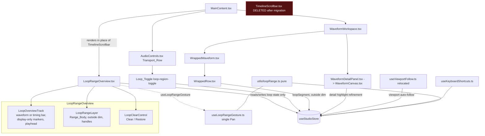
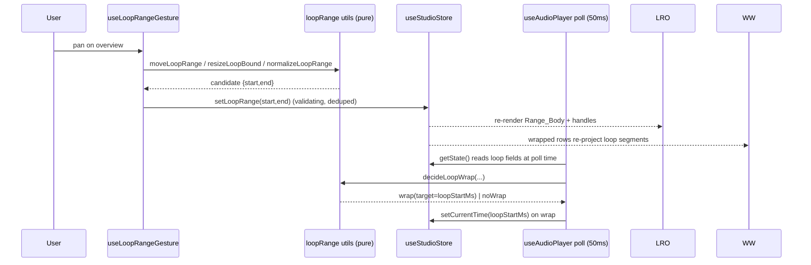

# Design Document: Loop Range Overview

## Overview

This feature replaces the waveform scrollbar (`src/components/ui/controls/TimelineScrollbar.tsx`)
with a compact, full-song **Loop Overview** that is a loop-range editor and never a scrollbar or a
seeking surface. It also consolidates BeatNote's three competing loop behaviours into one loop model
held in the single Zustand store (`src/hooks/useStudioStore.ts`, ADR-001). Wrapped rows remain the
only seeking surface; marker creation stays on the bottom marker controls.

The design satisfies the full requirements set in
[`requirements.md`](./requirements.md). It is a **spec-only** document: it proposes code structure,
types, and behaviour but changes no code.

### Current-state analysis

The behaviour below was read directly from source and constrains the design.

| Concern | Where it lives today | Relevant fact |
|---------|----------------------|---------------|
| Scrollbar + viewport handles + seek | `src/components/ui/controls/TimelineScrollbar.tsx` | 80px SVG, full-song waveform, markers, playhead, ghost, draggable viewport handles; tap/drag seeks. Hosts `timeline-gesture-area` and `playback-current-time`. Hidden when `showTimeline` is false. Phone falls back to a synthetic sine. |
| Viewport auto-follow | `TimelineScrollbar.tsx` effect (lines using `isViewportLocked`, `setViewportStartTime`) | Follows the playhead for the Detail_View viewport while `isViewportLocked` is true and playing. Must survive the scrollbar's removal (R18). |
| Loop range state | `src/hooks/useStudioStore.ts` | `loopStartMs`/`loopEndMs` (session-only, both `null` initially) and an **unvalidated** `setLoopRange`. Not persisted. |
| Range → rows projection | `src/utils/timelineMapping.ts` (`loopSegmentsForRows`) and `src/components/ui/waveform/WrappedRow.tsx` (`loopGeometry`, `wrapped-row-loop-{index}` at 0.15 opacity) | Half-open row ownership already enforced by `timestampToRow`. |
| Playback polling | `src/hooks/useAudioPlayer.ts` | Polls every `PLAYBACK_UPDATE_INTERVAL_MS = 50` with `END_OF_TRACK_TOLERANCE_MS = 100`; marker-loop branch then end-of-track repeat/pause. Effect deps include `isLoopMarkerActive`, `allLayersData`. |
| Transport row | `src/components/ui/controls/AudioControls.tsx` | skip-back, play-pause, skip-forward, repeat (`Repeat2`). No loop toggle, no testIDs on repeat. |
| Marker-segment loop | `MarkerButton.tsx` (`LoopMarkerIcon`), `useStudioStore` (`isLoopMarkerActive`/`toggleLoopMarker`), `useKeyboardShortcuts` (`Shift+L`), `useAudioPlayer` poll | Preserved as a session-only mode mutually exclusive with the Loop Range (R15). |
| Keyboard | `src/hooks/useKeyboardShortcuts.ts` | `L` → `toggleLoopMarker`; no `[`/`]` bindings; arrows drive timeline scroll/zoom. |
| Persistence | `src/utils/projectManager.ts`, `src/types/project.ts` | `PROJECT_VERSION = '1.0.0'`; `withWrappedViewDefaults` fills optional settings; no loop fields. `projectManager.wrapped.test.ts` asserts loop fields are absent. |
| Duration | `useStudioStore.setSongDuration`, `useAudioPlayer` effect | `setSongDuration` reshapes viewport but does not round or reclamp loop; player sets duration from `player.duration * 1000` (fractional). |
| Mount point | `src/components/layout/MainContent.tsx` | `timeline` (= `<TimelineScrollbar/>`) is rendered under the waveform in both the mobile canvas and the desktop scroll container. |
| Pure utils | `src/utils/` | `rowLayout.ts`, `timelineMapping.ts`, `projectManager.ts`. No loop-math module yet. |

Proven gesture pattern already used in `WrappedRow.tsx` and `TimelineScrollbar.tsx`:
`Gesture.Pan().runOnJS(true).activeOffsetX([-6, 6]).failOffsetY([-12, 12])`.

### Goals and non-goals

The non-goals in [`requirements.md`](./requirements.md) hold: no seeking or marker editing from the
overview, no new global store, no reintroduced phone scrolling, no 8-count snapping, no second audio
engine. All colours come from `src/styles/common.ts`; timestamps stay integer milliseconds (ADR-009).

## Loop-model consolidation

### Chosen model

Reuse the existing `loopStartMs`/`loopEndMs` fields, route **every** write through validating setters,
add an `isLoopRangeEnabled` flag, and add an in-memory restore snapshot. Preserve the session-only
marker-segment loop, with mutual exclusion between the two bounded loop modes. Keep whole-song
repeat with the precedence in R10.2/10.7/10.8.

### Alternatives compared

| Option | Shape | Verdict |
|--------|-------|---------|
| **A. Reuse `loopStartMs`/`loopEndMs` + validating setters + `isLoopRangeEnabled` + snapshot** (chosen) | Minimal field churn; `loopSegmentsForRows`, `WrappedRow` loop accent, and both wrapped unit tests keep working unchanged; validation centralised in setters | Lowest migration risk; honours ADR-001 and ADR-009; matches the invariants in requirements |
| B. New object field `loopRange: { startMs, endMs } \| null` | One nullable object replaces the pair | Cleaner null-handling, but rewrites `loopSegmentsForRows` callers, `WrappedWaveform` selectors, and both existing tests; more churn for no behavioural gain. The requirements name `loopStartMs`/`loopEndMs` throughout, so A tracks them literally |
| **C. Keep the marker-segment loop alongside the range loop** (2026-10-13 amendment) | Two loop concepts coexist, but enabling one disables the other | Chosen after simulator review because marker-bounded rehearsal remains valuable; mutual exclusion removes playback ambiguity |

### Field-by-field migration table

| Field / action | Disposition | Notes |
|----------------|-------------|-------|
| `loopStartMs: number \| null` | **kept** | Written only by validating setters (R19.1) |
| `loopEndMs: number \| null` | **kept** | Written only by validating setters |
| `setLoopRange(startMs, endMs)` | **changed** | Becomes validating; returns `boolean` (committed or not); rounds, orders, clamps, enforces `MIN_LOOP_DURATION_MS`; rejects non-finite with one `console.warn` (R13.6) |
| `isLoopRangeEnabled: boolean` | **added** | INV-3: true only while range is Valid |
| restore snapshot (`loopRestoreSnapshot`) | **added** | In-memory `{ loopStartMs, loopEndMs, isLoopRangeEnabled, expiresAtMs } \| null`; not persisted (R8.10) |
| `isLoopMarkerActive: boolean` | **kept** | Session-only; mutually exclusive with `isLoopRangeEnabled` (R15) |
| `toggleLoopMarker()` | **kept** | Enabling it disables the Loop Range |
| `LoopMarkerIcon` usage in `MarkerButton.tsx` | **kept** | Accessible fifth marker-row control |
| marker-loop branch in `useAudioPlayer` poll | **kept/refined** | Resolves the segment from the previous playback sample to avoid skipping a crossed boundary |
| keyboard `L` / `Shift+L` | **changed** | `L` toggles Loop Range; `Shift+L` toggles marker loop |
| `isRepeatActive` / `toggleRepeat` | **kept** | Precedence per R10.2/10.7/10.8 |

The two bounded modes are deliberately represented by distinct state and controls; store tests must
prove their mutual exclusion.

## Architecture

### Component architecture



### Component responsibilities

- **`LoopRangeOverview.tsx`** (replaces `TimelineScrollbar`): root `loop-overview` element,
  measures the editable track region via `onLayout`, owns the single Pan gesture through
  `useLoopRangeGesture`, and composes the three children. The Clear_Control occupies a fixed sibling
  action slot, so neither its visual bounds nor its 44×44 hit area overlays full-song content. Target
  ≤ 150 lines; drawing math is delegated to `loopRange` utils and the children. Renders only when
  `showTimeline` is true (R1.8); keeps loop state untouched while hidden (R1.10).
- **`LoopOverviewTrack`**: draws the full-song background — a waveform path when
  `useWaveformData` source is `'decoded'` with ≥1 peak (R2.1), otherwise a solid timing bar and **no**
  synthetic sine (R2.2). Draws display-only marker indicators for every visible layer (R2.4, R2.5,
  R2.7) and exactly one playhead (R2.3). Memoises the waveform path on `(peaks, width, songDuration)`
  only (R19.3) so 50ms `currentTime` updates move only the playhead (R19.4).
- **`LoopRangeLayer`**: draws `loop-overview-range` (Range_Body), the enabled-only outside-range
  dimming (≤ 0.5× inside opacity, R3.2), the undimmed disabled treatment (R3.3), the 2px-minimum body (R3.7), and
  `loop-overview-handle-start` / `loop-overview-handle-end` centred on the bounds (R3.5, R7.1). Exposes
  the `enabled`/`disabled` test-readable state indicator (R3.6).
- **`LoopClearControl`**: always-present icon-only `loop-overview-clear` with a ≥ 44×44 effective hit
  area; shows a disabled trash before a range exists, active trash for clear, and undo for restore
  while preserving descriptive accessibility labels
  (R8.1, R8.4), and remains in the reserved action slot beside the track (R8.11). Owns the 5000ms expiry timer that
  it cancels on unmount or snapshot discard (R8.6).
- **`useLoopRangeGesture.ts`** (one-job hook): the single Pan gesture; classifies mode at
  `onBegin`, commits live during the drag through the store setters, handles cancel/orientation
  semantics. No React render logic.
- **`useViewportFollow.ts`** (relocated, one-job hook): the viewport auto-follow effect lifted out
  of `TimelineScrollbar`.

### Relocating the viewport-follow effect — justification

The auto-follow effect currently lives inside `TimelineScrollbar` and so stops running when
`showTimeline` is false. R18.2 requires follow to run independently of the Loop_Overview's
visibility and of whether the Detail_View panel is shown. The effect must therefore mount at a point
that is always present while a song is loaded and never gated by `showTimeline`.

**Chosen mount point:** `WaveformWorkspace.tsx` (always mounted while a song is loaded, owns the
Detail_View viewport, and already reads/writes `viewportStartTime`/`viewportDuration`). It calls
`useViewportFollow()`, a one-job hook that reads `isViewportLocked`, `isPlaying`, `currentTime`,
`songDuration`, `viewportStartTime`, `viewportDuration` and applies R18.1/18.3/18.4/18.6. The
Loop_Overview itself never writes viewport state (INV-8, R18.5). An alternative — leaving the effect
in a top-level screen component — was rejected because `WaveformWorkspace` already owns viewport
clamping and keeps the follow logic next to the viewport setters.

### Deletion plan

`TimelineScrollbar.tsx` and `src/styles/components/controls/timelineScrollbar.ts` are deleted after
the migration lands and the three stable testIDs it hosted are re-homed: `playback-current-time`
moves to the Transport_Row or an overview caption (R1.6); `timeline-gesture-area` is removed entirely
and the Playwright/XCTest suites are updated to the `loop-overview*` testIDs (R1.7). `useScrollZoom`
stays (used by `WaveformCanvas`).

### Data flow



## Components and Interfaces

### Store state and actions (`src/hooks/useStudioStore.ts`)

New and changed members of the single store (ADR-001). All clock-dependent actions take the current
time as an argument so the store performs no timer or clock side effect (R8.3).

```typescript
interface LoopRestoreSnapshot {
  loopStartMs: number | null;
  loopEndMs: number | null;
  isLoopRangeEnabled: boolean;
  expiresAtMs: number; // clearTime + RESTORE_WINDOW_MS
}

interface StudioStoreLoopSlice {
  // State
  loopStartMs: number | null;        // kept
  loopEndMs: number | null;          // kept
  isLoopRangeEnabled: boolean;       // added, default false (INV-3)
  loopRestoreSnapshot: LoopRestoreSnapshot | null; // added, not persisted

  // Validating setters (every write to the range goes through one of these)
  /** Validate+commit a range. Returns true if committed. R5.3-5.5, R13.6, INV-1/2. */
  setLoopRange: (startMs: number | null, endMs: number | null) => boolean;
  /** R5.8/5.10/5.13/5.14: derive end from P, reject if invalid (console.warn). */
  setLoopStartAtPlayhead: (playheadMs: number) => void;
  /** R5.9/5.10/5.13/5.14. */
  setLoopEndAtPlayhead: (playheadMs: number) => void;
  /** R7.9/17.6: move one bound by steps*Beat_Step (sign = direction), clamped. */
  nudgeLoopBound: (bound: 'start' | 'end', steps: number) => void;
  /** R8.2/8.3: clear + write snapshot with expiry = nowMs + RESTORE_WINDOW_MS. */
  clearLoopRange: (nowMs: number) => void;
  /** R8.5/8.8/8.9: restore snapshot if nowMs < expiry and it normalises Valid. */
  restoreLoopRange: (nowMs: number) => void;
  /** R8.6: drop an expired/consumed snapshot. */
  discardLoopRestore: () => void;
  /** R9.3/9.4: set flag; no-op (and false) unless a Valid range + song exist. */
  setLoopRangeEnabled: (enabled: boolean) => void;
  /** R9.4/9.5: invert when enabled is allowed. Bound to keyboard L. */
  toggleLoopRangeEnabled: () => void;
  /** R13.4: null range, disable, discard snapshot (called from loadSong). */
  resetLoopForNewAudio: () => void;
}
```

Changed `setSongDuration` behaviour (R13.1-13.3, R13.5, R13.8, R13.9): round the incoming value to
the nearest integer millisecond (halves up) before storing or comparing; if the rounded value equals
the stored `songDuration`, leave loop state untouched and log nothing; otherwise reclamp the range via
`reclampLoopRangeToDuration` and set `isLoopRangeEnabled` consistently (INV-3). While `songDuration`
is 0 or non-finite, retain the existing bounds as a **pending range** exempt from the duration bound
(INV-1, R13.5) and hold `isLoopRangeEnabled` false; when a finite positive duration first arrives,
validate the pending range and restore the pre-pending (or project-restored) enabled value (R13.8).
The existing viewport reshaping in `setSongDuration` is preserved.

`loadProject`/`loadProjectAudio` keep the project-restored range and only adjust it through R13.2/13.3
once the player reports a duration (R13.7, R14.11). `loadSong` calls `resetLoopForNewAudio` (R13.4).

### Pure utilities (`src/utils/loopRange.ts`)

No React/React Native imports, no I/O, no store access; equal inputs give equal outputs (R19.2).
Each function is covered by Jest unit tests under `tests/unit/`.

```typescript
export const MIN_LOOP_DURATION_MS = 500;
export const LOOP_BOUNDARY_TOLERANCE_MS = 30;
export const RESTORE_WINDOW_MS = 5000;
export const FALLBACK_KEY_STEP_MS = 250;
export const LARGE_STEP_MULTIPLIER = 10;

export interface LoopRange { loopStartMs: number | null; loopEndMs: number | null; }

/** True iff finite integers, 0 <= start < end <= songDuration, end-start >= MIN. */
export function isValidLoopRange(range: LoopRange, songDuration: number): boolean;

/** Round, order, clamp to [0,songDuration]; null-range or a Valid range (INV-1/2). R5.3, R19.6. */
export function normalizeLoopRange(
  startMs: number | null, endMs: number | null, songDuration: number,
): LoopRange;

/** R13.2/13.3: clamp both bounds to the new duration; null if < MIN or start>=duration. */
export function reclampLoopRangeToDuration(range: LoopRange, songDuration: number): LoopRange;

/** R6.1-6.6: slide, preserving end-start exactly (INV-4), clamped to [0,songDuration]. */
export function moveLoopRange(range: LoopRange, deltaMs: number, songDuration: number): LoopRange;

/** R7.4/7.5/7.8: move one bound to candidateMs, keep MIN gap, round, clamp. */
export function resizeLoopBound(
  range: LoopRange, bound: 'start' | 'end', candidateMs: number, songDuration: number,
): LoopRange;

/** Beat_Step: round(60000/bpm) when bpm finite > 0, else FALLBACK_KEY_STEP_MS. */
export function beatStepMs(bpm: number): number;

/** R5.3, R19.9: timestamp -> pixel x. Returns 0 when width/duration non-finite or <= 0. */
export function msToOverviewX(ms: number, songDuration: number, width: number): number;

/** R5.3, R19.9: pixel x -> integer ms, monotonic, clamped. 0 on degenerate inputs. */
export function overviewXToMs(x: number, songDuration: number, width: number): number;

/** R7.4-7.7: which handle a press hits, resolving overlap by nearest centre then direction. */
export function resolveHandleHit(
  pointerX: number, range: LoopRange, songDuration: number, width: number, platform: 'web' | 'native',
  movementDeltaX?: number,
): 'start' | 'end' | null;

/** R5-R7 Interaction Rules: classify a begun gesture into create/move/resize-start/resize-end. */
export function resolveGestureMode(
  pointerX: number, range: LoopRange, songDuration: number, width: number, platform: 'web' | 'native',
  movementDeltaX?: number,
): 'create' | 'move' | 'resize-start' | 'resize-end';

/** R3.2/4.3: outside-range sub-segments of a row for de-emphasis drawing. */
export function outsideLoopSegmentsForRow(
  rowStartMs: number, rowEndMs: number, range: LoopRange,
): Array<{ fromMs: number; toMs: number }>;

export interface LoopWrapInput {
  isEnabled: boolean; isPlaying: boolean;
  loopStartMs: number | null; loopEndMs: number | null;
  previousSampleMs: number; currentSampleMs: number; toleranceMs: number;
}
export type LoopWrapDecision = { kind: 'wrap'; targetMs: number } | { kind: 'noWrap' };
/** R10.1-10.5/10.9: armed-wrap decision; target is always loopStartMs (no overshoot adjust). */
export function decideLoopWrap(input: LoopWrapInput): LoopWrapDecision;

/** R17.1 value text "m:ss.s", truncated to lower tenth. */
export function formatLoopTime(ms: number): string;

/** R17.2 "Loop m:ss.s to m:ss.s, N seconds" or "No loop selected". */
export function loopSummaryLabel(range: LoopRange): string;
```

`src/utils/timelineMapping.ts` keeps `loopSegmentsForRows` for the inside-range row segments; the new
`outsideLoopSegmentsForRow` lives in `loopRange.ts` to keep the de-emphasis geometry with the other
loop math.

### Numeric version comparison (`src/utils/projectManager.ts`)

```typescript
/** Compare 'major.minor.patch' numerically so '1.10.0' > '1.2.0'. R14.6. */
export function compareProjectVersion(a: string, b: string): -1 | 0 | 1;
```

### Loop toggle (`src/components/ui/controls/AudioControls.tsx`)

Add the Loop_Toggle as the **last** Transport_Row control, after repeat: `testID="loop-region-toggle"`,
`accessibilityRole="button"`, label "Loop selected range", a distinct icon, `accessibilityState`
`checked = isLoopRangeEnabled` and `disabled = !(validRange && songLoaded)`, mirrored to `aria-pressed`
/ `aria-disabled` on web (R9.1, R9.2). Give the repeat button `testID="repeat-toggle"`, label "Repeat
song", and `checked = isRepeatActive` (R9.9).

**Icon choice:** `Brackets` from `lucide-react-native` (verified present in
`node_modules/lucide-react-native`). It is visually distinct from the circular `Repeat2` repeat icon
and echoes the `[`/`]` keyboard bindings. Alternatives also present and acceptable: `IterationCw`,
`ArrowLeftRight`.

## Gesture ownership and conflict resolution

### Single gesture

`useLoopRangeGesture` builds exactly one `Gesture.Pan()`:

```typescript
Gesture.Pan()
  .runOnJS(true)                 // callbacks on the JS thread (R12.3, R19.* pure utils)
  .activeOffsetX([-6, 6])        // exact ±6px to activate (R12.2)
  .failOffsetY([-12, 12])        // ±12px vertical-first fails the gesture (R12.2)
  .maxPointers(1)                // second touch ignored (R12.5)
```

No `Tap` gesture is attached: a tap (ends with < 4px horizontal movement) must have no effect
(R5.7), which a Pan that never activates already guarantees. The Clear_Control is a **separate**
`Pressable` outside the Pan surface so clearing/restoring is a button press, not a Range_Gesture
(R8.2, R8.5).

### Handle hit areas vs the strip

Handles need a 44×44 touch area on native (R7.2) and ≥16px pointer area on web (R7.3), but the phone
strip is only 36px tall. The design extends the handle hit area **vertically beyond the strip** (≥4px
above and below on native, R7.2) using a transparent child `View` with `hitSlop`, kept inside the
Loop_Overview's own gesture surface.

**Chosen approach and justification:** the vertical extension stays part of the Loop_Overview's Pan
surface (a sibling layered above the track within the `loop-overview` root), not a floating overlay
on top of the Wrapped_Canvas. Because the overview sits *below* the Wrapped_Canvas in layout, a press
in the extension lands on the overview, and `resolveHandleHit` classifies it as a handle gesture
(R7.11); the Wrapped_Canvas never receives it. A floating overlay was rejected because it would sit
over wrapped rows and could steal row-seek touches, violating R12.10/12.11. Centred hit areas that
would overflow the overview's left/right edges are shifted inward while still covering the handle
centre (R7.10). While no Valid range exists, no handle extension is provided (R7.11).

### Mode state machine

```mermaid
stateDiagram-v2
  [*] --> Idle
  Idle --> Begun: onBegin (record anchorX, anchorMs, startRange)
  Begun --> Create: onActivate; no valid range OR press outside body+handles
  Begun --> Move: onActivate; press inside Range_Body, outside handles
  Begun --> ResizeStart: onActivate; press in Start_Handle hit area
  Begun --> ResizeEnd: onActivate; press in End_Handle hit area
  Begun --> Failed: vertical move >=12px before activate
  Create --> Create: onUpdate (provisional < MIN; commit >= MIN)
  Move --> Move: onUpdate (delta from gesture start)
  ResizeStart --> ResizeStart: onUpdate (clamp to [0, end-MIN])
  ResizeEnd --> ResizeEnd: onUpdate (clamp to [start+MIN, duration])
  Create --> Idle: onEnd/cancel
  Move --> Idle: onEnd/cancel
  ResizeStart --> Idle: onEnd/cancel
  ResizeEnd --> Idle: onEnd/cancel
  Failed --> Idle
```



- **Mode decided when the Pan activates** from the touch-down position (R5.1 anchors at the initial
  touch-down x, not the later activation x) plus the activating horizontal movement direction, via
  `resolveGestureMode`. `onBegin` records the anchor but cannot resolve R7.7's directional tie yet.
- **Tie-break** when both handle hit areas overlap: nearer centre, then by the activating movement
  direction — left → Start_Handle, right → End_Handle (R7.6, R7.7), resolved by the first horizontal
  movement.
- **Live commits with dedupe:** each `onUpdate` writes at most one validated range and skips the
  write when the result equals the current stored range (R12.9).
- **Announcement isolation:** drag updates never call the native accessibility announcement bridge.
  Explicit adjustable actions and keyboard changes announce the affected handle exactly once after
  the synchronous store action, including clamped no-ops (R17.4), keeping drag rendering off that
  extra bridge hot path.
- **Provisional creation below MIN:** while a creation span < `MIN_LOOP_DURATION_MS`, the overview
  shows a provisional band but the store keeps the pre-gesture range (R5.4); it commits only once the
  span reaches MIN (R5.5), and a drop back below MIN after reaching it keeps the pre-gesture range.
- **Cancel semantics:** on system cancellation or orientation change, resize/move and a creation
  whose span ≥ MIN keep the last committed Valid range; a creation below MIN discards the provisional
  and restores the pre-gesture range and flag (R12.7, R12.8, R5.6). After an orientation change, no
  further pointer movement changes the range until a new gesture starts.
- **Edge clamping:** pointer timestamps are clamped to `[0, songDuration]` while tracking continues
  past the edges (R12.6).

### No seek / marker / viewport writes

Range handlers call none of `onSeek`, `setCurrentTime`, `addMarker`, scrub-start, or any viewport
setter, and never touch `ghostPlayheadTime` or markers (INV-5, INV-8, R12.1). On desktop web the Pan
surface sets `touch-action: none` and the page scroll offsets are unchanged during an active gesture
(R12.12). `// [PLATFORM: web]` marks the `touch-action`/cursor branches.

### Ownership table

| Surface | Owns | Must never do |
|---------|------|---------------|
| Loop_Overview Pan | create/move/resize of the range (live) | seek, marker, viewport, scrub |
| Clear_Control Pressable | clear / restore | start a Range_Gesture |
| Wrapped_Canvas row gesture | seek / marker-select / scrub | change loop range or enabled flag (INV-6) |
| Loop_Toggle | invert `isLoopRangeEnabled` | change range, currentTime, repeat |
| `useViewportFollow` | viewport auto-follow | write loop state |

While a Range_Gesture is active the Wrapped_Canvas starts no row/gutter/marker/drag gesture, and vice
versa (R12.10, R12.11).

## Range projection onto wrapped rows

`loopSegmentsForRows(rows, loopStartMs, loopEndMs)` (unchanged) yields one inside-range segment per
intersecting row; `outsideLoopSegmentsForRow` yields the complementary de-emphasis segments. Ownership
is **half-open** `[row.startMs, row.endMs)` with `songDuration` owned by the final row, so a bound on a
row boundary belongs to the later row and no zero-width segment is drawn on the earlier row (R4.2).

Per-row pixel geometry (reusing `WrappedRow.loopGeometry`): for a segment `[fromMs, toMs]` and row
span `span = row.endMs - row.startMs`,

```text
x     = clamp(((fromMs - row.startMs) / span) * rowPixelWidth, 0, rowPixelWidth)
right = clamp(((toMs   - row.startMs) / span) * rowPixelWidth, 0, rowPixelWidth)
width = max(0, right - x)   // within ±1px of the spec formula (R4.1)
```

On the fixed phone canvas every row is mounted, so segments appear on all rows; on the virtualized
tablet/desktop list they appear on every mounted row, including rows mounted later by scrolling
(R4.1, R4.8). Content inside the range renders at the no-loop opacity; while `isLoopRangeEnabled` is
true, content outside renders at a lower opacity, including on rows that do not intersect the range
(R4.3). When `isLoopRangeEnabled` is false the segments still render with a disabled treatment
distinct from enabled, but no outside-range de-emphasis renders (R4.7, R11.2). With no Valid range,
no segment, no de-emphasis, and no Detail_View highlight render
(R4.6). Marker x-positions, marker tap selection, and seek gestures are unchanged by the presence of a
range (R4.5, INV-6).

**Detail_View highlight (refinement, R4.4):** when the Detail_View is active, highlight the
intersection of `[loopStartMs, loopEndMs]` with `[viewportStartTime, viewportStartTime +
viewportDuration]`; empty intersection → no highlight. This may ship after R4.1-4.3.

## Playback loop algorithm

The marker-segment branch and range branch share the same armed-boundary decision. The poll reads
loop state at poll time via
`useStudioStore.getState()` so changing the range or flag mid-playback does not restart the interval
(R10.6); the effect's dependency list is reduced to `[player, isPlaying]` plus the existing
`setCurrentTime`/`setIsPlaying` identities. A `previousSampleRef` (a `useRef`) tracks the previous
position sample across polls.

Each poll, before any end-of-track repeat/pause logic:

1. Read `{ isLoopRangeEnabled, loopStartMs, loopEndMs, songDuration }` from `getState()`.
2. Call `decideLoopWrap({ isEnabled, isPlaying, loopStartMs, loopEndMs, previousSampleMs:
   previousSampleRef.current, currentSampleMs, toleranceMs: LOOP_BOUNDARY_TOLERANCE_MS })`.
3. On `wrap`: seek to exactly `loopStartMs / 1000` s, keep playing, `setCurrentTime(loopStartMs)`,
   set `previousSampleRef.current = loopStartMs`, and **skip** end-of-track logic for this poll
   (R10.1, R10.2). The target is exactly `loopStartMs` regardless of overshoot, so iteration N seeks
   to the same target as iteration 1.
4. On `noWrap`: run the existing end-of-track repeat/pause logic (R10.7, R10.8), then
   `setCurrentTime(currentSampleMs)` and `previousSampleRef.current = currentSampleMs`.

**Armed rule (ARMED-WRAP):** a wrap fires only when `loopStartMs <= previousSampleMs < loopEndMs`
*and* `currentSampleMs >= loopEndMs - LOOP_BOUNDARY_TOLERANCE_MS`, for any overshoot past `loopEndMs`
(R10.1). A sample that starts or lands at/after `loopEndMs` is not armed and plays on to song end
(R10.4, decision D-7). A range with `loopEndMs = songDuration` wraps (30ms tolerance < 100ms
end-of-track tolerance) and never pauses or repeats (R10.2, Edge Case 1/3).

**Enable mid-playback (R10.5):** on the first poll after `isLoopRangeEnabled` goes false→true, the
most recent sample is used as `previousSampleMs`; if it is already ≥ `loopEndMs`, R10.4 applies and no
seek occurs.

**Seek failure (R10.10):** if the wrap seek throws/rejects, `console.error` the error and target, set
`currentTime` from the player's next reported position, record that as `previousSampleRef.current`,
and attempt no further loop seeks until a later sample is armed again — one attempt per boundary
crossing, no per-poll retry loop.

**Seek/scrub suspension (R10.11):** while the user seeks or scrubs on the Wrapped_Canvas, loop-wrap
decisions are suspended; the landed position becomes `previousSampleRef.current`, then R10.1/10.3/10.4
resume from it. A boolean suspension flag (set by `onScrubStart`/`seekToPosition`, cleared by
`onScrubEnd`) gates step 2.

**Repeat precedence:** loop wins while enabled and armed inside the range; whole-song repeat/pause
applies only at song end when the armed condition is false (R10.7, R10.8, R11.5, Edge Case 12).

```text
poll():
  cur = player.currentTime * 1000
  st  = getState()
  if scrubSuspended: previousSampleRef = cur; return   # R10.11
  d = decideLoopWrap({...st, prev: previousSampleRef, cur, tol: 30})
  if d.kind == 'wrap':
    try: seekTo(st.loopStartMs/1000); play()
         setCurrentTime(st.loopStartMs); previousSampleRef = st.loopStartMs
    catch e: console.error(e, st.loopStartMs); // one attempt, resync next poll
    return                                     # skip end-of-track (R10.2)
  if cur >= st.songDuration - 100:             # end-of-track (R10.7/10.8/11.5)
    if st.isRepeatActive: setCurrentTime(0); seekTo(0); play()
    else: pause(); setIsPlaying(false); setCurrentTime(st.songDuration)
  else:
    setCurrentTime(cur)
  previousSampleRef = cur
```

```mermaid
sequenceDiagram
  participant T as Timer (50ms)
  participant Pl as Player
  participant D as decideLoopWrap
  participant S as Store
  T->>Pl: read currentTime
  T->>D: prev, cur, range, flags, tol
  alt armed wrap
    D-->>T: wrap(target=loopStartMs)
    T->>Pl: seekTo(loopStartMs/1000); play
    T->>S: setCurrentTime(loopStartMs)
  else no wrap, at song end
    D-->>T: noWrap
    T->>Pl: repeat or pause
    T->>S: setCurrentTime(...)
  else no wrap, mid-song
    D-->>T: noWrap
    T->>S: setCurrentTime(cur)
  end
```

**Timing/tolerance analysis:** at 50ms polls the worst-case overshoot per poll is one interval of
audio. `LOOP_BOUNDARY_TOLERANCE_MS = 30` (< 50) arms the wrap slightly before the exact boundary so a
throttled or backgrounded timer that overshoots (even to `songDuration`) still wraps on the sample it
is observed (R10.1, Edge Case 16). Because the target never includes the overshoot, repeated
iterations are drift-free. The loop is not sample-accurate (explicit non-goal) but is adequate for
rehearsal (manual acceptance target).

## Persistence and migration

### Schema additions (`src/types/project.ts`)

```typescript
settings: {
  // ...existing fields...
  loopRange?: { startMs: number; endMs: number } | null; // R14.1
  loopEnabled?: boolean;                                   // R14.1 (D-2: flag persists)
}
```

`PROJECT_VERSION` becomes `'1.1.0'` (R14.2). Saving a project whose loaded version is `'1.1.0'` or
older, or a never-saved project, writes `version: '1.1.0'`. A project loaded with a version newer than
`'1.1.0'` (by numeric `compareProjectVersion`) is loaded for known fields without rewriting, keeps its
original version string in memory, and on save preserves that version and any unrecognised top-level
and `settings` fields (R14.6, R14.10, D-9).

### Save/load behaviour

- **Save:** write `settings.loopRange = { startMs, endMs }` with integer bounds equal to the store
  values, or `null` when no Valid range; write `settings.loopEnabled = isLoopRangeEnabled`, forced to
  `false` whenever `loopRange` is `null` (R14.1). The restore snapshot is never serialised, so a save
  during the Restore_Window writes `loopRange: null`, `loopEnabled: false` (R8.10, R14.10).
- **Load:** a `'1.0.0'` project or one missing `loopRange`/`loopEnabled` loads with range null and
  flag false, no error (R14.3). A non-null persisted range is normalised with the **same**
  `normalizeLoopRange`/`reclampLoopRangeToDuration` used by the setters against the loaded
  `songDuration`, keeping it when Valid (R14.4). An invalid persisted range (non-finite/non-number
  bound, `startMs >= endMs` pre-clamp, `startMs >= songDuration`, or `< MIN` after clamp) loads with
  range null, flag false, and one `console.warn` with the persisted range and loaded duration, markers
  and other settings intact (R14.5). A non-boolean `loopEnabled`, or `true` with a null/rejected
  range, loads as `false` (R14.9, INV-3). When loaded `songDuration` is 0/non-finite, hold the flag
  false and apply R14.4/14.5 to the pending range once a finite positive duration arrives (R14.11,
  R13.5).

### Migration table

| From | On load | On save |
|------|---------|---------|
| `1.0.0` (no loop fields) | range null, flag false, no error | writes `1.1.0`, `loopRange`/`loopEnabled` |
| `1.1.0` valid range | normalise+clamp, keep if Valid; flag per `loopEnabled` (false if range null) | writes `1.1.0` |
| `1.1.0` invalid range | null + flag false + one warn | writes `1.1.0`, `loopRange: null` |
| newer than `1.1.0` | known fields only, keep version string | keep version + unknown fields |

### Pending range

While `songDuration` is 0/non-finite at load, the persisted bounds are held as a pending range (INV-1)
and validated when the player first reports a finite positive duration (R13.8, R14.11).

### Test updates (R14.8)

`tests/unit/projectManager.wrapped.test.ts` currently asserts `settings` omits loop fields; those
expectations are replaced with expectations for `loopRange` and `loopEnabled`, plus a round-trip test
(R14.7) and the version-preservation test (R14.10). `tests/unit/studioStore.wrapped.test.ts` is
updated to drop `toggleLoopMarker`/`isLoopMarkerActive` references (R15.1).

## Responsive layout and accessibility

### Layout per breakpoint

The Loop_Overview is rendered where `TimelineScrollbar` was in `MainContent.tsx` — directly below the
Wrapped_Canvas (or the Detail_View when it replaces the canvas) and above the control dock.

- **Phone portrait (< 768px):** inside the fixed workspace and safe-area insets, width = canvas
  width ±1px (R16.1). Total height 36px (band 32-40px, R1.2).
- **Phone landscape (< 768px):** below the Wrapped_Canvas inside the canvas column, width = canvas
  column width ±1px, not overlapping the control rail or a docked Detail_View (R16.2).
- **Tablet/desktop (≥ 768px):** below the Wrapped_Canvas, width = Wrapped_Canvas width ±1px, total
  height 32-40px (R1.3, R16.3).

The Detail_View stays visible and keeps representing the full song (0 → `songDuration`), not the
viewport, in both portrait-replace and landscape-dock modes (R16.6). On window/orientation change the
Range_Body, handles, playhead, and markers re-project to the new width (±1px) after layout, leaving
loop values and the flag unchanged (R16.5).

### Height budget (36px phone)

```text
+-----------------------------------------+------+  <- loop-overview root (36px)
| track strip: waveform/range/playhead    | icon |  <- dedicated action slot
+-----------------------------------------+------+
```

Handle hit areas extend beyond the strip via `hitSlop` to reach the 44px native target (R7.2).
The 40px action slot directly abuts the track; its internal hit slop supplies the wider touch target
without reintroducing a visible seam. The playhead centre stays two pixels inside either track edge.
`playback-current-time` remains only as a 1×1 non-layout automation probe while a song is loaded;
no current-time caption is visible (R1.6).

### Transport_Row fit at 320/375px

Five controls — skip-back, play-pause, skip-forward, repeat, Loop_Toggle — on one row, no wrapping, no
overflow, no overlapping hit areas, each ≥ 44×44 effective (R9.6). The compact button is 44×44
(`audioControls.ts` `buttonCompact`); five buttons at 44px + the 6px mobile gap sum to ~250px, inside
the 320px content width after padding, so no shrink is needed. Each button keeps a 44×44 touch target
via `hitSlop` where the visual box is smaller. The bottom marker row keeps add, nav-left, nav-right,
remove-last, and marker-loop controls with stable testIDs and 44×44 targets (R15).

### Icon and cursors

- Loop_Toggle icon: `Brackets` (verified in `node_modules/lucide-react-native`), distinct from
  `Repeat2`.
- Mouse cursors (R16.4, `// [PLATFORM: web]`): `ew-resize` over a handle hit area, `grab` over the
  Range_Body outside handles, `grabbing` from move-gesture start until release.
- Web keyboard focus shows a visible focus indicator on Start_Handle, End_Handle, and Clear_Control,
  removed on blur (R16.7).

### Accessibility semantics

- **Handles (R17.1):** native `accessibilityRole="adjustable"` / web `role="slider"`;
  min 0, max `songDuration`, now = bound (integer ms), value text `Loop start m:ss.s` /
  `Loop end m:ss.s` (truncated to the lower tenth, e.g. 61,250 → `1:01.2`); mirrored to
  `aria-valuemin/max/now/valuetext` on web. Start_Handle precedes End_Handle in tab order (R17.6).
- **Summary (R17.2):** `Loop m:ss.s to m:ss.s, N seconds` (N half-up to one decimal, always one
  decimal) when Valid; `No loop selected` otherwise.
- **Actions (R17.3):** expose "Set loop start at playhead" and "Set loop end at playhead" while a
  song is loaded and `songDuration >= MIN_LOOP_DURATION_MS`; add "Clear loop" while Valid; none
  otherwise.
- **Announcements (R17.4):** announce the updated handle value text once per change; if a change is
  clamped to no-op, announce the current value text without modifying the range.
- **Keyboard stepping (R17.6, R7.9):** ArrowLeft/Down decrement, ArrowRight/Up increment by one
  Beat_Step; PageDown/Up and Shift+Arrow by `LARGE_STEP_MULTIPLIER × Beat_Step`; Home/End to the
  lower/upper clamp limits (R7.4/7.5 limits), via `nudgeLoopBound`.
- **Focus on clear (R17.7):** clearing (control, action, or keyboard on a handle/Clear_Control)
  moves focus to the Clear_Control (now "Restore"); when the Restore_Window closes without restore,
  focus moves to the overview summary so focus is never lost to the document root.

### Native vs RN Web ARIA

Native uses `accessibilityRole`/`accessibilityState`/`accessibilityValue`/`accessibilityActions`; web
mirrors to `role`, `aria-pressed`, `aria-disabled`, and `aria-value*`. These mirrored attributes are
set together wherever RN Web does not derive the web attribute automatically.

### Keyboard map and `[`/`]` conflict check

| Key | Action | Guard |
|-----|--------|-------|
| `L`/`l` | toggle `isLoopRangeEnabled` | no modifiers, song loaded, Valid range, no text focus (R9.5) |
| `Shift+L` | toggle `isLoopMarkerActive` | song loaded, no text focus (R15.5) |
| `[` | Set loop start at playhead | no text focus, song loaded (R5.11) |
| `]` | Set loop end at playhead | no text focus, song loaded (R5.11) |

`useKeyboardShortcuts.ts` currently binds Space, M, Ctrl/Cmd+Z, Ctrl+Shift+Z, arrows, R, L, T. `[`
and `]` are **not** currently bound (confirmed by reading the hook), so adding them introduces no
conflict. `L` toggles the custom range; `Shift+L` retains marker-loop access.

### Contrast pairs (R17.5, manual)

All of Start_Handle, End_Handle, Range_Body edges, Clear_Control, and Loop_Toggle use tokens from
`src/styles/common.ts` and must measure ≥ 3:1 for non-text graphics and ≥ 4.5:1 for text, in every
state (enabled, disabled, focused). Candidate pairs to measure: handle/body stroke
`colors.loopEnabled` (`#00d4c7`) on `colors.surface` (`#111111`); disabled treatment via
`colors.loopDisabled` (`#477a76`) or
`colors.textSecondary` (`#999999`); focus ring `colors.text` (`#ffffff`). Verified by manual
measurement, not automated tests.

## Data Models

```typescript
// src/utils/loopRange.ts
interface LoopRange { loopStartMs: number | null; loopEndMs: number | null; }
type LoopWrapDecision = { kind: 'wrap'; targetMs: number } | { kind: 'noWrap' };

// src/hooks/useStudioStore.ts
interface LoopRestoreSnapshot {
  loopStartMs: number | null;
  loopEndMs: number | null;
  isLoopRangeEnabled: boolean;
  expiresAtMs: number;
}

// src/types/project.ts (settings additions)
interface PersistedLoopSettings {
  loopRange?: { startMs: number; endMs: number } | null;
  loopEnabled?: boolean;
}
```

Invariants carried by these models: INV-1 (range is null-null, Valid, or pending while
`songDuration` ≤ 0), INV-2 (integer bounds when non-null), INV-3 (`isLoopRangeEnabled` true only while
Valid), INV-4 (move preserves duration).

## Error Handling

| Condition | Requirement | Handling |
|-----------|-------------|----------|
| Loop setter receives NaN/Infinity/-Infinity/non-number | R13.6 | Leave range and flag unchanged; one `console.warn` with the rejected input |
| Set-at-playhead would produce an invalid range | R5.10 | Leave range and flag unchanged; `console.warn` with rejected start and end |
| `songDuration` reclamp yields `< MIN` or `start >= duration` | R13.3 | Set range null, flag false; one `console.warn` with previous start, previous end, new duration |
| `songDuration` rounds to the current value | R13.9 | No change, no warning |
| Persisted range invalid after normalise/clamp | R14.5 | Load with range null, flag false; `console.warn` with persisted range and loaded duration; other fields intact |
| Persisted `loopEnabled` non-boolean, or `true` with null/rejected range | R14.9 | Load flag as false (INV-3) |
| Restore snapshot invalid after normalise | R8.8 | Range null, flag false; discard snapshot; `console.warn` with snapshot range and current duration |
| Restore at/after expiry or with no snapshot | R8.9 | Leave range and flag unchanged; discard any expired snapshot |
| Wrap seek throws/rejects | R10.10 | `console.error` error + target; resync from next reported position; one attempt per crossing; range and flag unchanged |
| `songDuration` 0/non-finite / no song | R2.6, R5.12 | Placeholder bar; hide waveform/playhead/markers/handles/range/clear; ignore Range_Gestures; keep Loop_Toggle disabled |
| `songDuration < MIN_LOOP_DURATION_MS` | R5.12 | No provisional range; reject creation and set-at-playhead; Loop_Toggle stays disabled |
| Marker timestamp non-finite / `< 0` / `> songDuration` | R2.7 | Omit that indicator; draw the rest; leave marker data unchanged |
| `useWaveformData` source `'synthetic'`/empty/not-yet | R2.2 | Draw solid timing bar; no waveform path; no synthetic sine |
| Computed Range_Body width `< 2px` | R3.7 | Render at 2px centred on the midpoint; bounds unchanged |

Errors are never swallowed silently (coding standard): invalid inputs log with context. The store
performs no clock/timer side effect — all time-dependent actions take `nowMs` as an argument (R8.3).

## Testing Strategy

The loop math and store logic are pure/deterministic and ideal for **property-based testing**; the
Loop_Overview rendering, gestures, responsive layout, accessibility, and detail-view follow are UI
behaviour validated by example/integration tests and manual acceptance. Property tests use
**fast-check** (R19.6-19.9 require it); the project already runs Jest (`npx jest
--testPathPatterns=unit`) and Playwright (`npm test`), with iOS XCTest via `npm run test:ios:ui`.

### Unit tests (Jest, fresh store per test — `create()` directly, not the singleton)

- `tests/unit/loopRange.test.ts` — `normalizeLoopRange`, `moveLoopRange`, `resizeLoopBound`,
  `reclampLoopRangeToDuration`, `msToOverviewX`/`overviewXToMs`, `decideLoopWrap`, `beatStepMs`,
  `resolveHandleHit`, `resolveGestureMode`, `outsideLoopSegmentsForRow`, `formatLoopTime`,
  `loopSummaryLabel`, including the enumerated `decideLoopWrap` cases from R10.9 and the R13.2 example
  (`180000` → `179987`). Property tests (fast-check, ≥ 100 iterations) for Properties 1-6, 8, 9.
- `tests/unit/studioStore.loop.test.ts` — validating setters, set-at-playhead (R5.8-5.10),
  `clearLoopRange`/`restoreLoopRange` with injected `nowMs` (R8.2-8.9), `setSongDuration`
  rounding/reclamp/pending (R13.1-13.9), INV-3 across action sequences (Property 10, fast-check).
- `tests/unit/projectManager.wrapped.test.ts` (updated) — replace the loop-field-absence
  assertions with `loopRange`/`loopEnabled` expectations; add the save/load round-trip (Property 7)
  and newer-version preservation (R14.10); `compareProjectVersion` ordering (fast-check).
- `tests/unit/timelineMapping.test.ts` — half-open loop-segment ownership edge cases (R4.2).

### E2E (Playwright, web)

Replace `timeline-gesture-area` with `loop-overview*` testIDs in `ui-components.spec.ts` and
`waveform-features.spec.ts` (R1.7). Cover: overview replaces the scrollbar and spans the full song;
create by drag; move; resize each handle; clear then restore within 5s; Loop_Toggle enable/disable
and disabled state; `[`/`]`/`L` keyboard; outside-range dimming; wrapped-row loop segments; detail
follow preserved with `showTimeline` false; `playback-current-time` present with timeline hidden; a tap
on the overview changes nothing.

### iOS XCTest (`tests/ios/BeatNoteUITests.swift`)

Replace the four `timeline-gesture-area` references with `loop-overview` interactions. Cover handle
drags with the 44×44 extended hit area, Transport_Row five-button fit, marker row after loop removal,
and background-playback continuity through a wrap.

### Manual acceptance (not automated)

60fps drag + playback on iPhone 17 Pro / iOS 26.2 and a physical iPhone; VoiceOver handle adjustment;
contrast measurement of token pairs; audible loop boundary on device.

## Correctness Properties

*A property is a characteristic or behavior that should hold true across all valid executions of a
system — essentially, a formal statement about what the system should do. Properties serve as the
bridge between human-readable specifications and machine-verifiable correctness guarantees.*

Each property is implemented by a single fast-check property test running ≥ 100 iterations, tagged
`Feature: loop-range-overview, Property {number}: {property_text}`.

### Property 1: Normalisation is idempotent and well-shaped

For any two numbers and any finite `songDuration ≥ 0`, `normalizeLoopRange` applied twice equals
applying it once, and its output is either the null range or an integer-bounded range with
`0 ≤ loopStartMs < loopEndMs ≤ songDuration` and duration `≥ MIN_LOOP_DURATION_MS` (a pending range
when `songDuration ≤ 0`).
**Validates: Requirements 5.3, 19.6, INV-1, INV-2**

### Property 2: Move preserves duration

For any Valid_Loop_Range and any finite pointer delta, `moveLoopRange` returns an integer-bounded
range inside `[0, songDuration]` whose `loopEndMs − loopStartMs` equals the input duration exactly;
a delta of 0 returns the input unchanged.
**Validates: Requirements 6.1, 6.2, 6.3, 6.4, 6.6, 19.7, INV-4**

### Property 3: Resize keeps the minimum duration and the other bound

For all Valid_Loop_Range inputs, either handle, and any finite candidate timestamp, `resizeLoopBound`
returns a range with `loopEndMs − loopStartMs ≥ MIN_LOOP_DURATION_MS`, integer bounds inside `[0,
songDuration]`, the moved bound equal to the clamped candidate, and the untouched bound unchanged.
**Validates: Requirements 7.4, 7.5, 7.8, 7.9, 19.8**

### Property 4: Pixel/millisecond mapping is monotonic, integral, and round-trip bounded

For all finite `songDuration > 0`, `width > 0`, and timestamps in `[0, songDuration]`, `overviewXToMs`
returns an integer clamped to `[0, songDuration]` and is monotonically non-decreasing in pixel x, and
`overviewXToMs(msToOverviewX(t))` differs from `t` by at most `ceil(songDuration / width)` ms; if
`songDuration` or `width` is non-finite or ≤ 0, both mapping functions return 0.
**Validates: Requirements 5.3, 19.9**

### Property 5: Loop wrap fires exactly when armed and targets the loop start

`decideLoopWrap` returns `wrap` exactly when the flag is true, playback is active, the range is
Valid, `loopStartMs ≤ previousSampleMs < loopEndMs`, and `currentSampleMs ≥ loopEndMs − tolerance`;
its target is always `loopStartMs`, regardless of overshoot.
**Validates: Requirements 10.1, 10.2, 10.3, 10.4, 10.5, 10.9**

### Property 6: Duration re-clamp yields a Valid range or clears it

For all ranges, prior enabled flags, and any finite `songDuration`, `reclampLoopRangeToDuration`
returns either a Valid_Loop_Range (both bounds clamped to `[0, songDuration]`, duration ≥
`MIN_LOOP_DURATION_MS`) or the null range, and the resulting `isLoopRangeEnabled` is true only when
the result is Valid (INV-3).
**Validates: Requirements 13.1, 13.2, 13.3, 13.9, INV-3**

### Property 7: Project save/load round-trips the loop

For any Valid_Loop_Range with either enabled flag, and for the null range with a false flag, saving
then loading at the same `songDuration` yields identical integer `loopStartMs`/`loopEndMs` and an
identical enabled flag.
**Validates: Requirements 14.1, 14.4, 14.7**

### Property 8: Set-at-playhead produces a Valid range or no change

For all playhead positions `P` in `[0, songDuration]` and all current ranges, each set-at-playhead
action either produces a Valid_Loop_Range with the targeted bound at `P` and duration ≥
`MIN_LOOP_DURATION_MS`, or leaves the range and flag unchanged when no Valid range can be formed.
**Validates: Requirements 5.8, 5.9, 5.10**

### Property 9: Project version comparison is numeric and a consistent total order

For all triples of non-negative integers forming `major.minor.patch` version strings,
`compareProjectVersion` orders them by numeric component comparison (so `1.10.0` is newer than
`1.2.0`) and is antisymmetric and transitive.
**Validates: Requirements 14.6**

### Property 10: Enabled implies a Valid range after any action sequence

For all finite sequences of loop store actions applied to a fresh store, `isLoopRangeEnabled` is true
only while the current `{ loopStartMs, loopEndMs }` is a Valid_Loop_Range; whenever an action makes
the range null or invalid, the flag is false.
**Validates: Requirements 3.3, 9.3, 9.7, 13.3, 14.9, INV-3**

## Alternatives considered

| Alternative | Description | Why not chosen |
|-------------|-------------|----------------|
| **Remove the overview entirely** | No strip; create loops by long-press on wrapped rows plus the set-at-playhead `[`/`]` buttons/actions | Loses the full-song, at-a-glance view of where the loop sits relative to markers (R2) and the one-motion drag create (R5); long-press collides with the row seek/marker gestures the overview is designed to stay isolated from (R12) |
| **Keep a desktop-only scrollbar** | Replace on phone, keep `TimelineScrollbar` on desktop | R1.1 requires replacement on all platforms; maintaining both doubles gesture/seek surfaces and the viewport-follow coupling the feature is removing |
| **Tap-to-seek on the overview** | Let a tap seek like the old scrollbar | Rejected by R5.7/D-4: the overview is explicitly not a seeking surface; seeking stays on wrapped rows |
| **Inline handles on the wrapped rows** | Drag loop edges directly on the row waveform | Conflicts with row seek/scrub gestures (R12.10/12.11) and has no full-song context; the overview isolates loop editing from seeking |
| **Marker-segment loop retained without exclusivity** | Allow both bounded loop flags simultaneously | Rejected: mutual exclusion gives deterministic playback and visibly communicates the active mode |

**Chosen:** a dedicated full-song Loop_Overview with a single Pan gesture, display-only markers, and
all loop math in pure utils. Tradeoff: ~24px of vertical space on phone and a new component to
maintain, accepted for the one-motion create, clear full-song context, and clean gesture isolation.

## Migration and compatibility risks

- **testID re-homing:** three suites reference `timeline-gesture-area`/`playback-current-time`. The
  design keeps `playback-current-time` (relocated) and removes `timeline-gesture-area`; all four
  XCTest spots and both Playwright specs must be updated in the same change or they break (R1.7).
- **Viewport-follow regression:** moving the follow effect out of `TimelineScrollbar` risks losing
  auto-follow if the new mount point is gated by `showTimeline`. Mounting it in `WaveformWorkspace`
  (always present) mitigates this; R18.2 is the acceptance guard.
- **Fractional player duration:** `player.duration * 1000` is fractional; without the R13.1 rounding
  a persisted range ending at `songDuration` can become invalid. The rounding + reclamp path covers
  this (Edge Cases 15, 19).
- **`setLoopRange` signature change:** it now returns `boolean` and validates. Existing callers
  (the two wrapped unit tests) pass values that remain valid, but any caller expecting the old
  unconditional write must be updated.
- **Backward project compatibility:** `1.0.0` projects must load unchanged with no loop (R14.3) and
  newer-version projects must round-trip their version and unknown fields (R14.10) — both are easy to
  regress without the dedicated tests.
- **Phone layout budget:** adding a 36px overview plus a five-button Transport_Row to the fixed,
  no-scroll phone workspace risks overflow (INV-7, R1.4, R9.6); the height budget above must be held
  on 375×667.

## Unresolved decisions

| ID | Decision | Default (used by this design) | Impact if changed |
|----|----------|-------------------------------|-------------------|
| D-1 | `MIN_LOOP_DURATION_MS` value | 500ms | Changes minimum range, provisional threshold, and short-song gating (R5.4, R5.12) |
| D-2 | Does `loopEnabled` persist? | Persists | If not, loaded projects always start disabled; changes R14.1 and Property 7 |
| D-3 | "Set range from surrounding markers" action | Not included | Would add a store action and overview/accessibility affordance |
| D-4 | Should a tap ever seek? | No | Reintroducing tap-seek conflicts with R5.7 and the gesture ownership table |
| D-5 | Clear/restore affordance form | Clear_Control becomes "Restore" for 5000ms | Alternative affordances change `LoopClearControl` and focus handling (R17.7) |
| D-6 | Separate viewport strip for detail mode? | No; detail keeps pinch/wheel zoom | Adding one reintroduces a viewport editing surface (R18.7) |
| D-7 | Jump to `loopStartMs` when starting at/after `loopEndMs`? | No; play to song end | Changes the armed rule and `decideLoopWrap` (R10.4) |
| D-8 | Restore_Window = 5000ms, focus moves to Restore? | Yes | Changes `RESTORE_WINDOW_MS` and focus flow (R8, R17.7) |
| D-9 | Are newer-version projects writable? | Yes; preserve version + unknown fields | If not, saving a newer project would need to block or downgrade (R14.10) |
