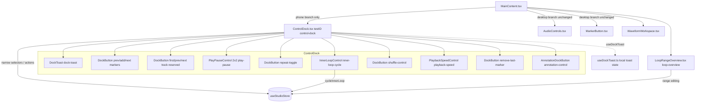

# Design Document: Playback and Marker Control Dock

## Overview

This feature replaces the two separate phone control rows in `MainContent.tsx` — the five-button
`AudioControls` row and the five-button `MarkerButton` row — with one coherent **Control_Dock**: a
portrait two-row, eight-column grid and a landscape two-column rail with a central 2×2 play block rendered only on the phone layout. Play/pause becomes a dominant 2×2
block in columns 4–5, dividing marker and playlist actions (left, columns 1–3) from playback modes
and modifiers (right, columns 6–8). The dock consolidates the existing store-backed behaviours
(markers, navigation, whole-track repeat, the two mutually exclusive inner loops, custom-range
editing) into direct controls, adds a tri-state inner-loop control, reserves clearly-marked
placeholders for future playlist/shuffle work, introduces a playback-speed button contract, and adds
one shared transient toast.

This design satisfies the full requirements set in [`requirements.md`](./requirements.md). It is a
**spec-only** document: it proposes component structure, store additions, types, and behaviour but
changes no code and no tests.

### Scope boundary

In scope: layout, interaction, state wiring, accessibility, and feedback for the phone control dock,
reusing existing store state. Out of scope (per [`requirements.md`](./requirements.md) and the
steering backlog): the playlist/queue data model, a shuffle engine, the native pitch-preserving
playback-speed engine (`modules/audio-time-stretch/`), a persisted `playbackSpeed` field, moving loop
handles into the wrapped gutter, and desktop layout redesign. Timestamps stay integer milliseconds
(ADR-009); all global state stays in the single Zustand store `useStudioStore` (ADR-001); all colours
come from `src/styles/common.ts` (ADR-006, coding standards).

### Current-state analysis

The behaviour below was read directly from source and constrains the design.

| Concern | Where it lives today | Relevant fact |
|---------|----------------------|---------------|
| Phone dock composition | `src/components/layout/MainContent.tsx` | Mobile branch composes `AudioControls` (transport row) and `MarkerButton` (marker row) inside `styles.mobileControlDock` (portrait, `testID="portrait-control-dock"`) or `styles.landscapeControlRail` (`testID="landscape-control-rail"`). The `LoopRangeOverview` strip sits above the dock inside `styles.mobileCanvas`. |
| Transport controls | `src/components/ui/controls/AudioControls.tsx` | Renders `skip-back`, `play-pause`, `skip-forward`, `repeat-toggle` (`isRepeatActive`/`toggleRepeat`), and `loop-region-toggle` (`isLoopRangeEnabled`/`toggleLoopRangeEnabled`, gated by `isValidLoopRange(state, songDuration)`). Hosts the hidden `playback-current-time` probe. Button sizing from `audioControlsStyles` (`button` 80×80, `buttonMobile` 52×52, `buttonCompact` 44×44). Icons from `lucide-react-native`. |
| Marker controls | `src/components/ui/controls/MarkerButton.tsx` | Renders `remove-last-marker` (`removeLastMarker`), `navigate-left-marker` (`navigateToLeftMarker`), the context-sensitive `add-marker` toggle (`onTap` = `tapToBeat`), `navigate-right-marker` (`navigateToRightMarker`), and `loop-marker-toggle` (`isLoopMarkerActive`/`toggleLoopMarker`). Add/remove toggles on `hasNearbyMarker` (`< 100` ms) and `isActiveLayerVisible`. Custom marker icons from `src/components/icons`. |
| Inner-loop mutual exclusion | `src/hooks/useStudioStore.ts` | `toggleLoopMarker` sets `isLoopRangeEnabled: false` when enabling; `toggleLoopRangeEnabled`/`setLoopRangeEnabled` set `isLoopMarkerActive: false` when enabling. `toggleRepeat` flips `isRepeatActive` only and touches no loop state. `setSongLoaded(false)` resets `isLoopMarkerActive` to false. |
| Range init / validation | `src/utils/loopRange.ts`, store setters | `MIN_LOOP_DURATION_MS = 500`, `isValidLoopRange`, `normalizeLoopRange`; `setLoopRange(start, end)` returns a boolean and is the only validated range-mutation path. |
| Playback loop logic | `src/hooks/useAudioPlayer.ts` | Polls every `PLAYBACK_UPDATE_INTERVAL_MS = 50` with `END_OF_TRACK_TOLERANCE_MS = 100`. Computes `effectiveLoopStartMs/EndMs` from the range when `isLoopRangeEnabled`, else from `markerLoopRangeAtTime` when `isLoopMarkerActive`; `loopIsEnabled = isLoopRangeEnabled \|\| isLoopMarkerActive`. Inner loop governs playback while enabled; whole-track repeat applies only at end-of-track when no inner wrap occurs. Seek suspends decisions via `loopDecisionSuspendedRef`; invalid range skips wrap via `failedLoopRangeKeyRef`. |
| Range editor | `src/components/ui/controls/LoopRangeOverview.tsx` | `testID="loop-overview"`; owns `loop-overview-handle-start`/`loop-overview-handle-end`, the track region, accessible actions, and web action probes. Does not seek; hidden when `showTimeline` is false. |
| Persistence | `src/types/project.ts`, `src/utils/projectManager.ts` | `settings.loopRange: { startMs; endMs } \| null`, `settings.loopEnabled?: boolean`; `PROJECT_VERSION = '1.1.0'`; `normalizePersistedLoop` clears ranges older than `1.1.0` and re-clamps/rejects out-of-range bounds. |
| Playback speed | n/a | No `playbackSpeed` store field, no `setPlaybackSpeed`, no native module. Deferred to the steering backlog. |
| Toast | n/a | No shared toast mechanism exists today. Net-new. |

### Goals and non-goals

- Replace the two rows with one `ControlDock`; render zero elements from either prior row on phone
  (R1.7).
- Reuse every existing store field and action; add only a net-new derivation plus one net-new store
  action (`cycleInnerLoop`) for testability.
- Do not change `useAudioPlayer.ts` loop logic. This feature only changes how the UI sets the same
  store fields; playback precedence stays exactly as implemented.
- Keep toast state local to the mobile editor composition; no new store (ADR-001).
- Keep the desktop branch of `MainContent.tsx` working with its existing `AudioControls`/
  `MarkerButton` composition unchanged (the dock is phone-only).

## Architecture

### Component architecture



### Chosen composition and justification

A single `ControlDock.tsx` lays out the fixed 2×8 grid and renders small presentational square-button
primitives. The grid is layout; the primitives are presentation; the store is state. This mirrors the
loop-range feature's composition style (a container that measures and composes thin children) and the
repo's style-mirroring convention (ADR-006).

| Option | Shape | Verdict |
|--------|-------|---------|
| **A. One `ControlDock` grid + a shared `DockButton` primitive + two specialised controls (`PlayPauseControl`, `InnerLoopControl`, `PlaybackSpeedControl`)** (chosen) | Grid owns layout; `DockButton` owns the square icon-button look, 44×44 target, four-state styling, and accessibility plumbing; specialised controls own their multi-state behaviour | Lowest duplication; one place enforces R3 button rules and R17 accessibility; store subscriptions stay narrow per control |
| B. Keep `AudioControls` + `MarkerButton` and merely reparent them into a grid | Reuse existing components | Rejected: R1.7 forbids retaining either row's structure; the two components mix transport and marker concerns and cannot express the 2×2 play/pause block or the tri-state loop |
| C. One monolithic `ControlDock` with every button inline | Single file | Rejected: exceeds the ~150-line component budget (coding standards), duplicates button/accessibility code 11×, and makes selector scoping hard to review |

### Files

New files follow the file-naming rules (components `PascalCase.tsx`, hooks `useCamelCase.ts`, styles
mirror the component path under `src/styles/`).

| File | Role |
|------|------|
| `src/components/ui/controls/ControlDock.tsx` | Grid container, `testID="control-dock"`; composes children; chooses portrait vs landscape arrangement and reports toast messages to its parent |
| `src/components/ui/controls/DockButton.tsx` | Presentational square icon-button primitive; owns the 44×44 target and the four-state (active/inactive/unavailable/reserved) styling and accessibility props |
| `src/components/ui/controls/PlayPauseControl.tsx` | The 2×2 dominant control, `testID="play-pause"` |
| `src/components/ui/controls/InnerLoopControl.tsx` | Tri-state loop control, `testID="inner-loop-cycle"` |
| `src/components/ui/controls/PlaybackSpeedControl.tsx` | Speed text button + chooser popover, `testID="playback-speed"` |
| `src/components/ui/controls/DockToast.tsx` | Shared transient overlay, `testID="dock-toast"` |
| `src/hooks/useDockToast.ts` | Local toast state hook (show/replace/auto-dismiss) |
| `src/styles/components/controls/controlDock.ts` | Grid + container styles |
| `src/styles/components/controls/dockButton.ts` | Square-button + four-state styles |
| `src/styles/components/controls/playPauseControl.ts` | 2×2 block styles |
| `src/styles/components/controls/innerLoopControl.ts` | Per-state visual styles |
| `src/styles/components/controls/playbackSpeedControl.ts` | Text button + popover styles |
| `src/styles/components/controls/dockToast.ts` | Overlay styles |

`AudioControls.tsx` and `MarkerButton.tsx` remain in the tree for the desktop branch; the pure
utility `src/utils/innerLoop.ts` (net-new) holds the `Inner_Loop_State` derivation and cycle planning
so it can be unit-tested without a component tree (coding standards: pure functions in `src/utils/`).

### Desktop vs phone parity

The dock geometry (fixed 2×8, 2×2 play/pause) is phone-specific, so the dock is **phone-only**. The
desktop branch of `MainContent.tsx` keeps its current `controlsRow` composition of `AudioControls` +
`AnnotationField` + `MarkerButton` unchanged. Store state is shared, so behaviour parity (markers,
loop, repeat) holds across web and mobile without the desktop concern compromising the phone grid.
The net-new `cycleInnerLoop` action and the `Inner_Loop_State` derivation are store/util level and are
therefore available to a later desktop adoption without rework; this feature does not alter the
desktop UI.

### What does not change

`useAudioPlayer.ts` loop logic is unchanged. The dock sets the same store fields (`isLoopMarkerActive`,
`isLoopRangeEnabled`, `isRepeatActive`, `loopStartMs`, `loopEndMs`) through the same existing actions
that `AudioControls`/`MarkerButton` call today, so the 50 ms poll, the `effectiveLoop*` resolution,
the seek suspension (`loopDecisionSuspendedRef`), and the invalid-range skip (`failedLoopRangeKeyRef`)
all behave identically. `LoopRangeOverview` remains the only range editor. No new persistence or
migration is introduced.

## Components and Interfaces

### `ControlDock.tsx`

Props mirror what `MainContent` already passes to the phone controls:

```typescript
interface ControlDockProps {
  isLandscape: boolean;             // choose portrait-control-dock vs landscape-control-rail
  onTogglePlayback: () => void;     // from useCustomAudioPlayer
  onSeek: (position: number) => void; // navigation follows with onSeek (R6.2/6.3)
  onAddMarker: () => void;          // wraps tapToBeat toggle semantics (R4)
}
```

Responsibilities: render the fixed 2×8 grid; place each child in its cell; render the `DockToast`
overlay; expose `testID="control-dock"` plus the orientation container testID
(`portrait-control-dock` / `landscape-control-rail`, reused from today). The dock subscribes to no
broad store slice itself — each child subscribes narrowly (see Selector scoping). Target ≤ 150 lines.

### `DockButton.tsx`

The presentational primitive every ordinary control uses.

```typescript
type DockButtonState = 'active' | 'inactive' | 'unavailable' | 'reserved';

interface DockButtonProps {
  testID: string;
  icon: React.ReactNode;            // a lucide-react-native icon element
  state: DockButtonState;
  onPress?: () => void;             // omitted/no-op when unavailable
  accessibilityLabel: string;
  accessibilityRole?: 'button';
  checked?: boolean;                // toggle controls expose checked (R17.2)
  disabledReason?: string;          // description when unavailable (R17.3)
  reserved?: boolean;               // reserved announces "in development" (R17.4)
}
```

`DockButton` guarantees a ≥ 44×44 touch target via `hitSlop` when the visual box is smaller (R3.1,
R17.5), renders only colour tokens from `src/styles/common.ts` and a `lucide-react-native` icon
(R3.5), and maps each of the four states to a **distinct non-colour cue** in addition to colour
(R3.6): active = filled button treatment + full opacity + checked state; inactive = outline glyph + full opacity;
unavailable = outline glyph + reduced opacity + disabled affordance; reserved = outline glyph + a
small corner "soon" dot/badge + pressable-but-reserved semantics.

The reserved-control accessible pattern is **resolved** (R7.5, R17.4): a `reserved` button is a
pressable button (accessibility role `button`, **not** natively disabled) whose accessibility
description and state announce "coming soon" (reserved / in development). This is deliberately
distinct from the `unavailable` state, which is natively disabled and announces "temporarily
unavailable". A `reserved` button stays pressable so a press can surface its in-development toast
(R7.4); an `unavailable` control cannot receive that press. The pre-engine `PlaybackSpeedControl`
adopts this same "coming soon" reserved pattern while remaining interactive (R14.6). The non-colour
cue stays the small corner "soon" badge.

### `PlayPauseControl.tsx`

Occupies columns 4–5 across both rows as one contiguous 2×2 block (R2.1). Each side is ≥ 2.0× an
ordinary square button side (R2.2); the icon scales to stay fully within the block (R2.3). Subscribes
to `isPlaying` and `songLoaded`. Shows `Pause` when `isPlaying`, else `Play`, never both (R2.4).
Disabled appearance + disabled accessibility state while `!songLoaded`; a press while `!songLoaded`
does not toggle (R2.5, R2.6). `testID="play-pause"`.

### `InnerLoopControl.tsx`

The tri-state control, `testID="inner-loop-cycle"`. It derives its state from the store and advances
by one on tap (details in Data Models and the state table). Subscribes to `isLoopMarkerActive`,
`isLoopRangeEnabled`, `songLoaded`, `songDuration`, and the range bounds (only to decide whether a
valid range exists for the `range` state). It renders `LoopMarkerIcon` for off and markers, using the
dock's outlined versus filled treatment, then changes to `Brackets` for range (R8.4). On each
successful transition it calls the dock toast with
the matching message (R8.5–R8.7). Accessibility: a button-with-value pattern exposing an
accessible value that uniquely names `off`, `markers`, or `range` (R8.9, R17.2).

### `PlaybackSpeedControl.tsx`

`testID="playback-speed"`. The one control that shows text, not an icon (R3.2, R3.3). It renders the
current speed as `${value}×` (for example `1×`, `0.75×`), defaulting to `1×` (R14.1), fully inside its
cell for every supported value with no clipping or wrapping (R3.4). Tapping opens a compact speed
chooser popover above the button listing the supported speeds in ascending order as selectable
options (R14.2); selecting one updates the displayed value, dismisses the popover (R14.3), and fires a
speed toast (R14.4). Because the native engine is out of scope, the control is purely a stable
**contract**: it holds the selected label in local state and does not call any time-stretch engine
(R14.5, R14.7, R14.8).

```typescript
interface PlaybackSpeedControlProps {
  // Stable contract so the deferred engine can connect later without redesigning the dock (R14.6).
  value?: number;                    // current multiplier; defaults to 1
  options?: number[];                // supported speeds; default [0.75, 0.8, 1, 1.25, 2] (R14.2, R14.7)
  onSelect?: (value: number) => void; // deferred engine wires this to setPlaybackSpeed later
  onToast?: (message: string) => void;
}

function formatSpeedLabel(value: number): string; // -> `${value}×`, e.g. 0.75 -> "0.75×"
```

The supported-speed set and default are **resolved** (R14.2): the authoritative ordered set is
`[0.75, 0.8, 1, 1.25, 2]`, displayed `0.75×, 0.8×, 1×, 1.25×, 2×`, with `1×` as the default. The set
stays data-driven through the `options` prop (defaulting to that list) so it can be extended later
without a contract change (R14.7); the contract does not hard-fix the set.

The pre-engine behaviour is also **resolved**: until the native time-stretch engine ships, selecting a
speed updates the displayed label and fires the Dock_Toast but does **not** change the actual audio
playback rate (R14.5), so the control is never silently inert. The control presents an explicit
"coming soon" affordance consistent with the reserved-control accessible pattern (R14.6, and the
resolved reserved pattern below). `onSelect` today only updates the local label and emits the toast;
the deferred playback-speed engine wires real rate changes later through this same stable contract. No
time-stretch engine is implemented here (R14.8).

### `DockToast.tsx` and `useDockToast.ts`

The shared transient feedback element, `testID="dock-toast"`. See the Toast section for behaviour.

```typescript
interface DockToastController {
  message: string | null;
  show: (message: string) => void;  // replace content and restart the timer (R15.3)
}

function useDockToast(autoHideMs?: number): DockToastController; // default ~1500 ms
```

### Store additions (`src/hooks/useStudioStore.ts`)

Only one net-new action is added; everything else is reused.

```typescript
interface StudioStoreInnerLoopSlice {
  // Net-new action. Advances the tri-state inner loop off -> markers -> range -> off,
  // composing the existing toggleLoopMarker / toggleLoopRangeEnabled, and auto-initialising a
  // whole-song range via setLoopRange(0, songDuration) when entering `range` with no valid range.
  // Returns the resulting Inner_Loop_State so the caller can pick the toast message. R8.2, R8.10, R11.
  cycleInnerLoop: () => InnerLoopState;
}
```

Rationale for adding a store action rather than composing in the component: the testing-strategy
steering requires store actions to be unit-tested against a fresh `create()` store, and the cycle has
real branching (range auto-init, the `MIN_LOOP_DURATION_MS` / zero-duration guards, mutual exclusion).
Putting it in the store keeps the component thin and the branching directly testable. It is net-new.

The derivation and cycle *planning* live in a pure util so the branch logic is tested without the
store too:

```typescript
// src/utils/innerLoop.ts (net-new, pure)
export type InnerLoopState = 'off' | 'markers' | 'range';

/** Derive the tri-state from the two store flags. R8.1. */
export function deriveInnerLoopState(
  isLoopMarkerActive: boolean,
  isLoopRangeEnabled: boolean,
): InnerLoopState;

/** The next state in the cycle off -> markers -> range -> off. R8.2. */
export function nextInnerLoopState(current: InnerLoopState): InnerLoopState;

/** Whether entering `range` is allowed / requires auto-init. R8.10, R11.7, R11.8. */
export function canEnterRangeState(songDuration: number, hasValidRange: boolean): boolean;
```

`cycleInnerLoop` is implemented in terms of these helpers plus the existing `toggleLoopMarker`,
`toggleLoopRangeEnabled`, and `setLoopRange`, so mutual exclusion (R8.8) is still enforced by the
existing store code — the cycle action adds no new way to set both flags true.

### Selector scoping (avoid waveform repaint)

The loop-range handover history shows that broad subscriptions repaint waveform rows. Each dock
control therefore subscribes only to the fields it needs, matching the narrow
`useStudioStore(state => state.x)` / `useShallow` pattern already used by `LoopRangeOverview` and
`WrappedWaveform`.

| Control | Subscribes to |
|---------|---------------|
| `PlayPauseControl` | `isPlaying`, `songLoaded` |
| Prev/Next marker | `songLoaded`, `currentTime`, `allLayersData`, `ghostPlayheadTime`, `songDuration`, `layerSpecificNavigation`, `activeLayerId` (same inputs `MarkerButton` reads today) |
| Add marker | `songLoaded`, `activeLayerId`, `layers`, `currentTime` (for the nearby/visible gating) |
| Remove previous | `songLoaded`, `currentTime`, `allLayersData`, `activeLayerId`, `layerSpecificNavigation`, `markerDeletionHistory` |
| Annotation | `currentTime`, `activeLayerId`, `allLayersData` |
| `Repeat_Control` | `isRepeatActive`, `songLoaded` |
| `InnerLoopControl` | `isLoopMarkerActive`, `isLoopRangeEnabled`, `songLoaded`, `songDuration`, `loopStartMs`, `loopEndMs` |
| `PlaybackSpeedControl` | none (local state only) |
| Reserved controls | `songLoaded` |

No dock control subscribes to waveform-row inputs (`viewportStartTime`, row data, peaks), so toggling
any control does not re-render the waveform. The `ControlDock` container itself holds no store
subscription that spans these fields.

## Data Models

```typescript
// src/utils/innerLoop.ts
type InnerLoopState = 'off' | 'markers' | 'range';

// Local to the dock (not in the store, not persisted)
interface DockToastState {
  message: string | null;
  nonce: number; // bumps on every show() so identical consecutive messages restart the timer
}

interface PlaybackSpeedUiState {
  value: number;       // multiplier, default 1 (not persisted by this feature)
  chooserOpen: boolean;
}
```

No change to `BeatNoteProject` or `settings`. The custom-range fields `settings.loopRange` /
`settings.loopEnabled` already exist and are reused unchanged; `playbackSpeed` is deliberately **not**
added to the schema (out of scope). Invariants carried: inner-loop mutual exclusion
(`isLoopMarkerActive` and `isLoopRangeEnabled` never both true), `Inner_Loop_State` is a pure function
of those two flags, and at most one `DockToast` is visible at a time.

### Why toast state is local (not in the store)

The toast is net-new, has no persisted or cross-screen meaning, and is pure presentation. ADR-001
keeps global state in one store but prefers local state for UI-only concerns (coding standards: "use
local component state for UI-only concerns"). A `useDockToast` hook owns a tiny reducer
(`{ message, nonce }`) and a single auto-hide timer that cleans up on unmount. Putting it in the store
would add churn and risk broad re-renders for a transient banner with no other consumer. If a future
feature needs toasts elsewhere, the hook can be promoted without changing the dock's contract.

## Inner-loop state machine

### Tri-state transition table

The cycle is off → markers → range → off. `cycleInnerLoop` composes the existing actions; the store's
own mutual-exclusion code guarantees only one loop flag is ever true (R8.8).

| Current state | Tap action | Store calls | Resulting `isLoopMarkerActive` | Resulting `isLoopRangeEnabled` | Range-init side effect | Toast |
|---------------|-----------|-------------|-------------------------------|-------------------------------|------------------------|-------|
| `off` | advance | `toggleLoopMarker()` | `true` | `false` | none | "Loop between markers" |
| `markers` | advance | `toggleLoopMarker()` (off marker), then enter range: `setLoopRange(0, songDuration)` if no valid range, then `toggleLoopRangeEnabled()` | `false` | `true` | whole-song range auto-created when none valid (R11.1) | "Loop selected range" (or whole-song-selected message on auto-init, R11.5) |
| `range` | advance | `toggleLoopRangeEnabled()` (off range) | `false` | `false` | none | "Looping off" |
| `markers` (range entry blocked: `songDuration < MIN_LOOP_DURATION_MS`, 0, unknown, or `setLoopRange` fails) | advance | validate before changing either loop flag; guard rejects with no toggle call | `true` (unchanged) | `false` | none created (R11.2, R11.7, R11.8) | "No range available" (R8.10) and remain in `markers` |

Three taps from any starting state return to that state (off→markers→range→off). A blocked
markers→range transition leaves the state unchanged.

### Inner loop × repeat independence

`toggleRepeat` flips `isRepeatActive` only and touches no loop state; `cycleInnerLoop` never writes
`isRepeatActive`. The two are orthogonal.

| Scenario | `isRepeatActive` before | Action | `isRepeatActive` after | Inner_Loop_State after | Notes |
|----------|------------------------|--------|------------------------|------------------------|-------|
| Repeat on, cycle inner loop off→markers | `true` | `cycleInnerLoop()` | `true` (unchanged, R9.2) | `markers` | repeat untouched |
| Repeat on, inner loop at `range`, cycle to off | `true` | `cycleInnerLoop()` | `true` (unchanged) | `off` | turning the inner loop off reveals the still-active repeat; no extra action needed (R10.3) |
| Inner loop `markers`, toggle repeat | unchanged | `toggleRepeat()` | inverted (R9.1) | `markers` (unchanged) | loop flags retain their exact values |
| Repeat off, toggle repeat | `false` | `toggleRepeat()` | `true` | unchanged | toast "Repeat track on" (R9.3) |

### Playback precedence (unchanged logic)

Precedence is enforced entirely by `useAudioPlayer.ts` and is **not** modified by this feature:

1. While an inner loop is enabled and the playhead is armed inside the active loop
   (`loopStartMs ≤ previousSample < loopEndMs`), the poll wraps to the loop start within one 50 ms
   interval and takes precedence over whole-track repeat, so playback never advances past the loop end
   (R10.1).
2. The custom range (`isLoopRangeEnabled`) supplies `effectiveLoop*` directly; otherwise the marker
   range (`isLoopMarkerActive`) supplies it via `markerLoopRangeAtTime`. The two flags are mutually
   exclusive, so only one source is active.
3. Whole-track repeat (`isRepeatActive`) applies only at end-of-track when no inner wrap occurred
   (R10.2); with the inner loop off it seeks to 0 and continues (R10.3).
4. Seeks suspend loop-wrap evaluation via `loopDecisionSuspendedRef` and resume on the next sample
   (R10.4); an invalid range skips the wrap via `failedLoopRangeKeyRef`, letting repeat/end-of-track
   proceed (R10.6).
5. On a song change the store already sets `isLoopMarkerActive` false and derives
   `isLoopRangeEnabled` + bounds from the persisted range (R10.5).

The dock changes only *which store fields the UI sets* and *when*; the engine reads the same fields at
poll time via `useStudioStore.getState()`.

## Grid layout

### Portrait 8×2 grid

Columns 1–8 left to right; row 1 top, row 2 bottom. Play/pause is one 2×2 block spanning columns 4–5
on both rows.

```text
        c1        c2        c3     c4----c5     c6        c7        c8
      +---------+---------+---------+-----------+---------+---------+---------+
 r1   | prev    | add     | next    |           | repeat  | inner   | shuffle |
      | marker  | marker  | marker  |           | toggle  | loop    | control |
      +---------+---------+---------|  play /   +---------+---------+---------+
 r2   | first   | prev    | next    |  pause    | annotate| speed   | remove  |
      | track   | track   | track   |  (2x2)    | marker  | 1x      | prev mk |
      +---------+---------+---------+-----------+---------+---------+---------+
```

- Row 1: `navigate-left-marker`, `add-marker`, `navigate-right-marker` (c1–c3); `play-pause` (c4–c5);
  `repeat-toggle`, `inner-loop-cycle`, `shuffle-control` (c6–c8).
- Row 2: `first-track-control`, `previous-track-control`, `next-track-control` (c1–c3); `play-pause`
  continues (c4–c5); `annotation-control`, `playback-speed`, `remove-last-marker` (c6–c8).

### Landscape rail

The landscape rail uses a purpose-built two-column arrangement instead of compressing the portrait
grid. It is 104 points wide; removing the persistent annotation row leaves that height to the audio
canvas. Three
compact rows sit above a full-width play/pause block whose height equals two ordinary rows, followed
by three compact rows. The grid distributes the available safe height across eight row units, keeping
ordinary controls near-square and using hit slop for a 44-point effective target (R16.3–R16.5, R17.5).

```text
  landscape-control-rail (104-point column on the right)
  +----------+----------+
  | prev mk  | next mk  |
  | add mk   | rm prev  |
  | inner    | annotate |
  +----------+----------+
  |      play/pause     |
  |        (2×2)        |
  +----------+----------+
  | repeat   | speed    |
  | first tr | shuffle  |
  | prev tr  | next tr  |
  +----------+----------+
```

The dock fits phone portrait widths 320–480 px and landscape 480–932 px with no horizontal scrollbar
and no clipped control; if a control cannot fit at a supported width, controls resize to stay fully
visible while preserving the orientation-specific arrangement (R16.1, R16.7). Orientation changes retain all playback,
marker, loop, repeat, and speed state (R16.6).

## Toast

### Mechanism

`DockToast` renders directly above the loop overview with a small vertical gap, as a non-layout-shifting
overlay. It is absolutely positioned (anchored above the overview) so appearing or disappearing
causes zero change to the rendered position or size of the waveform and the dock (R15.5), and the
`LoopRangeOverview` handles and the waveform interaction region stay fully hittable beneath it
(R15.6).

The toast uses the shared restrained liquid-glass backdrop at a lighter opacity than the persistent
dock: a translucent dark diagonal gradient, 12-point corners, and a fine 10%-white highlight stroke.
It has no saturated teal outline, so feedback remains visually consistent without overpowering the
waveform below it.

- Appears within 100 ms of a triggering action (R15.1).
- Stays visible ~1.5 s (±200 ms) then hides (R15.2).
- A new toast while one is visible replaces the content and restarts the timer from zero (R15.3), via
  the `nonce` bump in `useDockToast`.
- Exposes content as a single accessibility announcement — web `aria-live="polite"`, native
  `accessibilityLiveRegion="polite"` — emitting exactly one announcement per distinct message and
  suppressing repeats of identical consecutive content (R15.4).

### Orientation placement

Toast placement is **resolved** in both orientations (R15.10):

- **Portrait and landscape:** the toast anchors directly above the Loop_Overview on the canvas side.
  This keeps all action feedback in one predictable location, including loop clear/restore feedback.

In both orientations the toast renders as a non-layout overlay that causes zero change to the rendered
position or size of the waveform and the Control_Dock (R15.5), keeping the toast near the controls
that triggered it without shifting the waveform.

### Message catalog

| Trigger | Message | Requirement |
|---------|---------|-------------|
| Inner loop → off | "Looping off" | R8.5 |
| Inner loop → markers | "Loop between markers" | R8.6 |
| Inner loop → range | "Loop selected range" | R8.7 |
| Inner loop → range, whole-song auto-created | whole-song-selected message | R11.5 |
| Inner loop → range blocked (no valid range) | "No range available" | R8.10 |
| Repeat on | "Repeat track on" | R9.3 |
| Repeat off | "Repeat track off" | R9.4 |
| Speed selected | the selected multiplier (for example "0.75×") | R14.4 |
| First track reserved | "First track is in development" | R7.2 |
| Previous track reserved | "Previous track is in development" | R7.2 |
| Next track reserved | "Next track is in development" | R7.2 |
| Shuffle reserved | "Shuffle is in development" | R7.2 |
| Marker added | successful-addition message | R4.7 |
| Nearby marker removed | "Marker removed" | R4.7 |
| Previous marker removed | successful-removal message | R5.4 |
| Loop range cleared | "Loop range cleared" | R15.7 |
| Loop range restored | "Loop range restored" | R15.7 |
| Marker op failed/unavailable | message naming no-change + reason | R15.9 |

No toast for play/pause, previous-marker navigation, or next-marker navigation (R15.8, R6.6).

## Persistence and migration

No project schema or migration change. Custom-range persistence already exists:
`settings.loopRange: { startMs; endMs } | null` and `settings.loopEnabled?: boolean` in
`src/types/project.ts`, with `PROJECT_VERSION = '1.1.0'` and `normalizePersistedLoop` in
`projectManager.ts` clearing ranges from projects older than `1.1.0` and re-clamping or rejecting
out-of-range bounds (R13.1–R13.5). This feature reuses that path unchanged: the dock sets the same
store fields the save path already serialises. `playbackSpeed` is **not** persisted by this feature;
the speed value lives only in `PlaybackSpeedControl` local state (out of scope for persistence).

## Test identifiers and accessibility

### Reused testIDs

`play-pause`, `add-marker`, `remove-last-marker`, `navigate-left-marker`, `navigate-right-marker`,
`repeat-toggle`, `loop-overview` and its handles, `portrait-control-dock`, `landscape-control-rail`,
and the hidden `playback-current-time` probe (R17.7).

### Net-new testIDs

`control-dock`, `inner-loop-cycle`, `playback-speed`, `shuffle-control`, `first-track-control`,
`previous-track-control`, `next-track-control`, `annotation-control`, `annotation-editor`,
`annotation-callout`, `dock-toast`, `dock-toast-action`.

### Collapsed testIDs — flagged for the tasks phase

The old `loop-region-toggle` (range loop in `AudioControls`) and `loop-marker-toggle` (marker loop in
`MarkerButton`) collapse into the single `inner-loop-cycle` control on phone. Existing tests that
reference `loop-region-toggle` / `loop-marker-toggle` for the phone dock must be updated to drive
`inner-loop-cycle` through its tri-state cycle. This document only flags the change; tests are updated
in the tasks phase, not here. The desktop `AudioControls`/`MarkerButton` retain their original testIDs.

### Accessibility per control

| Control | Role / pattern | States |
|---------|----------------|--------|
| Play/pause | `button` | `disabled` while `!songLoaded`; label reflects play vs pause (R2.4, R17.1) |
| Prev/Next marker | `button` | `disabled` with a reason when no navigable target (R6.4, R6.5, R17.3) |
| Add marker | `button` | `disabled` with a reason when `!songLoaded` or layer not visible (R4.2, R4.3) |
| Remove previous | `button` | always pressable; no target produces the explanatory toast (R5.3) |
| Repeat | toggle button | `checked` = `isRepeatActive` (R9.5, R17.2); `aria-pressed`/`aria-disabled` on web (R17.6) |
| Inner loop | button-with-value (adjustable-style) | accessible value uniquely names `off`/`markers`/`range` (R8.9, R17.2); never ambiguous |
| Speed | `button` | label includes the current multiplier; opens the chooser |
| Reserved (track/shuffle) | pressable-but-reserved (role `button`, not natively disabled) | announces "coming soon" (reserved / in development), distinct from the disabled state's "temporarily unavailable" (R7.5, R17.4); stays operable so a press fires the toast |
| Empty cell | none | no role, no activation affordance (R1.5) |

A reserved control must stay pressable (not natively disabled) because a natively disabled control
cannot receive a press to surface its toast (R7.4). Its accessibility description and state announce
"coming soon" rather than "temporarily unavailable", and the pre-engine `PlaybackSpeedControl` uses
this same resolved pattern (R14.6, R17.4). On web every interactive control is
keyboard-reachable and operable; toggles set `aria-pressed`, unavailable controls set `aria-disabled`
(R17.6). Icon-only buttons retain their accessibility label, role, checked/disabled states, and a
44×44 target even with text hidden (R17.5).

## Icon strategy

Icons come from the shared custom `BeatNoteIcon` family in `src/components/icons`. Its 24×24,
1.75-point rounded grammar follows iOS system-icon principles: one optically balanced silhouette,
generous negative space, and no decorative detail. Transport uses simple rounded geometry,
choreography actions reuse one single-border shield marker, and previous/next track use mirrored double
triangles so they remain distinct from first track. Each control's four states differ by a
non-colour cue (R3.6), and the tri-state loop uses a distinct glyph per state (R8.4).

Marker controls share a solid single-border shield silhouette at one invariant optical size.
Add/remove use subdued green/red fills without cramped interior marks, navigation uses the white shield in a
wider composite view box, and remove-previous uses the red shield. Repeat and both inner-loop states
share the same thin rounded two-arrow chassis with an open centre; the loop mode is shown by placing
either a smaller shield or a `•—•` bounded-segment cue inside that chassis. Filled active control
backgrounds use the muted control-state orange rather than the brighter timeline accent.

Marker-control glyphs remain white. Timeline marker lines use the dedicated vivid-violet
`colors.marker` token (`#c084fc`) with a heavier stroke, separating marker positions from orange
playback/playhead state and teal loop-range state without changing annotation-layer identity colours.

| Control | Icon | Non-colour state cue |
|---------|------|----------------------|
| Play/pause | `BeatNoteIcon` `play` / `pause` | glyph swaps between play and pause |
| Previous marker | `MarkerLeftIcon` (existing custom) | enabled = solid, disabled = outline + dimmed |
| Add marker | `MarkerAddIcon` / `MarkerRemoveIcon` (existing custom) | glyph swaps on nearby-marker, disabled = neutral `MarkerIcon` |
| Remove previous marker | `MarkerRemoveLastIcon` (existing custom) | always full-emphasis; delete marker precedes left arrow |
| Next marker | `MarkerRightIcon` (existing custom) | enabled = solid, disabled = outline + dimmed |
| Repeat | `BeatNoteIcon` `repeat` outline | orange button background + checked state when active; glyph never fills |
| Inner loop | `off`/`markers` = `LoopMarkerIcon`, `range` = `BeatNoteIcon` `range-loop` | off is outlined, markers is orange-filled, range changes glyph |
| Shuffle | `BeatNoteIcon` `shuffle` | reserved badge (corner dot) |
| First track | `BeatNoteIcon` `first` | reserved badge |
| Previous track | `BeatNoteIcon` `previous`, rounded hollow double triangles | reserved badge |
| Next track | `BeatNoteIcon` `next`, rounded hollow double triangles | reserved badge |
| Playback speed | text `1×` (no icon) | the text itself is the content (R3.2 exception) |

The tri-state treatments combine outline/fill state and glyph changes so the cycle remains legible
without relying only on hue.

The control dock, bounded annotation callout, and modal annotation editor share a restrained dark
diagonal glass gradient with a fine translucent highlight stroke. The editor uses an explicit draft
and Save/Cancel actions; the callout is centered above the overview, capped at two lines and 280
points, and tail-truncates without covering the waveform gutter. During playback, the newest reached
annotated marker owns a 2-second reading window followed by a 350-millisecond exit fade. A successive
annotated marker replaces it immediately and restarts that window, while an unannotated marker leaves
the current note intact. This borrows timed-comment chronology without adding social avatars or
stacking multiple notes over the rehearsal canvas.

## Error Handling

| Condition | Requirement | Handling |
|-----------|-------------|----------|
| Add/remove marker while `!songLoaded` or layer hidden | R4.2, R4.3 | Control disabled; no store mutation |
| Remove previous with nothing before `currentTime` and no history | R5.3 | Disable the control; leave state unchanged |
| Accidental marker deletion | R5.6–R5.7 | Preserve marker + annotation in bounded history; offer toast Undo and long-press restore/bulk-delete actions |
| Cycle into `range` with `songDuration` 0/unknown or `< MIN_LOOP_DURATION_MS` | R11.7, R11.8 | Do not call `setLoopRange`; stay out of `range`; toast "No range available" |
| `setLoopRange(0, songDuration)` fails validation | R11.2 | Leave bounds unchanged; do not enter `range`; toast "No range available" |
| Reserved control pressed | R7.3 | No playback/navigation/ordering change; fire the in-development toast only |
| Speed selected before engine exists | R14.5, R14.7 | Update label + toast only; invoke no time-stretch engine |
| Identical consecutive toast message | R15.4 | Render once visually with a timer restart; emit a single announcement, suppress the repeat |
| Marker operation fails/unavailable | R15.9 | Toast names the no-change and reason; no success message |

Errors are never swallowed silently (coding standards): a failed range auto-init surfaces through the
toast and the control staying in its prior state.

## Testing Strategy

Aligned with [`testing-strategy.md`](../../steering/testing-strategy.md): unit-test the net-new store
action and the pure derivations; cover dock geometry/behaviour/toast/responsive reflow as cohesive
Playwright workflows; cover geometry, interaction, and accessibility exposure in XCTest. No trivial
render-only or implementation-detail assertions.

### Unit tests (Jest, fresh store via `create()` directly)

- `tests/unit/innerLoop.test.ts` — `deriveInnerLoopState`, `nextInnerLoopState`, `canEnterRangeState`
  including the `MIN_LOOP_DURATION_MS`, zero-duration, and unknown-duration boundaries, and
  `formatSpeedLabel` formatting round-trip.
- `tests/unit/studioStore.innerLoop.test.ts` — `cycleInnerLoop` on a fresh store: the full
  off→markers→range→off cycle, mutual exclusion (never both flags true), range auto-init on entering
  `range` with no valid range, the blocked-entry guards, and repeat independence (`cycleInnerLoop`
  never changes `isRepeatActive`).

Do not unit-test component rendering, animation values, or style objects (per the steering rules).

### E2E (Playwright, web)

Cohesive phone-viewport workflows, not render smoke tests:

- Dock geometry: the 2×8 grid renders with the 2×2 play/pause block and annotation at r2c6; no
  `AudioControls`/`MarkerButton` row elements are present on phone.
- Inner-loop cycle: three taps return to the starting state; the toast message matches each
  transition; the `LoopRangeOverview` shows a whole-song range after auto-init.
- Repeat independence: cycling the inner loop never clears an active repeat; turning the inner loop
  off leaves repeat active.
- Toast: appears above the overview without shifting the waveform, auto-dismisses, and a second trigger
  replaces + restarts; `aria-live` announces once.
- Responsive reflow: portrait renders the two-row eight-column grid and landscape renders three
  paired rows (including inner-loop/annotation), a full-width 2×2 play block, then three paired rows;
  the reclaimed canvas height and all state are preserved across orientation changes.
- Marker add/remove toggle and navigation follow the playhead with `onSeek`; gutter/waveform taps
  still never create a marker (R18.1, R18.4).

### iOS XCTest (`tests/ios/BeatNoteUITests.swift`)

Geometry (dock fits the rail and portrait dock), interaction (play/pause, add/remove, inner-loop
cycle, reserved toast), and accessibility exposure (checked state on repeat, a unique value per
inner-loop state, reserved announcement on placeholders).

### Manual acceptance

Physical-iPhone touch-target comfort, VoiceOver announcement of the tri-state value and reserved
controls, and toast legibility over the waveform.

## Correctness Properties

*A property is a characteristic or behavior that should hold true across all valid executions of a
system — essentially, a formal statement about what the system should do. Properties serve as the
bridge between human-readable specifications and machine-verifiable correctness guarantees.*

Each property is implemented by a single property-based test (fast-check) running ≥ 100 iterations,
tagged `Feature: playback-marker-control-dock, Property {number}: {property_text}`.

### Property 1: Inner-loop mutual exclusion

For any sequence of `cycleInnerLoop` and `toggleRepeat` calls applied to a fresh store with any
loaded song duration, `isLoopMarkerActive` and `isLoopRangeEnabled` are never both true at the same
time.

**Validates: Requirements 8.1, 8.8**

### Property 2: Three taps return to the starting state

For any starting `Inner_Loop_State` reachable on a store with `songDuration ≥ MIN_LOOP_DURATION_MS`,
applying `cycleInnerLoop` three times returns the derived `Inner_Loop_State` to its starting value.

**Validates: Requirements 8.2, 8.3**

### Property 3: Repeat independence

For any sequence of `cycleInnerLoop` calls, the value of `isRepeatActive` after the sequence equals
its value before the sequence (the inner-loop cycle never writes repeat state), and conversely
`toggleRepeat` never changes either inner-loop flag.

**Validates: Requirements 9.1, 9.2, 10.3**

### Property 4: Range auto-init only when duration is sufficient

For all finite `songDuration` values and any current range, entering the `range` state via
`cycleInnerLoop` sets `isLoopRangeEnabled` true and a valid range only when
`songDuration ≥ MIN_LOOP_DURATION_MS`; otherwise the control stays out of `range`, `setLoopRange` is
not committed, and the state is left unchanged.

**Validates: Requirements 11.1, 11.2, 11.7, 11.8**

### Property 5: Speed label formatting round-trips

For any supported numeric speed value, `formatSpeedLabel(value)` yields `${value}×`, and parsing the
numeric portion back recovers the original value, with every supported value rendering within the cell
bounds (no clipping/wrapping assertion in the formatter test; verified visually in E2E).

**Validates: Requirements 3.3, 3.4, 14.1**

### Property 6: At most one visible toast

For any sequence of `show(message)` calls on `useDockToast`, at every point in time at most one toast
message is visible, and a `show` while visible replaces the content and restarts the timer rather than
stacking a second toast.

**Validates: Requirements 15.3, 15.5**

## Resolved design decisions

All five product decisions are now resolved in [`requirements.md`](./requirements.md); the design
reflects them as follows, with the choice recorded for the record:

1. **Supported playback-speed set and default.** The `PlaybackSpeedControl` contract accepts an
   `options` array and a `value`. The authoritative ordered set is `[0.75, 0.8, 1, 1.25, 2]`
   (displayed `0.75×, 0.8×, 1×, 1.25×, 2×`) with `1×` as the default, following the fine-grained
   requirement examples rather than the backlog's `0.5 | 0.75 | 1.0`. The set stays data-driven via
   the `options` prop so it can be extended later without a contract change.
2. **Speed button behaviour before the engine ships.** Resolved as the explicit in-development path:
   selecting a speed updates the displayed label and fires the Dock_Toast but does not change the
   actual audio rate, and the control presents a "coming soon" affordance consistent with the
   reserved-control pattern. It is never silently inert, and the stable contract lets the deferred
   engine wire real rate changes later via the same `onSelect`.
3. **Toast placement in the landscape rail.** Resolved: in portrait the toast anchors directly above
   the dock; in the landscape rail it anchors to the rail's waveform-facing inner edge (the left of
   the rail with today's right-hand rail layout). In both orientations it is a non-layout overlay that
   does not shift the waveform or dock.
4. **Reserved-control accessible pattern.** Resolved: each reserved control, and the pre-engine
   `PlaybackSpeedControl`, is a pressable button (role `button`, not natively disabled) whose
   accessibility description and state announce "coming soon" (reserved / in development), distinct
   from a disabled control's "temporarily unavailable".
5. **Edge feedback for marker navigation.** Resolved: the Previous_Marker_Control and
   Next_Marker_Control stay silent at the edges. They are disabled at the first or last navigable
   target and emit no toast or other feedback, because the disabled control already conveys that no
   further target exists.
